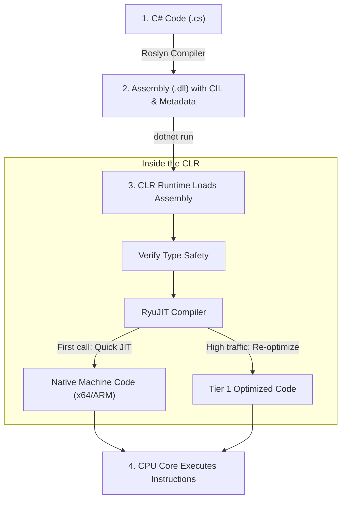

# Deep-Dive Guide: Common Language Runtime (CLR) Internals (Simple & Clear Bilingual Guide)

---

## 1. English Definition & Concept
The **Common Language Runtime (CLR)** is the engine that runs .NET programs. It is the heart of the .NET platform.

In simple terms:
1. When you compile C# code, it does **not** turn into machine code directly.
2. The Roslyn compiler turns your code into an intermediate format called **CIL (Common Intermediate Language)** bytecode.
3. When the program runs, the **CLR** loads the bytecode and compiles it into native machine code (0s and 1s) using the **JIT (Just-In-Time) Compiler**.
4. The CLR also manages memory, schedules threads, and cleans up unused objects using the **Garbage Collector (GC)**.

---

## 2. Bangla Explanation (বাংলায় সহজ ব্যাখ্যা)
সহজ ভাষায়, **Common Language Runtime (CLR)** হলো .NET-এর **"মস্তিষ্ক বা ইঞ্জিন"**। জাভা (Java) জগতে যেমন **JVM** কাজ করে, C# এবং .NET জগতে ঠিক একই কাজ করে **CLR**।

আমরা যখন C# কোড কম্পাইল করি, তখন সেটি সরাসরি কম্পিউটারের প্রসেসরের বোঝার উপযোগী মেশিন কোডে (Machine Code: 0 এবং 1) রূপান্তর হয় না। কম্পাইলার কোডটিকে **CIL (Common Intermediate Language)** নামক একটি মধ্যবর্তী ফরম্যাটে রূপান্তর করে `.dll` ফাইলে জমা রাখে।

অ্যাপ্লিকেশন রান করার সময় আসল কাজটি করে CLR:
1. এটি `.dll` ফাইল মেমোরিতে লোড করে।
2. কোডটি নিরাপদ কিনা তা পরীক্ষা করে (Type Safety)।
3. **JIT Compiler**-এর মাধ্যমে CIL কোডকে তাৎক্ষণিকভাবে কম্পিউটারের আসল মেশিন কোডে রূপান্তর করে।
4. মেমোরি খালি করা (Garbage Collection), থ্রেড চালানো এবং এরর নিয়ন্ত্রণের পুরো দায়িত্ব নিজের কাঁধে তুলে নেয়।

---

## 3. Why It Exists (কেন তৈরি করা হয়েছে?)

### English:
Before the CLR, programmers wrote code in C and C++. That old way had big problems:

1. **Manual Memory Bugs**: Programmers had to allocate and delete memory by hand. Forgetting to free memory caused **Memory Leaks**. Deleting twice crashed the program.
2. **Languages Could Not Talk**: A library written in C++ could not easily talk to Visual Basic.
3. **Hardware Lock-in**: Code built for an Intel x86 chip could not run on ARM or other chips without rebuilding everything.

### How the CLR Solves This:
- **Automatic Memory Cleanup**: The Garbage Collector (GC) frees memory automatically. You do not write manual memory deallocation code.
- **Cross-Language Support**: C#, F#, and VB.NET all compile into the same CIL bytecode. A C# class can easily use an F# library.
- **Run Anywhere**: The same `.dll` file runs on Windows, Linux, and macOS. The CLR on that computer compiles it for that specific CPU.

---

### বাংলায় কারণ:
CLR আসার আগে C এবং C++ দিয়ে কোড লেখা হতো। তখন কিছু বড় সমস্যা ছিল:
1. **মেমোরির ঝামেলা**: মেমোরি নেওয়া এবং মোছার দায়িত্ব ছিল প্রোগ্রামারের। মুছতে ভুলে গেলে মেমোরি জ্যাম হয়ে কম্পিউটার স্লো হতো (**Memory Leak**)। ভুল করে আগে মুছে ফেললে অ্যাপ ক্র্যাশ করত।
2. **ভাষার অমিল**: C++ কোডের সাথে Visual Basic কোডের ডেটা আদান-প্রদান করা ছিল কঠিন।
3. **হার্ডওয়্যার নির্ভরতা**: এক কম্পিউটারের জন্য বানানো সফটওয়্যার অন্য প্রসেসরের কম্পিউটারে সরাসরি চলত না।

### CLR কীভাবে সমাধান করে:
- **স্বয়ংক্রিয় মেমোরি পরিষ্কার**: Garbage Collector নিজে থেকেই অপ্রয়োজনীয় ডেটা মুছে মেমোরি খালি করে দেয়।
- **সব ভাষার মিলন**: C#, F# বা VB.NET সব কোডই CIL বাইটকোডে পরিণত হয়। ফলে এক ভাষার কোড অন্য ভাষায় সহজেই ব্যবহার করা যায়।
- **যেকোনো প্ল্যাটফর্মে চলা**: একই `.dll` ফাইল উইন্ডোজ, লিনাক্স ও ম্যাকে কোনো পরিবর্তন ছাড়াই চলে।

---

## 4. How It Works Under The Hood (অভ্যন্তরীণ মেকানিজম / Internals)

### The Complete Execution Steps:

```
[ C# Source Code (.cs) ]
           │
           ▼ (Compile Time: Roslyn Compiler)
[ Assembly (.dll / .exe) ]
   ├── CIL Bytecode (Universal Instructions)
   └── Metadata Tables (Class names, methods, fields)
           │
           ▼ (Runtime: CLR starts)
┌────────────────────────────────────────────────────────┐
│                   .NET CLR Engine                      │
│                                                        │
│  1. Assembly Loader (Loads .dll into memory)           │
│  2. Type Safety Verifier (Checks code safety)          │
│  3. RyuJIT Compiler (Translates CIL -> Machine Code)   │
│     ├── Tier 0: Quick JIT (Fast startup)               │
│     └── Tier 1: Optimized JIT (Fast execution)         │
│  4. Garbage Collector (Cleans up Heap memory)          │
│  5. ThreadPool (Schedules CPU threads)                 │
└────────────────────────────────────────────────────────┘
           │
           ▼
[ Native Machine Code (0s and 1s) ] ──> [ CPU Executes ]
```

---

### The 4 Core Standards: CLI, CLR, CTS, and CLS

1. **CLI (Common Language Infrastructure)**:
   - The official rulebook written by Microsoft and standardized by ISO/ECMA.
   - It describes how a virtual runtime engine should work on paper.
2. **CLR (Common Language Runtime)**:
   - Microsoft's actual engine built using the CLI rules.
3. **CTS (Common Type System)**:
   - The master list of all data types supported in .NET.
   - It guarantees that `int` in C# is the exact same 32-bit integer as `Integer` in VB.NET.
4. **CLS (Common Language Specification)**:
   - A smaller set of rules for public libraries.
   - Following CLS ensures your C# code can be called by any other .NET language without errors.

---

### How the JIT (Just-In-Time) Compiler Works
When you call a C# method for the first time:
1. It is not machine code yet.
2. The CLR calls **RyuJIT** (the .NET JIT compiler).
3. RyuJIT compiles the method's CIL bytecode into native CPU instructions.
4. The CLR saves the machine code in memory.
5. All future calls jump directly to the machine code. There is zero compilation delay on future calls.

---

### Tiered Compilation in Modern .NET (.NET 6, 7, 8, 9)
To make applications both start fast and run at peak speed, the CLR uses **Tiered Compilation**:
1. **Tier 0 (Quick JIT)**:
   - Compiles methods instantly with zero optimization.
   - *Goal*: Makes the application start up very fast.
2. **Tier 1 (Optimized JIT)**:
   - The CLR counts how many times each method is called.
   - If a method is called frequently (a "hot method"), a background thread re-compiles it with heavy optimizations (loop unrolling, method inlining).
   - *Goal*: Maximum long-term execution speed.

---

### Object Memory Layout on the 64-bit Heap
Every object created on the Heap has a hidden **16-byte header**:
1. **SyncBlockIndex (8 bytes)**: Used for thread synchronization (`lock(obj)`) and hash codes.
2. **MethodTable Pointer (8 bytes)**: Points to the class type information and virtual method table.
3. **User Fields**: The actual data variables inside your class.

> **Interview Fact**: On 64-bit .NET, an empty class `new object()` takes **24 bytes** of heap memory (16 bytes header + 8 bytes minimum padding alignment).

---

## 5. Built-in Types & Simple Example (বিল্ট-ইন টাইপ ও সহজ উদাহরণ)

### Core Runtime APIs

| Class | Namespace | What does it do? |
| :--- | :--- | :--- |
| **`GC`** | `System` | Checks memory usage and controls the Garbage Collector. |
| **`GCSettings`** | `System.Runtime` | Checks if Server GC or Workstation GC is running. |
| **`Environment`** | `System` | Reads OS version, CPU count, and 64-bit process mode. |
| **`ThreadPool`** | `System.Threading` | Checks available worker threads in the CLR pool. |

---

### Simple Code Example: Inspecting the CLR Runtime

```csharp
using System;
using System.Runtime;

public class Program
{
    public static void Main()
    {
        Console.WriteLine("--- CLR Runtime Information ---");

        // 1. Check CLR and OS Version
        Console.WriteLine($"CLR Version     : {Environment.Version}");
        Console.WriteLine($"64-Bit Process  : {Environment.Is64BitProcess}");
        Console.WriteLine($"CPU Cores       : {Environment.ProcessorCount}");

        // 2. Check Garbage Collector Settings
        Console.WriteLine($"Server GC Mode  : {GCSettings.IsServerGC}");
        Console.WriteLine($"Total Memory    : {GC.GetTotalMemory(false) / 1024} KB");

        // 3. Object Generation tracking
        string testObj = new string("Hello CLR");
        Console.WriteLine($"GC Generation   : Gen {GC.GetGeneration(testObj)}");
    }
}
```

---

## 6. Real-World Production Example: Workstation GC vs. Server GC

In production, you can configure how the CLR manages memory using the `.runtimeconfig.json` or `.csproj` file:

```xml
<Project Sdk="Microsoft.NET.Sdk">
  <PropertyGroup>
    <TargetFramework>net8.0</TargetFramework>
    
    <!-- Enable Server GC for multi-threaded ASP.NET Core web servers -->
    <ServerGarbageCollection>true</ServerGarbageCollection>
    
    <!-- Enable Dynamic Profile-Guided Optimization for maximum JIT speed -->
    <TieredPGO>true</TieredPGO>
  </PropertyGroup>
</Project>
```

- **Workstation GC**: Uses 1 GC thread. Best for desktop apps and background utilities to keep memory low.
- **Server GC**: Creates 1 separate GC heap and thread per CPU core. Best for ASP.NET Core web APIs handling thousands of requests per second.

---

## 7. Visual Diagram (ডায়াগ্রাম)

### How Code Moves from C# to Hardware Execution



---

## 8. Common Mistakes & Gotchas (সাধারণ ভুল ও ফাঁদ)

### ⚠️ Pitfall 1: Boxing in High-Throughput Code
- **English**: Passing a Value Type (`int`, `struct`) to an interface or `object` forces the CLR to allocate a box on the Heap. This creates garbage collection pressure.
- **বাংলায় ফাঁদ**: ইন্টারফেসে ভ্যালু টাইপ পাস করলে CLR তাকে হিপে নিয়ে বক্স করে। এর ফলে মেমোরি নষ্ট হয় এবং অ্যাপ স্লো হয়।
- **Solution**: Use generic constraints (`where T : struct`) to avoid boxing.

---

### ⚠️ Pitfall 2: Memory Leaks from Static Event Handlers
- **English**: The CLR Garbage Collector cannot collect an object if a static event still holds a reference to it.
- **বাংলায় ফাঁদ**: স্ট্যাটিক ইভেন্টে সাবস্ক্রাইব করে আনসাবস্ক্রাইব না করলে অবজেক্ট সারাজীবন মেমোরিতে আটকে থাকে।
- **Solution**: Always unsubscribe from events in `Dispose()`.

---

## 9. Interview Perspective: Top Q&As (ইন্টারভিউ প্রস্তুতি)

### Q1: What is the difference between CLI, CLR, CTS, and CLS?
- **Simple Answer**:
  - **CLI**: The open standard rulebook.
  - **CLR**: Microsoft's actual engine built from the rules.
  - **CTS**: The master list of all data types in .NET.
  - **CLS**: A smaller set of rules so all .NET languages can talk to each other.
- **বাংলায়**: CLI হলো স্ট্যান্ডার্ড নিয়মাবলী, আর CLR হলো সেই নিয়মে তৈরি ইঞ্জিন। CTS হলো সব ডেটা টাইপের নিয়ম, আর CLS হলো সব ভাষার মিল রাখার নিয়ম।

---

### Q2: How does RyuJIT's Tiered Compilation work?
- **Simple Answer**: 
  - On startup, **Tier 0** compiles code instantly with zero optimizations so the app starts fast.
  - When a method is called frequently (e.g. 30+ times), the CLR re-compiles it in **Tier 1** with heavy optimizations (loop unrolling, method inlining) for maximum speed.
- **বাংলায়**: অ্যাপ দ্রুত চালু করতে প্রথমে Tier 0 দিয়ে দ্রুত সাধারণ কোড বানানো হয়। পরে যে মেথডগুলো বেশি কল হয়, সেগুলোকে Tier 1 দিয়ে ব্যাকগ্রাউন্ডে সর্বোচ্চ গতিতে অপ্টিমাইজ করা হয়।

---

### Q3: What is the memory overhead of an object on the 64-bit Heap?
- **Simple Answer**: Every object has a mandatory 16-byte header: **8 bytes for `SyncBlockIndex`** (used for `lock` and hash codes) and **8 bytes for `MethodTable Pointer`** (type metadata). An empty class `new object()` takes **24 bytes** of heap memory due to 8-byte alignment.
- **বাংলায়**: ৬৪-বিট মেমোরিতে প্রতিটি অবজেক্টের শুরুতে ১৬ বাইটের গোপন হেডার থাকে (৮ বাইট SyncBlockIndex + ৮ বাইট MethodTable Pointer)। অ্যালাইনমেন্টের কারণে খালি অবজেক্টও হিপে ২৪ বাইট জায়গা নেয়।

---

### Q4: What is the difference between JIT and Native AOT?
- **Simple Answer**:
  - **JIT**: Compiles CIL bytecode to machine code at runtime. It has full support for dynamic reflection, but starts slower.
  - **Native AOT**: Compiles C# directly into native machine code at build time. It starts instantly (< 10 ms) and uses less memory, but restricts runtime reflection.
- **বাংলায়**: JIT রানটাইমে মেশিন কোড বানায় (সব রিফ্লেকশন চলে কিন্তু স্টার্ট হতে সময় নেয়)। Native AOT বিল্ড করার সময়ই আসল মেশিন কোড বানিয়ে ফেলে (১ মিলিসেকেন্ডে চালু হয় এবং মেমোরি কম লাগে)।

---

### Q5: Managed Code vs. Unmanaged Code: What is the difference?
- **Simple Answer**: Managed code runs inside the CLR with automatic memory cleanup (Garbage Collector). Unmanaged code (like C/C++ or Windows Win32 APIs) runs directly on the OS without the CLR, and memory must be managed manually.
- **বাংলায়**: Managed কোড CLR-এর সুরক্ষায় চলে এবং মেমোরি স্বয়ংক্রিয়ভাবে পরিষ্কার হয়। Unmanaged কোড (C/C++) সরাসরি ওএসে চলে এবং এর মেমোরি প্রোগ্রামারকে ম্যানুয়ালি ডিলিট করতে হয়।

---

## 10. Summary Matrix: Execution Models in .NET

| Feature | Managed JIT | Native AOT | Unmanaged C/C++ |
| :--- | :--- | :--- | :--- |
| **Execution Engine** | CLR (`coreclr.dll`) | Minimal Embedded Runtime | Operating System directly |
| **Intermediate Format** | CIL Bytecode + Metadata | Pure Machine Code | Pure Machine Code |
| **Startup Speed** | Slower (JIT compilation overhead) | Instant (< 10 ms) | Instant (< 5 ms) |
| **Memory Management** | Automatic Garbage Collector | Automatic Garbage Collector | Manual (`malloc` / `free`) |
| **Dynamic Reflection** | Full support | Restricted (Trimming strips types) | None |
| **Platform Target** | Any (cross-platform JIT) | Pre-compiled per OS target | Pre-compiled per OS target |

---

## 📂 Related Documentation Links
- CLR Top Interview Q&As: [`docs/CLR_qa.md`](file:///Users/limon/interview/c-sharp-prep/docs/CLR_qa.md)
- Stack, Heap & Garbage Collection: [`docs/memory_management.md`](file:///Users/limon/interview/c-sharp-prep/docs/memory_management.md)
- Reflection & Type Metadata Inspection: [`docs/Reflection.md`](file:///Users/limon/interview/c-sharp-prep/docs/Reflection.md)
- Task-Based Asynchronous Programming (TAP): [`docs/TaskBasedAsync.md`](file:///Users/limon/interview/c-sharp-prep/docs/TaskBasedAsync.md)
- Multithreading & Synchronization: [`docs/Multithreading.md`](file:///Users/limon/interview/c-sharp-prep/docs/Multithreading.md)
- Repository Table of Contents: [`Readme.md`](file:///Users/limon/interview/c-sharp-prep/Readme.md)
