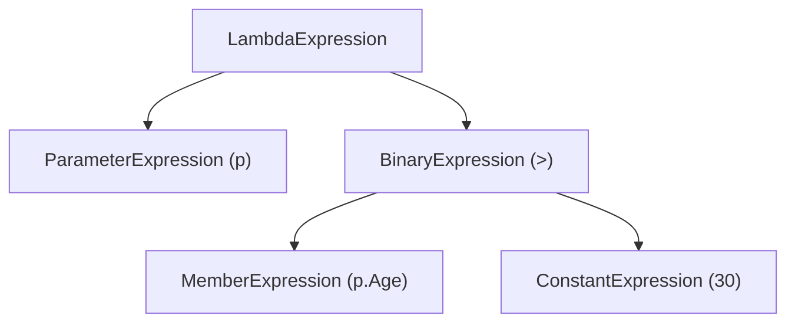

# Learn Expression<T> – Simple English + বাংলা (9‑step interview‑ready guide)

---

## 1️⃣ Concept in English
`Expression<T>` represents the **syntax tree** of a lambda expression. Instead of compiling the lambda to IL right away, the compiler builds an object graph that describes each node (parameter, operator, constant, method call, etc.). This object can be inspected, transformed, or compiled later.

## 2️⃣ Concept in বাংলা
`Expression<T>` হল একটি **ল্যাম্বডা এক্সপ্রেশন‑ট্রি**। ল্যাম্বডা তৎক্ষণাতই চালানোর বদলে, কম্পাইলার তার গঠন (প্যারামিটার, অপারেটর, কনস্ট্যান্ট, মেথড কল) কে একটি অবজেক্ট গ্রাফ হিসেবে রাখে। পরে এই অবজেক্টকে পড়া, পরিবর্তন করা বা কম্পাইল করা যায়।

---

## 3️⃣ Why does it exist? (Why we need Expression<T>)
**English:**
- ORMs like Entity Framework need to **translate** a lambda into SQL. They cannot run the compiled code because the database lives outside the CLR.
- Dynamic query builders need a **portable representation** of a filter that can be sent over the network or saved in a DB.
- Rule engines store business rules as data, not as compiled code, so they can be edited without a new deployment.

**বাংলা:**
- EF ও অন্যান্য ORM‑কে ল্যাম্বডা কে **SQL‑এ রূপান্তর** করতে হয়; সরাসরি কম্পাইলড কোড চালাতে পারে না।
- ডাইনামিক কুয়েরি বানাতে শর্তের একটি **ডেটা রূপ** দরকার, যাতে তা নেটওয়ার্কে পাঠানো বা DB‑এ সংরক্ষণ করা যায়।
- রুল‑ইঞ্জিনে ব্যবসায়িক নিয়মগুলোকে **ডেটা** হিসেবে রাখে; কোড রিবিল্ড না করেই পরিবর্তন করা যায়।

---

## 4️⃣ How it works under the hood (Internals)
- When the compiler sees `Expression<Func<T,bool>> expr = x => x.Age > 30;` it creates a **`LambdaExpression`** object.
- The object contains a **`ParameterExpression`** for `x` and a **`BinaryExpression`** for the `>` operator.
- Each node implements `Expression` and knows its **NodeType** (`Parameter`, `Constant`, `GreaterThan`, `MethodCall`, …).
- The tree can be **visited** by a `ExpressionVisitor` to rewrite parts or to translate it (e.g., to SQL).
- Calling `expr.Compile()` builds a delegate `Func<T,bool>` that caches the generated IL for fast execution.

---

## 5️⃣ Built‑in types & Simple code example
| Type | Purpose |
| :--- | :--- |
| `Expression<TDelegate>` | Holds the full expression tree. |
| `ParameterExpression` | Represents a lambda parameter. |
| `ConstantExpression` | Represents a constant value. |
| `BinaryExpression` | Represents binary operators (`+`, `>`, `&&` …). |
| `MethodCallExpression` | Represents a method invocation. |

**Simple C# example**
```csharp
using System;
using System.Linq.Expressions;

public class Person { public int Age { get; set; } }

// Build the tree manually (same as p => p.Age > 30)
ParameterExpression param = Expression.Parameter(typeof(Person), "p");
MemberExpression ageProp = Expression.Property(param, nameof(Person.Age));
ConstantExpression const30 = Expression.Constant(30);
BinaryExpression body = Expression.GreaterThan(ageProp, const30);
Expression<Func<Person,bool>> expr = Expression.Lambda<Func<Person,bool>>(body, param);

Console.WriteLine(expr);                     // p => (p.Age > 30)
Console.WriteLine(expr.Body.NodeType);      // GreaterThan

// Compile and run – now we have a real delegate
Func<Person,bool> filter = expr.Compile();
Console.WriteLine(filter(new Person{Age=25})); // False
Console.WriteLine(filter(new Person{Age=35})); // True
```

---

## 6️⃣ Real‑world production example (Entity Framework)
```csharp
using System;
using System.Linq;
using System.Linq.Expressions;
using Microsoft.EntityFrameworkCore;

public class Order { public int Id { get; set; } public decimal Amount { get; set; } }
public class AppDbContext : DbContext { public DbSet<Order> Orders => Set<Order>(); }

public static class OrderRepository
{
    // Caller provides a filter as an expression tree
    public static IQueryable<Order> GetOrders(Expression<Func<Order,bool>> filter)
    {
        using var ctx = new AppDbContext();
        // EF reads the expression tree and translates it to SQL
        return ctx.Orders.Where(filter);
    }
}

// Usage – the filter can be built at runtime
Expression<Func<Order,bool>> highValue = o => o.Amount > 1000m;
var bigOrders = OrderRepository.GetOrders(highValue).ToList();
Console.WriteLine($"Found {bigOrders.Count} big orders");
```
*What happens*: EF walks the `highValue` tree, sees a `MemberExpression` (`Amount`) and a `ConstantExpression` (`1000`). It generates `WHERE Amount > 1000` SQL. No C# code is executed on the client.

---

## 7️⃣ Visual diagram (Mermaid) – Expression tree for `p => p.Age > 30`


---

## 8️⃣ Common pitfalls & Gotchas
- **Capturing outer variables** creates a **closure class**, which defeats the purpose of a pure expression tree and may cause `NotSupportedException` in EF.
- **Unsupported members**: EF cannot translate everything (e.g., custom C# methods without a provider mapping). The query will throw at runtime.
- **Calling `.Compile()` too early**: If you compile inside a hot loop you lose the benefit of re‑using the same tree; compile once and cache the delegate.
- **Mixing `Expression` and `Func`**: Do not pass a `Func<T>` where an `Expression<T>` is required – the provider will see a compiled delegate and cannot translate it.

---

## 9️⃣ Interview perspective & summary matrix
| Question | One‑line answer (English) | One‑line answer (বাংলা) |
| :--- | :--- | :--- |
| What is `Expression<T>`? | An object that stores the **syntax tree** of a lambda instead of executing it. | ল্যাম্বডার **গঠন (ট্রি)** সংরক্ষণকারী অবজেক্ট। |
| Why use it over `Func<T>`? | Because the caller can **inspect or translate** the expression (e.g., to SQL). | কারণ এটি **ইন্সপেক্ট বা ট্রান্সলেট** করা যায় (যেমন SQL)। |
| How does EF use it? | EF reads the tree, maps nodes to SQL operators, and builds a query string. | EF ট্রি পড়ে, নোডগুলোকে SQL‑এ রূপান্তর করে কুয়েরি গঠন করে। |
| What is a closure in this context? | When the lambda captures an outer variable, the compiler creates a hidden class that holds that variable, breaking the pure‑expression guarantee. | বাছাই করা ভেরিয়েবল থাকলে কম্পাইলার একটি হিডেন ক্লাস তৈরি করে, যা এক্সপ্রেশন‑ট্রিকে “শুদ্ধ” না রাখে। |
| When should you compile? | Compile once and cache the delegate for repeated execution; never compile inside a tight loop. | একবার কম্পাইল করে ক্যাশে রাখুন; লুপের ভেতরে না কম্পাইল করুন। |


>**When would you choose `Expression<Func<T,bool>>` over a plain `Func<T,bool>`?**
>
> *Answer:* “When the caller needs to **inspect or translate** the lambda – for example, building a LINQ‑to‑SQL query, a dynamic filter UI, or a rule engine. `Func` is already compiled code; `Expression` keeps the lambda as data that can be examined and later compiled if needed.”
---

## 📂 References
- Full delegate guide: [delegate.md](file:///Users/limon/interview/c-sharp-prep/docs/delegate.md)
- Expression guide (this file): [ExpressionLearning.md](file:///Users/limon/interview/c-sharp-prep/docs/ExpressionLearning.md)
- EF Core docs on expression translation.

