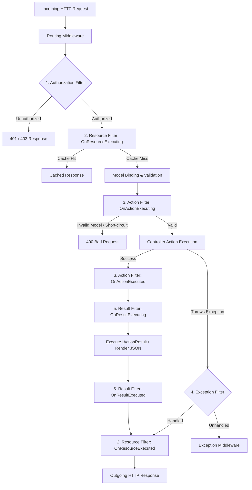
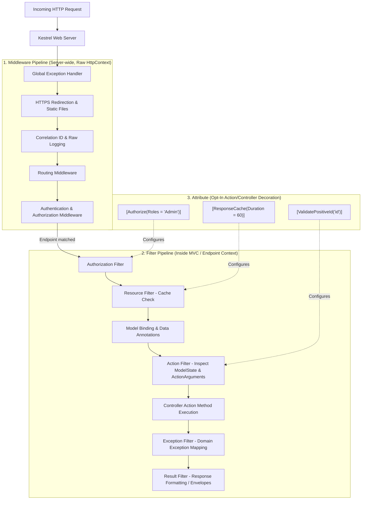

# Deep-Dive Guide: ASP.NET Core Filters (Fully Paired Bilingual Guide)

---

## 1. English Definition & Concept
**Filters** are specialized components that run at specific stages within the **MVC / Web API Action Invocation Pipeline- —either globally, per-controller, or per-action**. They allow developers to intercept HTTP requests at various critical stages before and after an Action Method or its Result executes.

While standard **Middleware** operates on the raw `HttpContext` across the entire application without awareness of which controller or action is selected, **Filters have full MVC context**: access to `ActionDescriptor`, model state, route arguments, and action parameters. Filters are ideal for cross-cutting concerns specifically scoped to controllers and endpoints—such as custom authorization, resource caching, input model validation, audit logging, and response transformation.

---

## 2. Bangla Explanation (বাংলায় সহজ ব্যাখ্যা)
সহজ ভাষায়, **Filters** হলো ASP.NET Core এর কন্ট্রোলার এবং অ্যাকশন মেথডের নিজস্ব **"সিকিউরিটি চেকপোস্ট বা হুক (Hooks)"**।

সাধারণ **Middleware** কাজ করে পুরো অ্যাপ্লিকেশনের গ্লোবাল লেভেলে—রিকোয়েস্ট কোনো কন্ট্রোলারে পৌঁছানোর আগেই এটি কাজ শেষ করে এবং কন্ট্রোলারের ভেতরে কোন মেথড বা প্যারামিটার আছে তা মিডলওয়্যার জানে না। কিন্তু **Filter কাজ করে কন্ট্রোলারের একদম ভেতরে**, তাই ফিল্টারের কাছে কন্ট্রোলারের নাম, মেথডের নাম, মডেল ভ্যালিডেশন স্টেট এবং ইনপুট প্যারামিটারের সমস্ত তথ্য থাকে।

কোনো অ্যাকশন মেথড এক্সিকিউট হওয়ার ঠিক **আগে** কিংবা **পরে** যদি আপনি কোনো কমন লজিক চালাতে চান (যেমন: পারমিশন চেক, রিকোয়েস্ট ল্যাটেন্সি ট্র্যাকিং, মডেল ভ্যালিডেশন চেক, রেসপন্স ফরম্যাটিং, বা এক্সেপশন ক্যাচ করা)—সেজন্য ফিল্টার ব্যবহার করা হয়।

---

## 3. Why It Exists (কেন তৈরি করা হয়েছে?)

### English:
Without filters, developers are forced into repetitive and fragile patterns:
1. **DRY (Don't Repeat Yourself) Violations**: Every action method would need boilerplate code for logging, performance timing, validation checks, and role enforcement.
2. **Polluted Business Logic**: Controller actions should focus strictly on processing business logic, not cross-cutting concerns like measuring execution time or wrapping responses.
3. **Middleware Lack of MVC Awareness**: Middleware handles raw HTTP bytes and headers. It cannot inspect controller action arguments, cannot see validation errors populated by Model Binding, and cannot alter `ActionResult` objects.
4. **Granular Scoping**: Filters can be applied at three distinct scopes—**Globally** (all controllers), at the **Controller level** (all actions in a class), or at the individual **Action level** (a single endpoint). Middleware lacks this per-action granularity.

### বাংলায় কারণ:
ফিল্টার না থাকলে বাস্তব জীবনে নিম্নলিখিত সমস্যার সম্মুখীন হতে হতো:
1. **কোডের পুনরাবৃত্তি (Boilerplate Code)**: প্রতিটি অ্যাকশন মেথডের শুরুতে পারমিশন চেক, মেথড এক্সিকিউশন টাইম মাপা কিংবা মডেল ভ্যালিডেশন চেক করার কোড বারবার লিখতে হতো।
2. **বিজনেস লজিক দূষিত হওয়া**: অ্যাকশন মেথডের মূল উদ্দেশ্য হলো বিজনেস লজিক হ্যান্ডেল করা; সেখানে ক্রস-কাটিং কনসার্ন (যেমন অডিট লগিং, ক্যাশিং) লিখলে কোড অপরিচ্ছন্ন হয়ে যায়।
3. **মিডলওয়্যারের সীমাবদ্ধতা**: মিডলওয়্যার কেবল র' `HttpContext` চেনে; কিন্তু কোন অ্যাকশন মেথড কল হচ্ছে, মডেল বাইন্ডিংয়ে কী কী এরর এসেছে, তা মিডলওয়্যার দেখতে পায় না। ফিল্টার সরাসরি এই কন্ট্রোলার মেটাডেটা অ্যাক্সেস করতে পারে।
4. **নির্দিষ্ট স্কোপে প্রয়োগের সুবিধা**: ফিল্টারকে ইচ্ছেমতো পুরো অ্যাপে (Global), নির্দিষ্ট একটি কন্ট্রোলারে (Controller-level), অথবা কেবল একটি নির্দিষ্ট এন্ডিং পয়েন্টে (Action-level) প্রয়োগ করা যায়।

---

## 4. How It Works Under The Hood (অভ্যন্তরীণ মেকানিজম / Internals)

### The 5 Filter Stages & Execution Sequence

When an incoming HTTP request passes through the middleware pipeline and is routed to an MVC endpoint, it enters the **Filter Pipeline**. The 5 filter types execute in a strict, deterministic order:

```
[ Incoming HTTP Request from Routing Middleware ]
                      │
                      ▼
┌────────────────────────────────────────────────────────┐
│ 1. Authorization Filter                                │
│    - Checks user authentication, permissions, policies │
│    - First to run; can short-circuit immediately      │
└─────────────────────┬──────────────────────────────────┘
                      │
                      ▼
┌────────────────────────────────────────────────────────┐
│ 2. Resource Filter (OnResourceExecuting)               │
│    - Runs BEFORE Model Binding                         │
│    - Ideal for Output/Response Caching, Rate Limiting  │
└─────────────────────┬──────────────────────────────────┘
                      │
                      ▼
            [ Model Binding Occurs ]
                      │
                      ▼
┌────────────────────────────────────────────────────────┐
│ 3. Action Filter (OnActionExecuting)                   │
│    - Runs AFTER Model Binding, BEFORE Action executes  │
│    - Can inspect/modify Action Arguments & ModelState  │
└─────────────────────┬──────────────────────────────────┘
                      │
                      ▼
┌────────────────────────────────────────────────────────┐
│              [ Controller Action Method ]              │
│                 Executes Business Logic                │
└─────────────────────┬──────────────────────────────────┘
                      │
                      ▼
┌────────────────────────────────────────────────────────┐
│ 4. Exception Filter (OnException)                      │
│    - Only triggers IF an unhandled exception is thrown │
│    - Wraps Action execution & Result execution         │
└─────────────────────┬──────────────────────────────────┘
                      │
                      ▼
┌────────────────────────────────────────────────────────┐
│ 3. Action Filter (OnActionExecuted)                    │
│    - Runs AFTER Action executes                        │
│    - Can inspect/change returned IActionResult         │
└─────────────────────┬──────────────────────────────────┘
                      │
                      ▼
┌────────────────────────────────────────────────────────┐
│ 5. Result Filter (OnResultExecuting)                   │
│    - Runs BEFORE the IActionResult generates response  │
│    - Custom HTTP headers, response body formatting     │
└─────────────────────┬──────────────────────────────────┘
                      │
                      ▼
┌────────────────────────────────────────────────────────┐
│            [ ActionResult Execution Runs ]             │
│            (JSON Serialization / View Rendering)       │
└─────────────────────┬──────────────────────────────────┘
                      │
                      ▼
┌────────────────────────────────────────────────────────┐
│ 5. Result Filter (OnResultExecuted)                    │
│    - Runs AFTER response body has been rendered        │
└─────────────────────┬──────────────────────────────────┘
                      │
                      ▼
┌────────────────────────────────────────────────────────┐
│ 2. Resource Filter (OnResourceExecuted)                │
│    - Surrounds the entire rest of the pipeline         │
│    - Caches the final generated output                 │
└─────────────────────┬──────────────────────────────────┘
                      │
                      ▼
        [ Outgoing HTTP Response to Middleware ]
```

---

### Core Mechanics & Internal Rules

#### 1. Synchronous vs. Asynchronous Filters
- **Synchronous**: Implements pairs of methods: `On{Stage}Executing(Context)` and `On{Stage}Executed(Context)`.
- **Asynchronous**: Implements a single method: `On{Stage}ExecutionAsync(Context, NextDelegate)`.
- **Under the hood**: The ASP.NET Core framework checks for async implementations first. If both are implemented on the same class, the runtime **only executes the async version** and ignores the sync version!

#### 2. Short-Circuiting the Pipeline
Any filter can abort the rest of the pipeline early by assigning a value to `context.Result`:
```csharp
context.Result = new UnauthorizedResult(); // Or new ObjectResult(...)
```
Once `context.Result` is set, all downstream filters and the Action method are completely skipped. The pipeline immediately jumps straight to the **Result Filter** stage to render the assigned `context.Result` and then exits back through the outer filters.

#### 3. Filter Scopes and Ordering
Filters can be registered at three scopes:
1. **Global Scope**: Registered in `Program.cs` (`options.Filters.Add<T>()`) -> Runs across the entire application.
2. **Controller Scope**: Placed as an attribute on `[MyFilter] class MyController` -> Runs for all actions in that controller.
3. **Action Scope**: Placed on `[MyFilter] public IActionResult MyAction()` -> Runs only for that endpoint.

> **Default Order of Execution**:
> - For **"Before"** stages (`Executing`): **Global** $\rightarrow$ **Controller** $\rightarrow$ **Action**.
> - For **"After"** stages (`Executed`): **Action** $\rightarrow$ **Controller** $\rightarrow$ **Global** (reverse onion-layer order).
> - Custom priority can be enforced by implementing `IOrderedFilter` or setting `[MyFilter(Order = -1)]`.

#### 4. Dependency Injection in Filters: `[ServiceFilter]` vs. `[TypeFilter]`
Because C# attributes require compile-time constants for constructor arguments, filters needing Dependency Injection (e.g., injecting `ILogger` or `IDbContext`) cannot be applied directly as plain attributes. ASP.NET Core solves this with two approaches:

| Feature | `[ServiceFilter(typeof(T))]` | `[TypeFilter(typeof(T))]` |
| :--- | :--- | :--- |
| **DI Registration Required?** | **YES** (`builder.Services.AddScoped<T>()`) | **NO** (Created via `ObjectFactory`) |
| **Lifecycle** | Follows its DI registration (Transient/Scoped/Singleton) | Always created fresh per-request (Transient-like) |
| **Additional Arguments?** | Cannot pass runtime constructor parameters | Can pass extra non-DI arguments via `Arguments` |
| **Typical Use Case** | When you want single-instance sharing or explicit DI control | Quick injection without registering the filter in `Program.cs` |

---

#### 5. When to Use an Attribute vs. When to Use options.Filters.Add (Global Registration)
*(কখন Attribute ব্যবহার করবেন এবং কখন options.Filters.Add ব্যবহার করবেন?)*

### English:
Choosing between decorating a Controller/Action with an **Attribute** versus registering a Filter **Globally** in `Program.cs` via `options.Filters.Add<T>()` comes down to **Scope, Granularity, Parameterization, and Risk of Omission**:

1. **Use an Attribute (`[MyFilter]`, `[TypeFilter]`, `[ServiceFilter]`) when**:
   - **Granular / Endpoint-Specific Requirements**: The behavior only applies to certain controllers or actions (e.g., caching a specific heavy query `[AsyncCacheResourceFilter(30)]`, or requiring `'Admin'` access on `DELETE /products/{id}`).
   - **Configurable Parameters Needed**: You need to pass arguments directly into the filter on a per-action basis (e.g., `[ResponseHeader("X-Feature-Tier", "Beta")]`, `[ValidatePositiveId("orderId")]`).
   - **Opt-In Behavior**: You do not want the filter running accidentally on endpoints where it could cause bugs or unwanted performance hits (e.g., Caching on POST/PUT endpoints would corrupt data!).
   - **Explicit Self-Documenting Code**: Developers inspecting the controller method immediately see all cross-cutting policies applied directly above the method signature.

2. **Use Global Registration (`options.Filters.Add<T>()`) when**:
   - **Universal Application-Wide Policies (Zero Tolerance for Omission)**: The policy MUST run across every single controller and endpoint in the entire app without exception. If decorating 50 controllers, a developer will eventually forget to add the attribute to a new controller.
   - **Baseline Cross-Cutting Concerns**:
     - *Global Diagnostic Headers*: Adding `X-Correlation-ID`, `X-Server-Name`, and timestamps to all HTTP responses (`CustomResultFilter`).
     - *Global Request Telemetry / Latency Tracking*: Measuring overall MVC pipeline execution duration across every endpoint (`CustomResourceFilter`).
     - *Application-Wide Fallback Error Handling*: Translating unexpected exceptions to RFC-7807 `ProblemDetails` (`CustomExceptionFilter`).
     - *Universal Security Baselines*: Applying an `AuthorizeFilter` globally across all endpoints so that every endpoint requires authentication by default, requiring public endpoints to explicitly opt out with `[AllowAnonymous]`.
   - **Parameterless & Stateless Operations**: Global filters cannot take action-specific constructor parameters.

---

### Comparison Decision Matrix: Attribute vs. Global Registration

| Decision Factor | Attribute-Based Filter (`[MyFilter]`) | Global Registration (`options.Filters.Add<T>()`) |
| :--- | :--- | :--- |
| **Scope** | Controller-level or Action-level only | Application-wide (all controllers & actions) |
| **Application Mechanism** | Declarative Attribute (`[TypeFilter]`, `[ServiceFilter]`, Attribute) | Imperative in `Program.cs` (`builder.Services.AddControllers(...)`) |
| **Parameter Passing** | **YES** (e.g., `[ResponseHeader("X-Key", "Val")]`, `[Cache(30)]`) | **NO** (Parameters cannot vary per action) |
| **Risk of Developer Omission** | **High** (easy to forget on new controllers) | **Zero** (automatically inherited by all future controllers) |
| **Side-Effect Risk** | **Low** (only runs where explicitly requested) | **High** (dangerous if applied to inappropriate HTTP methods, e.g., caching POST) |
| **Ideal For** | Caching, specific role checks, route ID validation, null checks | Correlation ID, global execution profiling, global exception fallback |

---

### বাংলায় সহজ ব্যাখ্যা:

#### কখন Attribute ব্যবহার করবেন?
- যখন কোনো নির্দিষ্ট মেথড বা কন্ট্রোলারে স্পেশাল লজিক দরকার (যেমন: কেবল প্রোডাক্টের GET মেথডে ৩০ সেকেন্ডের ক্যাশ দরকার `[AsyncCacheResourceFilter(30)]`, বা শুধু ডিলিট মেথডে অ্যাডমিন পারমিশন দরকার `[TypeFilter(typeof(CustomAuthorizationFilter), Arguments = ...)]`)।
- যখন মেথডের ওপর ভিত্তি করে বিভিন্ন প্যারামিটার পাস করতে হয় (যেমন: `[ValidatePositiveId("orderId")]`)।
- কোড দেখেই যাতে পরিষ্কার বোঝা যায় এই মেথডে কী কী ফিল্টার কাজ করছে (Self-documenting)।

#### কখন Global Registration (options.Filters.Add) ব্যবহার করবেন?
- যখন পুরো অ্যাপ্লিকেশনের **প্রতিটি মেথডে বাধ্যতামূলকভাবে** কোনো লজিক চালাতেই হবে—যা কেউ কোনো নতুন কন্ট্রোলার তৈরি করলেও যেন ভুলবশত মিস না হয় (Zero Omission Risk)।
- যেমন: প্রতিটি রেসপন্সে `X-Correlation-ID` হেডার বসানো, পুরো পাইপলাইনের সময় মনিটর করা, বা সিস্টেমে আনহ্যান্ডেলড এরর ঘটলে গ্লোবালি ধরা।
- এটি সবার জন্য সমান ও অভিন্ন হতে হবে; কোনো মেথডভিত্তিক আলাদা প্যারামিটার নেওয়া সম্ভব নয়।

---

### Middleware vs. Filter: The Essential Architectural Difference

| Comparison Aspect | Middleware | Filter |
| :--- | :--- | :--- |
| **Pipeline Level** | ASP.NET Core Global Request Pipeline | MVC / Web API Action Invocation Pipeline |
| **Awareness** | Knows only `HttpContext` (Raw headers, stream) | Knows `ActionDescriptor`, `ModelState`, Parameters, `ActionResult` |
| **Scope** | Global (all requests: static files, WebSockets, APIs) | Granular (Global, Controller, or single Action method) |
| **Routing Context** | Runs before or after routing (pre-endpoint selection) | Runs strictly after routing selects a Controller Action |
| **Model Binding** | Has zero awareness of model binding | Runs before (Resource), during (Action), or after (Result) |

---

## 5. Built-in Types & Simple Example (বিল্ট-ইন টাইপ ও সহজ উদাহরণ)

### The 5 Filter Interface Families in .NET

| Interface Pair (Sync / Async) | Filter Category | Runs When? | Typical Responsibility |
| :--- | :--- | :--- | :--- |
| **`IAuthorizationFilter`**<br>`IAsyncAuthorizationFilter` | **Authorization** | Very first step | Enforcing user authentication, custom claims, and tenancy validation. |
| **`IResourceFilter`**<br>`IAsyncResourceFilter` | **Resource** | Before Model Binding | Caching responses, API key rate-limiting, short-circuiting heavy payloads. |
| **`IActionFilter`**<br>`IAsyncActionFilter` | **Action** | Before & after Action | Parameter sanitation, checking `ModelState.IsValid`, audit trail logging. |
| **`IExceptionFilter`**<br>`IAsyncExceptionFilter` | **Exception** | On unhandled exception | Catching action exceptions, converting domain errors to JSON responses. |
| **`IResultFilter`**<br>`IAsyncResultFilter` | **Result** | Before & after ActionResult | Setting custom HTTP headers, modifying wrapped envelope formats. |

---

### Minimal Self-Contained Example: Action Execution Timer Filter

```csharp
using System;
using System.Diagnostics;
using System.Threading.Tasks;
using Microsoft.AspNetCore.Mvc;
using Microsoft.AspNetCore.Mvc.Filters;
using Microsoft.Extensions.Logging;

namespace FilterDemo
{
    // Custom Async Action Filter measuring execution duration
    public class ExecutionTimerFilter : IAsyncActionFilter
    {
        private readonly ILogger<ExecutionTimerFilter> _logger;

        public ExecutionTimerFilter(ILogger<ExecutionTimerFilter> logger)
        {
            _logger = logger;
        }

        public async Task OnActionExecutionAsync(ActionExecutingContext context, ActionExecutionDelegate next)
        {
            // --- 1. BEFORE ACTION EXECUTES ---
            string actionName = context.ActionDescriptor.DisplayName ?? "Unknown";
            _logger.LogInformation("[START] Executing Action: {Action}", actionName);
            var stopwatch = Stopwatch.StartNew();

            // --- 2. EXECUTE THE ACTION METHOD ---
            ActionExecutedContext executedContext = await next();

            // --- 3. AFTER ACTION EXECUTES ---
            stopwatch.Stop();
            long elapsedMs = stopwatch.ElapsedMilliseconds;

            _logger.LogInformation("[FINISH] Action {Action} completed in {Elapsed} ms", actionName, elapsedMs);

            // Append performance diagnostic header to HTTP response
            context.HttpContext.Response.Headers.Add("X-Execution-Time-Ms", elapsedMs.ToString());
        }
    }

    [ApiController]
    [Route("api/[controller]")]
    public class OrdersController : ControllerBase
    {
        // Applied using TypeFilter (resolves ILogger automatically via DI)
        [HttpGet("{id}")]
        [TypeFilter(typeof(ExecutionTimerFilter))]
        public IActionResult GetOrder(int id)
        {
            return Ok(new { OrderId = id, Status = "Completed", Amount = 250.00 });
        }
    }
}
```

---

## 6. Real-World Production Example (বাস্তব প্রোডাকশন উদাহরণ)

### Production Scenario: Standardized API Response & Global Exception Filter

In enterprise REST APIs, client applications require a consistent, unified JSON envelope for all responses—both successful data payloads and error structures.

Using an **Async Action/Result Filter** alongside an **Async Exception Filter**, we enforce:
1. **Automatic Validation Interception**: Intercepting `ModelState.IsValid == false` before the action executes to return standard RFC-7807 error envelopes.
2. **Standardized Response Envelope**: Wrapping raw results in a unified `ApiResponse<T>` payload.
3. **Graceful Exception Translation**: Translating domain exceptions into clean JSON errors with correlation IDs.

```csharp
using System;
using System.Linq;
using System.Net;
using System.Threading.Tasks;
using Microsoft.AspNetCore.Mvc;
using Microsoft.AspNetCore.Mvc.Filters;
using Microsoft.Extensions.Logging;

namespace EnterpriseFilters
{
    // Unified API Response Model
    public class ApiResponse<T>
    {
        public bool Success { get; set; }
        public string? Message { get; set; }
        public T? Data { get; set; }
        public object? Errors { get; set; }
        public string TraceId { get; set; } = string.Empty;
    }

    // 1. Model Validation & Response Standardization Filter
    public class ValidateAndStandardizeFilter : IAsyncActionFilter
    {
        public async Task OnActionExecutionAsync(ActionExecutingContext context, ActionExecutionDelegate next)
        {
            string traceId = context.HttpContext.TraceIdentifier;

            // Short-circuit if Model Validation fails
            if (!context.ModelState.IsValid)
            {
                var validationErrors = context.ModelState
                    .Where(x => x.Value?.Errors.Count > 0)
                    .ToDictionary(
                        k => k.Key,
                        v => v.Value!.Errors.Select(e => e.ErrorMessage).ToArray()
                    );

                var errorResponse = new ApiResponse<object>
                {
                    Success = false,
                    Message = "Validation failed for one or more fields.",
                    Errors = validationErrors,
                    TraceId = traceId
                };

                // Short-circuiting the pipeline: Action method will NEVER run!
                context.Result = new BadRequestObjectResult(errorResponse);
                return;
            }

            // Proceed to execute the Action method
            ActionExecutedContext executedContext = await next();

            // Wrap successful ObjectResult into standardized envelope
            if (executedContext.Result is ObjectResult objectResult && objectResult.Value != null)
            {
                // Prevent double wrapping
                if (objectResult.Value.GetType().IsGenericType &&
                    objectResult.Value.GetType().GetGenericTypeDefinition() == typeof(ApiResponse<>))
                {
                    return;
                }

                var wrapped = new ApiResponse<object>
                {
                    Success = true,
                    Message = "Operation succeeded.",
                    Data = objectResult.Value,
                    TraceId = traceId
                };

                objectResult.Value = wrapped;
            }
        }
    }

    // 2. Enterprise Exception Filter
    public class ApiExceptionFilter : IAsyncExceptionFilter
    {
        private readonly ILogger<ApiExceptionFilter> _logger;

        public ApiExceptionFilter(ILogger<ApiExceptionFilter> logger)
        {
            _logger = logger;
        }

        public Task OnExceptionAsync(ExceptionContext context)
        {
            string traceId = context.HttpContext.TraceIdentifier;
            _logger.LogError(context.Exception, "[EXCEPTION] TraceId: {TraceId} - {Message}", traceId, context.Exception.Message);

            var errorResponse = new ApiResponse<object>
            {
                Success = false,
                Message = "An unhandled error occurred while processing your request.",
                Errors = context.Exception.Message,
                TraceId = traceId
            };

            // Set result and mark exception as handled
            context.Result = new ObjectResult(errorResponse)
            {
                StatusCode = (int)HttpStatusCode.InternalServerError
            };

            context.ExceptionHandled = true;
            return Task.CompletedTask;
        }
    }
}
```

### Explanation (কেন এটি প্রোডাকশনে ব্যবহৃত হয়?):
- **English**: By short-circuiting invalid model states inside `OnActionExecutionAsync`, invalid requests never execute costly database queries or service calls. Applying standard envelope wrapping across all endpoints guarantees API consistency for frontend and mobile clients without polluting controller actions with wrapping logic.
- **বাংলায় কারণ**: অ্যাকশন ফিল্টারের ভেতরে মডেল ভ্যালিডেশন ফেইল হলে `context.Result = ...` দিয়ে সঙ্গে সঙ্গে রিকোয়েস্ট ফেরত পাঠিয়ে দেওয়া হয়, ফলে কন্ট্রোলারের ভেতরের ডাটাবেজ কুয়েরি বা বিজনেস লজিক অহেতুক রান হয় না। সেই সাথে রেসপন্সকে একটি কমন ফরম্যাটে র্যাপ করে দিলে ফ্রন্টএন্ড ক্লায়েন্টরা সবসময় অভিন্ন স্ট্রাকচারে ডেটা গ্রহণ করতে পারে।

---

## 7. Visual Diagram (ডায়াগ্রাম)

### Architectural Overview of the Filter Pipeline Lifecycle



---

### Detailed Key Terms Breakdown for the Diagram

| Key Term / Diagram Node | English Architectural Explanation | বাংলায় সহজ ও টেকনিক্যাল ব্যাখ্যা |
| :--- | :--- | :--- |
| **`Routing Middleware`** | Inspects HTTP URL path and selects the target controller and action method. | রিকোয়েস্টের ইউআরএল দেখে কোন কন্ট্রোলারের কোন অ্যাকশন মেথড রান হবে তা নির্বাচন করে। |
| **`Authorization Filter`** | First filter in line; validates user credentials, security tokens, claims, and policies. | সিকিউরিটি চেকপোস্ট; ব্যবহারকারীর লগইন ও অ্যাক্সেস পারমিশন আছে কিনা সবার আগে যাচাই করে। |
| **`Resource Filter (Pre)`** | Runs before model binding; ideally suited for caching, thread culture setup, or rate limiting. | মডেল বাইন্ডিংয়ের পূর্বে চলে; ক্যাশ করা ডেটা থাকলে সাথে সাথে রেসপন্স ফেরত পাঠিয়ে দেয়। |
| **`Model Binding & Validation`** | Parses HTTP Body/Query/Route into strongly-typed C# objects and runs DataAnnotation validators. | রিকোয়েস্টের ডেটা থেকে C# অবজেক্ট তৈরি করে এবং ডেটা ভ্যালিডেশন চেক করে। |
| **`Action Filter (Pre)`** | Intercepts parameters and model state right before the action method executes. | মেথড এক্সিকিউশনের ঠিক আগে প্যারামিটার পরিমার্জন ও মডেল ভ্যালিডেশন স্টেট পরীক্ষা করে। |
| **`Controller Action Execution`** | The core business logic method written inside your controller class. | আপনার কন্ট্রোলারের মূল মেথড যেখানে আসল বিজনেস লজিক লেখা থাকে। |
| **`Exception Filter`** | Surrounds action and result execution; catches unhandled exceptions and constructs custom error results. | অ্যাকশন মেথডে কোনো এরর বা এক্সেপশন ঘটলে তা ধরে সুন্দর এরর রেসপন্স বানায়। |
| **`Action Filter (Post)`** | Inspects the generated `IActionResult` and execution context immediately after the action completes. | অ্যাকশন মেথডের কাজ শেষ হওয়ার সাথে সাথে তৈরি হওয়া রেজাল্ট ও মেটাডেটা পরিদর্শন করে। |
| **`Result Filter (Pre/Post)`** | Surrounds `IActionResult.ExecuteResultAsync`; modifies response headers and wraps final rendered bodies. | রেজাল্ট ক্লায়েন্টের কাছে পাঠানোর ঠিক আগে রেসপন্স হেডার ও বডি ফরম্যাট পরিবর্তনের কাজ করে। |
| **`Resource Filter (Post)`** | Last filter to run on the way out; allows caching the final generated response stream. | পুরো পাইপলাইনের একদম শেষে রান হয়; তৈরি হওয়া রেসপন্সটিকে ক্যাশে সংরক্ষণ করতে পারে। |

---

### Step-by-Step Real Example Execution Trace (বাস্তব উদাহরণের মাধ্যমে সম্পূর্ণ ধাপ)

Consider an HTTP POST request to create an order: `POST /api/orders` with body `{ "productId": 42, "quantity": 0 }`.

```
[ Step 1: Routing ]
  Request arrives at Routing Middleware -> Resolves to `OrdersController.CreateOrder(OrderDto dto)`.

[ Step 2: Authorization Filter ]
  `AuthorizeFilter` validates JWT bearer token -> Token is valid -> Pipeline proceeds.

[ Step 3: Resource Filter (Pre) ]
  `OutputCacheFilter.OnResourceExecuting` checks Redis cache for key `POST /api/orders` -> Cache Miss -> Proceeds.

[ Step 4: Model Binding ]
  ASP.NET Core binds JSON body into `OrderDto` object -> `quantity: 0` violates `[Range(1, 100)]`.
  `ModelState.IsValid` is set to FALSE.

[ Step 5: Action Filter (Pre - Short Circuit) ]
  `ValidateAndStandardizeFilter.OnActionExecutionAsync` inspects `context.ModelState.IsValid`.
  It discovers the validation failure.
  It sets: `context.Result = new BadRequestObjectResult(errorEnvelope);`
  *SHORT-CIRCUIT ACTIVATED!*

[ Step 6: Skipped Stages ]
  `OrdersController.CreateOrder()` action method is COMPLETELY SKIPPED. Database is never touched.

[ Step 7: Result Filter ]
  `ResultFilter.OnResultExecuting` adds standard tracking headers: `X-Trace-Id`.
  `BadRequestObjectResult` is serialized into JSON: `HTTP 400 Bad Request`.
  `ResultFilter.OnResultExecuted` runs.

[ Step 8: Resource Filter (Post) ]
  `OutputCacheFilter.OnResourceExecuted` completes cleanup without caching 400 errors.

[ Step 9: Response Dispatched ]
  Client receives clean, structured JSON 400 response with zero wasted server CPU cycles.
```

---

## 8. Common Mistakes & Gotchas (সাধারণ ভুল ও ফাঁদ)

### ⚠️ Pitfall 1: Modifying Response Headers in `OnResultExecuted`
- **English**: In `OnResultExecuted`, the `IActionResult` has already executed and the response body stream has begun flushing to the client network socket. Attempting to add or alter HTTP headers (`context.HttpContext.Response.Headers.Add(...)`) at this stage throws an **`InvalidOperationException: Headers are read-only, response has already started`**.
- **বাংলায় ফাঁদ**: `OnResultExecuted` এর সময় রেসপন্স অলরেডি ক্লায়েন্টের কাছে পাঠানো শুরু হয়ে যায়। এই অবস্থায় কোনো হেডার যুক্ত বা পরিবর্তন করতে গেলে সিস্টেম সাথে সাথে ক্র্যাশ করে (`Headers are read-only`)।

#### ❌ BAD (Throws InvalidOperationException at Runtime):
```csharp
public class BadHeaderFilter : IAsyncResultFilter
{
    public async Task OnResultExecutionAsync(ResultExecutingContext context, ResultExecutionDelegate next)
    {
        var executedContext = await next(); // Response body streaming has already begun!

        // ❌ RUNTIME CRASH: System.InvalidOperationException: Headers are read-only, response has already started.
        context.HttpContext.Response.Headers["X-Custom-Tracking"] = "Completed";
    }
}
```

#### ✅ Senior Solution (সিনিয়র সমাধান):
Always modify headers **before** calling `await next()` in `OnResultExecuting`, or attach an `HttpResponse.OnStarting` callback before downstream rendering starts.
```csharp
public class GoodHeaderFilter : IAsyncResultFilter
{
    public async Task OnResultExecutionAsync(ResultExecutingContext context, ResultExecutionDelegate next)
    {
        // ✅ Solution A: Inject header BEFORE next() while headers are still writable
        context.HttpContext.Response.Headers["X-Custom-Tracking"] = "Completed";

        // ✅ Solution B: Or register an OnStarting callback
        context.HttpContext.Response.OnStarting(() =>
        {
            context.HttpContext.Response.Headers["X-Trace-Id"] = Guid.NewGuid().ToString("N");
            return Task.CompletedTask;
        });

        await next();
    }
}
```

---

### ⚠️ Pitfall 2: Confusing `[ServiceFilter]` with `[TypeFilter]`
- **English**: Using `[ServiceFilter(typeof(MyFilter))]` without registering `MyFilter` in the DI container (`builder.Services.AddScoped<MyFilter>()`) causes runtime DI failure: **`InvalidOperationException: No service for type 'MyFilter' has been registered`**.
- **বাংলায় ফাঁদ**: `[ServiceFilter]` ব্যবহার করলে সেই ফিল্টার ক্লাসটিকে অবশ্যই `Program.cs` এ ডিপেনডেন্সি ইনজেকশনে রেজিস্টার করতে হয়। রেজিস্টার না করলে রানটাইমে এরর দিয়ে অ্যাপ ক্র্যাশ করবে।

#### ❌ BAD (Throws InvalidOperationException due to missing DI registration):
```csharp
// ProductsController.cs
[ServiceFilter(typeof(CustomLoggingFilter))] // ❌ Fails at runtime if not in DI container!
[HttpGet("{id}")]
public IActionResult GetProduct(int id) => Ok();

// Program.cs
// Developer forgot: builder.Services.AddScoped<CustomLoggingFilter>();
// Crash on request: System.InvalidOperationException: No service for type 'CustomLoggingFilter' has been registered.
```

#### ✅ Senior Solution (সিনিয়র সমাধান):
- **Choice A (`[TypeFilter]`)**: Use `[TypeFilter]` when you want constructor dependency injection without cluttering `Program.cs` with manual registrations:
  ```csharp
  // ✅ Works automatically! Creates instance on demand and resolves dependencies from DI:
  [TypeFilter(typeof(CustomLoggingFilter))]
  [HttpGet("{id}")]
  public IActionResult GetProduct(int id) => Ok();
  ```
- **Choice B (`[ServiceFilter]`)**: Use `[ServiceFilter]` only when you need centralized lifecycle management (e.g., Singleton or shared Scoped instance):
  ```csharp
  // 1. Explicitly register in Program.cs:
  builder.Services.AddScoped<CustomLoggingFilter>();

  // 2. Decorate action:
  [ServiceFilter(typeof(CustomLoggingFilter))]
  [HttpGet("{id}")]
  public IActionResult GetProduct(int id) => Ok();
  ```

---

### ⚠️ Pitfall 3: Using Exception Filters for Global API Error Handling Instead of Middleware
- **English**: Exception Filters **only catch exceptions originating inside Controller Actions and other Filters**. They cannot catch exceptions thrown in Authentication Middleware, Routing Middleware, Static File Middleware, or during `IActionResult` execution after the filter pipeline exits.
- **বাংলায় ফাঁদ**: অনেকে ভুল করে মনে করেন `ExceptionFilter` দিয়ে পুরো অ্যাপ্লিকেশনের সব এরর ধরা সম্ভব। আসলে এক্সেপশন ফিল্টার কেবল কন্ট্রোলারের ভেতরের এরর ধরতে পারে; মিডলওয়্যার বা অন্য কোনো রিকোয়েস্টে এরর হলে এটি সম্পূর্ণ ব্যর্থ হয়।

#### ❌ BAD (Relying exclusively on Exception Filter for API Error Handling):
```csharp
// This ONLY catches errors thrown inside action methods.
// ❌ FAILS to catch:
// 1. Exceptions in Authentication/Authorization/CORS middleware
// 2. Routing errors or malformed URL parsing before MVC is reached
// 3. Serialization exceptions when writing response JSON stream to the network
public class MyGlobalExceptionFilter : IExceptionFilter
{
    public void OnException(ExceptionContext context) { ... }
}
```

#### ✅ Senior Solution (সিনিয়র সমাধান):
Use standard **Global Exception Handling Middleware** (`app.UseExceptionHandler(...)` or custom Exception Middleware) as the outermost net. Reserve Exception Filters strictly for controller-level, domain-specific translation:
```csharp
// Program.cs: Outermost Global Middleware handles ALL unhandled exceptions across the entire server
app.UseExceptionHandler(errorApp =>
{
    errorApp.Run(async httpContext =>
    {
        httpContext.Response.StatusCode = StatusCodes.Status500InternalServerError;
        httpContext.Response.ContentType = "application/problem+json";

        var problem = new ProblemDetails
        {
            Status = StatusCodes.Status500InternalServerError,
            Title = "An unhandled server error occurred.",
            Detail = "Please contact support with the trace ID.",
            Instance = httpContext.Request.Path
        };

        await httpContext.Response.WriteAsJsonAsync(problem);
    });
});

// Use Controller Exception Filters ONLY for localized domain exception translation:
public class ProductDomainExceptionFilter : IExceptionFilter
{
    public void OnException(ExceptionContext context)
    {
        if (context.Exception is ProductNotFoundException notFound)
        {
            context.Result = new NotFoundObjectResult(new { error = notFound.Message });
            context.ExceptionHandled = true; // Prevents bubble-up to global middleware
        }
    }
}
```

---

### ⚠️ Pitfall 4: Short-Circuiting Incorrectly Without Setting `context.Result`
- **English**: Simply returning from an async filter without calling `await next()` but **forgetting to set `context.Result`** leaves the request in a corrupt, incomplete state where an empty HTTP 200 OK is returned to the client instead of an intended rejection.
- **বাংলায় ফাঁদ**: `await next()` কল না করে ফিল্টার থেকে রিটার্ন করার সময় যদি `context.Result` সেট না করা হয়, তবে ক্লায়েন্ট ভুলবশত একটি খালি 200 OK রেসপন্স পাবে।

#### ❌ BAD (Omits next() without setting context.Result):
```csharp
public class BadApiKeyFilter : IAsyncActionFilter
{
    public async Task OnActionExecutionAsync(ActionExecutingContext context, ActionExecutionDelegate next)
    {
        if (!context.HttpContext.Request.Headers.ContainsKey("X-Api-Key"))
        {
            // ❌ BIG BUG: Returned early without setting context.Result!
            // Result: Controller action is skipped, but ASP.NET Core returns HTTP 200 OK with empty body!
            return;
        }

        await next();
    }
}
```

#### ✅ Senior Solution (সিনিয়র সমাধান):
Always explicitly assign `context.Result` to an appropriate `IActionResult` (`UnauthorizedObjectResult`, `BadRequestObjectResult`, etc.) when deliberately aborting the pipeline:
```csharp
public class GoodApiKeyFilter : IAsyncActionFilter
{
    public async Task OnActionExecutionAsync(ActionExecutingContext context, ActionExecutionDelegate next)
    {
        if (!context.HttpContext.Request.Headers.TryGetValue("X-Api-Key", out var key) || key != "Secret-123")
        {
            // ✅ EXPLICIT SHORT-CIRCUIT: Setting context.Result immediately tells ASP.NET Core to return 401
            context.Result = new UnauthorizedObjectResult(new ProblemDetails
            {
                Status = StatusCodes.Status401Unauthorized,
                Title = "Unauthorized",
                Detail = "A valid 'X-Api-Key' header is required to access this resource."
            });
            return; // Exit cleanly; next() is NEVER called
        }

        await next();
    }
}
```

---

## 9. Interview Perspective (ইন্টারভিউ প্রস্তুতি)

### Q1: What is the fundamental difference between Middleware and Filters?
- **English Pitch**: Middleware operates globally across the entire ASP.NET Core request pipeline using raw `HttpContext`, with zero knowledge of MVC or which endpoint is selected. Filters run strictly inside the MVC Action Invocation pipeline *after* routing, providing rich access to MVC metadata such as `ActionDescriptor`, `ModelState`, and action parameter objects.
- **বাংলায় ব্যাখ্যা**: মিডলওয়্যার পুরো অ্যাপ্লিকেশনের গ্লোবাল লেভেলে র' `HttpContext` নিয়ে কাজ করে এবং সে জানে না কোন কন্ট্রোলার কল হচ্ছে। পক্ষান্তরে, ফিল্টার রান হয় রাউটিং হওয়ার পর কন্ট্রোলারের ঠিক ভেতরে; ফলে ফিল্টারের কাছে কন্ট্রোলার ও মেথডের নাম, মডেল ভ্যালিডেশন এবং প্যারামিটারের সম্পূর্ণ মেটাডেটা থাকে।

---

### Q2: What is the exact execution order of the 5 Filter types?
- **English Pitch**: 
  1. **Authorization Filters** (runs first to verify permissions).
  2. **Resource Filters** (runs before model binding; wraps the entire remaining pipeline).
  3. **Action Filters** (runs immediately before and after the action method executes).
  4. **Exception Filters** (runs only if an unhandled exception is thrown during action/result execution).
  5. **Result Filters** (runs immediately before and after the `IActionResult` is executed/rendered).
- **বাংলায় ব্যাখ্যা**: 
  ১. **Authorization Filter** (সবার আগে পারমিশন চেক করে)।
  ২. **Resource Filter** (মডেল বাইন্ডিংয়ের আগে চলে, ক্যাশিংয়ের জন্য উপযুক্ত)।
  ৩. **Action Filter** (অ্যাকশন মেথডের ঠিক আগে ও পরে চলে)।
  ৪. **Exception Filter** (কোনো এরর ঘটলেই কেবল সক্রিয় হয়)।
  ৫. **Result Filter** (রেজাল্ট জেনারেট হওয়ার ঠিক আগে ও পরে চলে)।

---

### Q3: When does Short-Circuiting occur in a Filter, and how does the pipeline respond?
- **English Pitch**: Short-circuiting occurs when any filter sets `context.Result` to an `IActionResult`. When this happens, ASP.NET Core immediately aborts execution of all subsequent filters and skips the Action method entirely. The runtime jumps directly to executing the assigned `context.Result` through the Result Filters, then unwinds back through any outer filters.
- **বাংলায় ব্যাখ্যা**: যখন কোনো ফিল্টারের ভেতরে `context.Result` এর মান সেট করা হয়, পাইপলাইন সাথে সাথে পরবর্তী সমস্ত ফিল্টার এবং অ্যাকশন মেথডকে স্কিপ (Skip) করে ফেলে। রানটাইম সরাসরি সেই রেজাল্টটি ক্লায়েন্টকে ফেরত পাঠাতে প্রস্তুত হয় এবং বাইরের ফিল্টারগুলো দিয়ে বের হয়ে যায়।

---

### Q4: What is the difference between `[ServiceFilter]` and `[TypeFilter]`?
- **English Pitch**: Both enable Dependency Injection inside attribute-based filters. `[ServiceFilter]` resolves the filter instance directly from the DI container, meaning the filter class **must be pre-registered** in `Program.cs` and obeys its registered service lifetime. `[TypeFilter]` uses `Microsoft.Extensions.DependencyInjection.ObjectFactory` to instantiate the filter on-demand without registering it in `Program.cs`, while still automatically injecting any required constructor dependencies.
- **বাংলায় ব্যাখ্যা**: দুটিই ফিল্টারে ডিপেনডেন্সি ইনজেকশন ব্যবহারের উপায়। `[ServiceFilter]` ব্যবহার করলে ক্লাসটিকে অবশ্যই `Program.cs` এ DI কন্টেইনারে রেজিস্টার করতে হয় এবং এটি তার নির্দিষ্ট লাইফটাইম মেনে চলে। আর `[TypeFilter]` ক্লাসকে `Program.cs` এ রেজিস্টার না করলেও নিজে থেকেই রানটাইমে অবজেক্ট তৈরি করে তার ভেতরে ডিপেনডেন্সি পুশ করে দেয়।

---

### Q5: Why is Resource Filter placed before Model Binding, and what is its primary use case?
- **English Pitch**: Model Binding is computationally expensive because it reads and parses the incoming HTTP stream, extracts JSON/forms, and validates object constraints. By placing the Resource Filter **before** Model Binding, ASP.NET Core allows caching filters to return a cached response immediately, completely bypassing unnecessary CPU and memory allocation for model binding and validation.
- **বাংলায় ব্যাখ্যা**: মডেল বাইন্ডিং একটি ব্যয়বহুল প্রক্রিয়া—কারণ এটি পুরো HTTP বডি পড়ে JSON পার্স করে অবজেক্ট বানায়। রিসোর্স ফিল্টারকে মডেল বাইন্ডিংয়ের ঠিক আগে রাখা হয়েছে যাতে ক্যাশে ডেটা থাকলে মডেল বাইন্ডিংয়ের পেছনে অযথা প্রসেসর ও মেমোরি খরচ না করে সাথে সাথে ক্যাশ থেকে উত্তর দিয়ে দেওয়া যায়।

---

### Q6: When should you register a filter globally in `Program.cs` (`options.Filters.Add`) vs applying it as an Attribute (`[MyFilter]`)?
- **English Pitch**: Use **Global Registration** for mandatory, application-wide baseline policies where omission is unacceptable—such as injecting correlation IDs into every response, global performance telemetry, or global RFC-7807 exception translation. Use an **Attribute** when the behavior is granular, opt-in, endpoint-specific (like caching a specific GET query), or requires custom per-action arguments (like `[ValidatePositiveId("id")]` or `[Authorize(Roles = "Admin")]`).
- **বাংলায় ব্যাখ্যা**: পুরো অ্যাপ্লিকেশনের সব কন্ট্রোলারে কোনো কিছু বাধ্যতামূলকভাবে নিশ্চিত করতে (যাতে কেউ নতুন কন্ট্রোলার বানালেও ভুল করে মিস না করে)—যেমন প্রতিটি রেসপন্সে ট্র্যাকিং হেডার বসানো বা গ্লোবাল এরর হ্যান্ডলিং—তখন `options.Filters.Add` দিয়ে গ্লোবালি রেজিস্টার করতে হয়। আর যখন কোনো নির্দিষ্ট এন্ডিং পয়েন্টে স্পেশাল নিয়ম বা প্যারামিটার লাগে (যেমন নির্দিষ্ট মেথডে ক্যাশিং বা অ্যাডমিন পারমিশন)—তখন `[Attribute]` ব্যবহার করা হয়।

---

---

## 10. Architectural Decision Guide: Middleware vs. Filter vs. Attribute (কখন কোনটি ব্যবহার করবেন?)

### The 30-Second Golden Rule (এক নজরে মূল নিয়ম)
* **Use Middleware** when the logic applies to the **entire HTTP web server** and only needs raw `HttpContext` (e.g., CORS, HTTPS redirection, raw logging, correlation IDs, global crash safety, static files). It has **zero awareness** of controllers, action parameters, or models.
* **Use a Filter (Global or Pipeline)** when the logic belongs to the **MVC / Web API pipeline** and needs MVC-specific metadata (e.g., `ModelState`, `ActionArguments`, `ActionDescriptor`, or `IActionResult`).
* **Use an Attribute** when a filter or metadata should be **opt-in and configured per-controller or per-action** with custom arguments (e.g., `[Authorize(Roles = "Admin")]`, `[ValidatePositiveId("id")]`).

---

### Pipeline Position Architecture: Where Each Layer Lives



---

### Comprehensive Comparison & Decision Matrix (সিদ্ধান্ত নেওয়ার তুলনামূলক ছক)

| Criteria / Feature | Middleware | Filter (Global / Pipeline) | Filter as an Attribute |
| :--- | :--- | :--- | :--- |
| **Pipeline Stage** | Outer pipeline (Before & after routing) | Inner pipeline (After routing, around Action) | Targeted around decorated Action/Controller |
| **Available Context** | Raw `HttpContext` only | `HttpContext`, `ModelState`, `ActionArguments`, `ActionDescriptor` | Action context + Attribute constructor arguments |
| **Aware of MVC / Controllers?** | ❌ No | ✅ Yes | ✅ Yes |
| **Scope of Execution** | Every HTTP request | Every Controller Action (Global) | Only decorated Actions/Controllers |
| **Primary Use Cases** | CORS, AuthN, Static files, Compression, Global Exception | Standard response envelopes, universal logging, model validation | Endpoint auth (`[Authorize]`), custom validation (`[ValidatePositiveId]`), Swagger doc |
| **Supports Action Parameters?**| ❌ No | ❌ No (runs uniformly) | ✅ Yes (can pass arguments to attribute) |

---

### Deep-Dive Criteria (কখন কোনটি বেছে নেবেন)

#### 1. When Should You Use Middleware?
- **English**:
  - The concern is protocol- or server-wide (runs for every request hitting Kestrel, including static files, health checks, or non-MVC endpoints).
  - It must execute before routing spends CPU/RAM resolving routes (e.g., IP blocking, rate limiting, SSL redirection, Correlation ID generation).
  - Global crash safety across the entire server (`app.UseExceptionHandler`).
  - Handling raw HTTP streams (response compression, raw request byte reading).
- **বাংলায়**:
  - পুরো সার্ভারের জন্য প্রযোজ্য হলে (রিকোয়েস্টটি কন্ট্রোলারে যাক বা না যাক—যেমন স্ট্যাটিক ফাইল, হেলথ চেক `/health` বা ইমেজের রিকোয়েস্ট)।
  - রাউটিং বা কন্ট্রোলার খোঁজার আগেই সিদ্ধান্ত নিতে হলে (যেমন আইপি ব্লকিং বা রিকোয়েস্টে `X-Correlation-ID` বসানো)।
  - পুরো অ্যাপ্লিকেশনের সব ধরনের ক্র্যাশ গ্লোবালি হ্যান্ডেল করতে (`UseExceptionHandler`)।

#### 2. When Should You Use a Filter?
- **English**:
  - You need access to MVC metadata (`ActionDescriptor`, `ModelState.IsValid`, or parsed method parameters in `context.ActionArguments`).
  - Short-circuiting invalid inputs before controller code executes (`ValidationActionFilter`).
  - Response standard wrapping (transforming `OkObjectResult` into `{ success: true, data: ... }`).
  - Caching before model binding executes via a **Resource Filter**.
  - Localized domain exception translation (`ProductNotFoundException` $\rightarrow$ 404 Not Found).
- **বাংলায়**:
  - কন্ট্রোলারের মেটাডেটা দরকার হলে (কোন মেথড কল হচ্ছে, মেথডের প্যারামিটারে কী মান এসেছে, বা `ModelState` ভ্যালিড কিনা)।
  - ডেটা ভুল থাকলে কন্ট্রোলারের ভেতরের ডাটাবেজ কোড রান না করেই সরাসরি 400 Bad Request ফেরত পাঠাতে।
  - কন্ট্রোলার-লেভেলে নির্দিষ্ট এরর হ্যান্ডলিং করতে (যেমন `ProductNotFoundException` কে 404 বানানো)।

#### 3. When Should You Use an Attribute?
- **English**:
  - **Granular / Opt-In behavior**: The behavior applies only to specific endpoints (e.g., `[Authorize(Roles = "Admin")]` on DELETE endpoints only).
  - **Parameterized rules**: The filter requires action-specific parameters passed at compile-time (e.g., `[ValidatePositiveId("productId")]` or `[ResponseCache(Duration = 120)]`).
  - **Marker metadata**: Annotating endpoints for Swagger documentation (`[ProducesResponseType(200)]`) or opting out of global policies (`[AllowAnonymous]`).
- **বাংলায়**:
  - স্পেসিফিক কোনো মেথড বা কন্ট্রোলারে অপ্ট-ইন করতে (সবার জন্য না চালিয়ে কেবল নির্দিষ্ট অ্যাকশনে অ্যাডমিন চেক করা)।
  - মেথডভিত্তিক কাস্টম প্যারামিটার পাস করতে (যেমন `[ValidatePositiveId("productId")]`)।
  - মেটাডেটা ফ্ল্যাগ দিতে (যেমন গ্লোবাল অথেনটিকেশন এড়িয়ে যেতে `[AllowAnonymous]` বা সোয়াগারের ডক তৈরি করতে)।

---

## 📂 Related Documentation Links
- Action Filter Examples: [`Backend.Prep/WebApiCore/Filters/CustomActionFilter.cs`](file:///Users/limon/interview/c-sharp-prep/Backend.Prep/WebApiCore/Filters/CustomActionFilter.cs)
- Validation Filters: [`Backend.Prep/WebApiCore/Filters/ValidationActionFilter.cs`](file:///Users/limon/interview/c-sharp-prep/Backend.Prep/WebApiCore/Filters/ValidationActionFilter.cs)
- Web API & Backend Concepts: [`docs/Backend.Prep.md`](file:///Users/limon/interview/c-sharp-prep/docs/Backend.Prep.md)
- Reflection & Attributes: [`docs/Reflection.md`](file:///Users/limon/interview/c-sharp-prep/docs/Reflection.md)
- Common Language Runtime (CLR): [`docs/CLR.md`](file:///Users/limon/interview/c-sharp-prep/docs/CLR.md)
- Repository Table of Contents: [`Readme.md`](file:///Users/limon/interview/c-sharp-prep/Readme.md)
