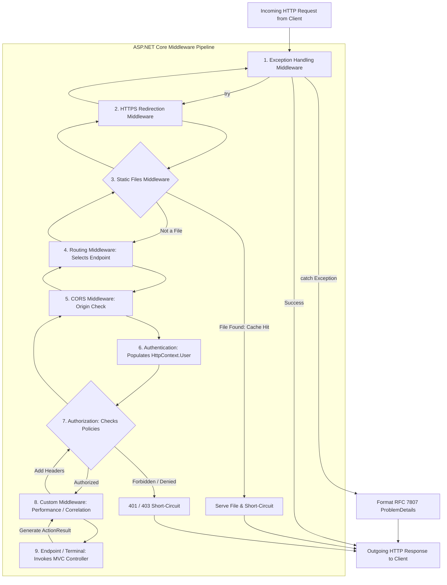
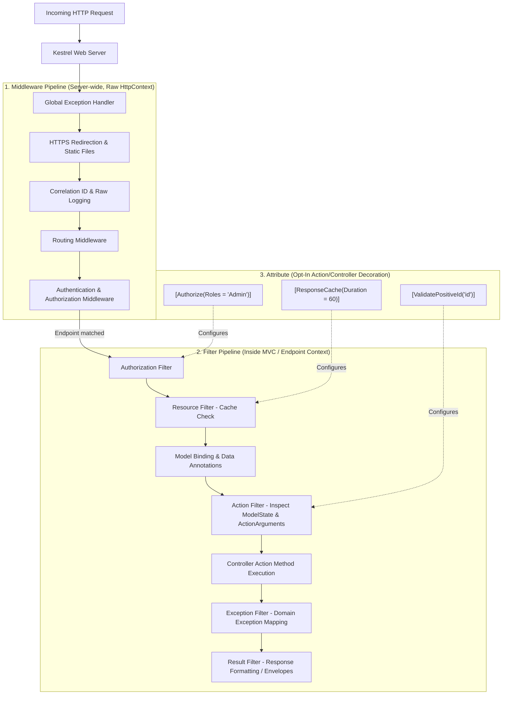

# Deep-Dive Guide: ASP.NET Core Middleware (Fully Paired Bilingual Guide)

---

## 1. English Definition & Concept
In ASP.NET Core, **Middleware** is software assembled into an application's request processing pipeline to handle HTTP requests and responses. Each middleware component in the pipeline:
1. Chooses whether to pass the request to the next component in the pipeline.
2. Can perform work before and after the next component in the pipeline is invoked.

The ASP.NET Core request pipeline consists of a sequence of **`RequestDelegate`** instances called one after another, forming a recursive, bidirectional **Russian Doll (or Onion)** architecture. Middleware operates globally on the raw `HttpContext` and handles cross-cutting concerns for the entire web server—such as exception handling, HTTPS redirection, static file serving, CORS, authentication, authorization, response compression, request diagnostics, and routing.

---

## 2. Bangla Explanation (বাংলায় সহজ ব্যাখ্যা)
সহজ কথায়, **Middleware** হলো ASP.NET Core অ্যাপ্লিকেশনের প্রধান প্রবেশদ্বারে বসানো একগুচ্ছ **"ক্রমাগত সিকিউরিটি গেট বা প্রসেসিং স্টেশন"**। 

ক্লায়েন্ট (ব্রাউজার বা মোবাইল অ্যাপ) থেকে যখন কোনো HTTP রিকোয়েস্ট সার্ভারে আসে, তখন সেটি সরাসরি কন্ট্রোলারে পৌঁছায় না। এটি একের পর এক মিডলওয়্যার পার হয়ে যায়। প্রতিটি মিডলওয়্যার:
1. রিকোয়েস্টের ওপর কিছু কাজ করতে পারে (যেমন: লগইন টোকেন চেক করা, লগ রাখা, HTTPS এ রিডাইরেক্ট করা)।
2. রিকোয়েস্টটিকে পাইপলাইনের পরবর্তী মিডলওয়্যারের কাছে পাঠাবে কিনা (Next Delegate) তা সিদ্ধান্ত নিতে পারে। চাইলে সেখানেই রিকোয়েস্ট থামিয়ে (Short-Circuit) সরাসরি রেসপন্স ফেরত পাঠিয়ে দিতে পারে।
3. যখন কন্ট্রোলার কাজ শেষ করে রেসপন্স তৈরি করে, তখন সেই রেসপন্সটি আবার উল্টো পথে এই মিডলওয়্যারগুলো দিয়েই ক্লায়েন্টের কাছে ফেরত যায়।

---

## 3. Why It Exists (কেন তৈরি করা হয়েছে?)

### English:
Before the modern ASP.NET Core pipeline, legacy ASP.NET (System.Web / IIS) used heavy, monolithic architectures (`HttpModules` and `HttpHandlers`). These had severe production problems:
1. **Tight IIS Coupling**: Legacy ASP.NET was fundamentally glued to Windows IIS and native OS modules, making cross-platform execution (Linux, macOS, Docker containers) impossible.
2. **Massive Overhead**: Every HTTP request had to traverse dozens of built-in IIS modules (session state, forms auth, cache) whether the application needed them or not, consuming unnecessary CPU and RAM.
3. **Black-Box Pipeline**: Developers had minimal control over the exact execution sequence of HTTP handlers.
4. **Lack of Composability**: Applications could not cleanly modularize features into lightweight, pluggable, asynchronous steps.

ASP.NET Core replaced this with a **zero-overhead, opt-in, fully composable Middleware pipeline**:
- **Pay-for-Play**: Your app only runs the middleware you explicitly register in `Program.cs`. If you don't need static files or session state, zero CPU cycles are wasted on them.
- **Cross-Platform & Cloud-Native**: Runs identically inside lightweight Linux Docker containers, Kestrel, or IIS.
- **Strict, Predictable Ordering**: You have complete, deterministic control over which component executes first, second, and last.

### বাংলায় কারণ:
অতীতে ক্লাসিক ASP.NET এ `HttpModules` এবং `HttpHandlers` ব্যবহার করা হতো, যা উইন্ডোজ IIS ওয়েব সার্ভারের সাথে শক্তভাবে বাঁধা (Tightly Coupled) ছিল। এতে মারাত্মক সমস্যা হতো:
1. **ওভারহেড ও ধীরগতি**: একটি সাধারণ রিকোয়েস্টেও উইন্ডোজের বহু অপ্রয়োজনীয় ইন্টারনাল মডিউল রান হতো, যা প্রচুর মেমোরি ও প্রসেসর অপচয় করত।
2. **লিনাক্স বা ডকারে না চলা**: IIS ছাড়া ক্লাসিক .NET চালানো যেত না, ফলে আধুনিক ক্লাউড বা লিনাক্স কন্টেইনারে চালানো অসম্ভব ছিল।
3. **পাইপলাইনের ওপর নিয়ন্ত্রণের অভাব**: কোন মডিউলটি আগে চলবে আর কোনটি পরে, তা ইচ্ছামতো নিয়ন্ত্রণ করা দুঃসাধ্য ছিল।

মাইক্রোসফট আধুনিক .NET Core এ নিয়ে আসে **Middleware Architecture**। এর ফলে:
- **Pay-for-Play (প্রয়োজনে ব্যবহার)**: আপনি `Program.cs` এ কোড লিখে যে কয়টি মিডলওয়্যার যোগ করবেন, কেবল সেই কয়টিই রান হবে—কোনো বাড়তি মেমোরি বা গতি অপচয় হবে না।
- **সম্পূর্ণ ক্রস-প্ল্যাটফর্ম**: লিনাক্স, ম্যাক, উইন্ডোজ বা ডকারে যেকোনো জায়গায় Kestrel সার্ভারের ওপর দ্রুতগতিতে চলে।
- **নিখুঁত ক্রম নিয়ন্ত্রণ**: ডেভেলপার নিজে নির্ধারণ করতে পারেন কোন মিডলওয়্যারের পর কোনটি এক্সিকিউট হবে।

---

## 4. How It Works Under The Hood (অভ্যন্তরীণ মেকানিজম / Internals)

### The Russian Doll (Onion) Pipeline Model

The core abstraction of the entire ASP.NET Core pipeline is a single delegate:
```csharp
public delegate Task RequestDelegate(HttpContext context);
```
Every middleware component receives a reference to the `next` `RequestDelegate` in the chain. When execution flows through the pipeline, each middleware wraps the execution of the next one:

```
[ Incoming HTTP Request ]
           │
           ▼
┌────────────────────────────────────────────────────────┐
│ Middleware 1 (e.g. Exception Handling)                 │
│   ├── Logic BEFORE next() (try { ...)                  │
│   │      │                                             │
│   │      ▼                                             │
│   │  ┌──────────────────────────────────────────────┐  │
│   │  │ Middleware 2 (e.g. Authentication)           │  │
│   │  │   ├── Logic BEFORE next() (Validate JWT)     │  │
│   │  │   │      │                                   │  │
│   │  │   │      ▼                                   │  │
│   │  │   │  ┌────────────────────────────────────┐  │  │
│   │  │   │  │ Middleware 3 (Terminal: Endpoint)  │  │  │
│   │  │   │  │   └── Executes Controller Action   │  │  │
│   │  │   │  └─────────────────┬──────────────────┘  │  │
│   │  │   │                    │                     │  │
│   │  │   │      ▲             ▼                     │  │
│   │  │   └── Logic AFTER next()                     │  │
│   │  └────────────────────────┬─────────────────────┘  │
│   │                           │                        │
│   │      ▲                    ▼                        │
│   └── Logic AFTER next() (} catch { Format 500 })      │
└───────────────────────────────┬────────────────────────┘
                                │
                                ▼
                    [ Outgoing HTTP Response ]
```

---

### The Three Middleware Primitives: `Use`, `Run`, and `Map`

ASP.NET Core provides three foundational methods on `IApplicationBuilder` to construct the pipeline:

| Primitive | Role in Pipeline | Calls Next? | Typical Use Case |
| :--- | :--- | :--- | :--- |
| **`app.Use(...)`** | **Chaining Middleware** | **Yes** (calls `await next()`) | Logging, diagnostics, authentication, adding headers. |
| **`app.Run(...)`** | **Terminal Middleware** | **No** (never calls `next()`) | End of the pipeline; writes response body and short-circuits. |
| **`app.Map(...)`** / `MapWhen` | **Branching Middleware** | **Branch Dependent** | Directing requests to a separate sub-pipeline based on URL path or request condition. |

#### Code Examples of the 3 Primitives:
```csharp
// 1. app.Use: Chains and calls next
app.Use(async (context, next) =>
{
    Console.WriteLine("Before next()");
    await next(context); // Passes to downstream middleware
    Console.WriteLine("After next()");
});

// 2. app.Map: Branches pipeline based on URL prefix
app.Map("/health", healthApp =>
{
    healthApp.Run(async context =>
    {
        await context.Response.WriteAsync("Healthy!");
    });
});

// 3. app.Run: Terminal; short-circuits the pipeline
app.Run(async context =>
{
    await context.Response.WriteAsync("Terminal Fallback - Pipeline Ends Here.");
});
```

---

### Conventional Middleware vs. Factory-Based Middleware (`IMiddleware`)

There are two distinct patterns for writing class-based middleware in ASP.NET Core:

| Comparison Point | Conventional Middleware | Factory-Based Middleware (`IMiddleware`) |
| :--- | :--- | :--- |
| **Interface Implemented** | None (Duck-typed convention) | Implements `Microsoft.AspNetCore.Http.IMiddleware` |
| **DI Registration Required?** | **NO** | **YES** (`builder.Services.AddTransient<T>()` or `AddScoped<T>()`) |
| **Lifetime in Memory** | **Singleton** (Instantiated once during application startup) | **Per-Request (Scoped or Transient)** resolved via `IMiddlewareFactory` |
| **How `next` is passed** | Injected once into the **Constructor** | Passed as an argument to `InvokeAsync(context, next)` |
| **Injecting Scoped Services** | **MUST inject into `InvokeAsync(...)` method** (Constructor injection causes Captive Dependency bug!) | Can safely inject Scoped services into the **Constructor** |
| **Performance** | Slightly faster (zero DI resolution per request) | Minor allocation overhead for per-request DI activation |

---

### The Canonical Middleware Pipeline Order (ক্রমানুসারে পাইপলাইনের সাজসজ্জা)

The order in which middleware is registered in `Program.cs` defines the exact order of execution. Getting this wrong breaks security and crash handling:

```
 1. ExceptionHandler / DeveloperExceptionPage  (Must be outer-most to catch all unhandled crashes)
 2. HSTS                                       (Strict-Transport-Security headers)
 3. HttpsRedirection                           (Redirects HTTP -> HTTPS)
 4. StaticFiles                                (Serves .js, .css, images; short-circuits on hit)
 5. Routing                                    (app.UseRouting() -> selects Endpoint & Route)
 6. CORS                                       (app.UseCors() -> evaluates Origin headers)
 7. Authentication                             (app.UseAuthentication() -> populates HttpContext.User)
 8. Authorization                              (app.UseAuthorization() -> checks roles/policies)
 9. Custom Middlewares                         (Rate-limiting, request logging, tenancy)
10. Endpoint / Terminal                        (app.MapControllers() -> invokes Controller & Filters)
```

> ⚠️ **Catastrophic Ordering Trap**: If you place `UseAuthorization()` *before* `UseAuthentication()`, the authorization system checks `HttpContext.User` before the authentication middleware has populated it! The user is seen as unauthenticated, resulting in bogus `401 Unauthorized` errors on valid requests!

---

## 5. Built-in Types & Simple Example (বিল্ট-ইন টাইপ ও সহজ উদাহরণ)

### Core Built-in Types in `Microsoft.AspNetCore.Http`

| Built-in Type | Responsibility | Key Properties / Methods |
| :--- | :--- | :--- |
| **`RequestDelegate`** | Function pointer executing the next middleware. | `Task Invoke(HttpContext context)` |
| **`HttpContext`** | Encapsulates all HTTP-specific information for a single request. | `Request`, `Response`, `User`, `Items`, `TraceIdentifier`, `RequestServices` |
| **`IApplicationBuilder`** | Fluent API used to construct the request pipeline. | `Use()`, `Run()`, `Map()`, `MapWhen()`, `Build()` |
| **`IMiddleware`** | Interface for factory-activated, scoped middleware. | `Task InvokeAsync(HttpContext context, RequestDelegate next)` |
| **`IMiddlewareFactory`** | Creates and disposes `IMiddleware` instances per request. | `Create(Type middlewareType)`, `Release(IMiddleware middleware)` |

---

### Minimal Self-Contained Example: Custom Conventional Middleware

```csharp
using System.Diagnostics;

namespace MiddlewareDemo
{
    // 1. Conventional Middleware Class
    public class RequestPerformanceMiddleware
    {
        private readonly RequestDelegate _next;
        private readonly ILogger<RequestPerformanceMiddleware> _logger;

        // RequestDelegate is injected once at application startup (Singleton lifetime)
        public RequestPerformanceMiddleware(RequestDelegate next, ILogger<RequestPerformanceMiddleware> logger)
        {
            _next = next;
            _logger = logger;
        }

        // Method MUST be named Invoke or InvokeAsync
        // Scoped services can be injected directly into this method signature!
        public async Task InvokeAsync(HttpContext context)
        {
            var stopwatch = Stopwatch.StartNew();
            var path = context.Request.Path;
            var method = context.Request.Method;

            _logger.LogInformation("[START] Processing HTTP {Method} {Path}", method, path);

            // Execute the next middleware downstream
            await _next(context);

            stopwatch.Stop();
            var elapsedMs = stopwatch.ElapsedMilliseconds;

            _logger.LogInformation("[FINISH] HTTP {Method} {Path} finished with Status {Status} in {ElapsedMs} ms",
                method, path, context.Response.StatusCode, elapsedMs);
        }
    }

    // 2. Fluent Extension Method for clean registration in Program.cs
    public static class RequestPerformanceMiddlewareExtensions
    {
        public static IApplicationBuilder UseRequestPerformance(this IApplicationBuilder app)
        {
            return app.UseMiddleware<RequestPerformanceMiddleware>();
        }
    }
}
```

---

## 6. Real-World Production Example (বাস্তব প্রোডাকশন উদাহরণ)

### Production Scenario: Global Exception Handling & Correlation ID Middleware

In enterprise microservices, two middlewares are non-negotiable:
1. **Correlation ID Middleware**: Extracts or generates an `X-Correlation-ID` header, sets it in `context.TraceIdentifier`, and returns it in response headers so distributed logs across microservices can be correlated.
2. **Global Exception Handling Middleware**: Wraps the entire pipeline in a robust `try/catch` block, logs critical stack traces, and returns an RFC-7807 compliant `ProblemDetails` response so server crashes never leak raw exceptions or crash the container.

```csharp
using System.Net;
using System.Text.Json;
using Microsoft.AspNetCore.Mvc;

namespace EnterpriseMiddleware
{
    // 1. Request Correlation ID Middleware
    public class CorrelationIdMiddleware
    {
        private const string CorrelationIdHeaderName = "X-Correlation-ID";
        private readonly RequestDelegate _next;
        private readonly ILogger<CorrelationIdMiddleware> _logger;

        public CorrelationIdMiddleware(RequestDelegate next, ILogger<CorrelationIdMiddleware> logger)
        {
            _next = next;
            _logger = logger;
        }

        public async Task InvokeAsync(HttpContext context)
        {
            // 1. Extract from client or generate brand new Correlation ID
            if (!context.Request.Headers.TryGetValue(CorrelationIdHeaderName, out var correlationId) ||
                string.IsNullOrWhiteSpace(correlationId))
            {
                correlationId = Guid.NewGuid().ToString("N");
            }

            // 2. Overwrite TraceIdentifier with Correlation ID for unified logging
            context.TraceIdentifier = correlationId!;

            // 3. Register callback to add header to outgoing response safely
            context.Response.OnStarting(() =>
            {
                context.Response.Headers.TryAdd(CorrelationIdHeaderName, correlationId);
                return Task.CompletedTask;
            });

            // 4. Push correlation ID into structured logging scope
            using (_logger.BeginScope(new Dictionary<string, object> { ["CorrelationId"] = correlationId }))
            {
                await _next(context);
            }
        }
    }

    // 2. Global Exception Handling Middleware
    public class GlobalExceptionHandlingMiddleware
    {
        private readonly RequestDelegate _next;
        private readonly ILogger<GlobalExceptionHandlingMiddleware> _logger;
        private readonly IHostEnvironment _env;

        public GlobalExceptionHandlingMiddleware(RequestDelegate next, ILogger<GlobalExceptionHandlingMiddleware> logger, IHostEnvironment env)
        {
            _next = next;
            _logger = logger;
            _env = env;
        }

        public async Task InvokeAsync(HttpContext context)
        {
            try
            {
                // Pass down through the entire pipeline
                await _next(context);
            }
            catch (Exception ex)
            {
                // Catch any unhandled crash originating from anywhere in the application
                await HandleExceptionAsync(context, ex);
            }
        }

        private async Task HandleExceptionAsync(HttpContext context, Exception ex)
        {
            var traceId = context.TraceIdentifier;

            _logger.LogError(ex, "[FATAL] Unhandled exception occurred on {Method} {Path} (TraceId: {TraceId})",
                context.Request.Method, context.Request.Path, traceId);

            if (context.Response.HasStarted)
            {
                _logger.LogWarning("[ExceptionMiddleware] Response has already started streaming. Cannot write error response.");
                return;
            }

            context.Response.ContentType = "application/problem+json";
            context.Response.StatusCode = (int)HttpStatusCode.InternalServerError;

            // In production, mask raw exception details to prevent leaking internal database schemas
            string detail = _env.IsDevelopment()
                ? ex.ToString()
                : "An unexpected error occurred while processing your request. Please contact support with the trace identifier.";

            var problem = new ProblemDetails
            {
                Status = StatusCodes.Status500InternalServerError,
                Title = "Internal Server Error",
                Detail = detail,
                Instance = context.Request.Path,
                Type = "https://httpstatuses.com/500"
            };
            problem.Extensions["traceId"] = traceId;
            problem.Extensions["timestamp"] = DateTime.UtcNow;

            var json = JsonSerializer.Serialize(problem);
            await context.Response.WriteAsync(json);
        }
    }

    // Registration Extensions
    public static class EnterpriseMiddlewareExtensions
    {
        public static IApplicationBuilder UseCorrelationId(this IApplicationBuilder app) =>
            app.UseMiddleware<CorrelationIdMiddleware>();

        public static IApplicationBuilder UseGlobalExceptionHandler(this IApplicationBuilder app) =>
            app.UseMiddleware<GlobalExceptionHandlingMiddleware>();
    }
}
```

### Explanation (কেন এটি প্রোডাকশনে ব্যবহৃত হয়?):
- **English**: Correlation IDs unify distributed logs across microservices, databases, and message queues into a single traceable string. Placing Global Exception Handling as the very first middleware guarantees that whether an error is thrown in authentication, routing, controllers, or static files, the app will never crash with an ugly unformatted 500 error or leak sensitive connection strings.
- **বাংলায় কারণ**: ডিস্ট্রিবিউটেড মাইক্রোসার্ভিসে হাজার হাজার লগের মধ্য থেকে একটি নির্দিষ্ট কাস্টমারের রিকোয়েস্ট ট্র্যাক করতে Correlation ID অপরিহার্য। আর গ্লোবাল এক্সেপশন মিডলওয়্যারকে পাইপলাইনের একদম শুরুতে রাখা হয়, যাতে অ্যাপের যেকোনো স্তরে (রাউটিং, অথেন্টিকেশন, কন্ট্রোলার বা ডাটাবেজ) কোনো অপ্রত্যাশিত ক্র্যাশ হলে তা সুন্দরভাবে ক্যাচ করে RFC-7807 ফরম্যাটে নিরাপদ এরর ফেরত পাঠানো যায়।

---

## 7. Visual Diagram (ডায়াগ্রাম)

### Architectural Overview of the Middleware Pipeline Lifecycle



---

### Detailed Key Terms Breakdown for the Diagram

| Key Term / Diagram Node | English Architectural Explanation | বাংলায় সহজ ও টেকনিক্যাল ব্যাখ্যা |
| :--- | :--- | :--- |
| **`Exception Handling Middleware`** | Outermost middleware wrapping the entire pipeline in `try-catch` to safely catch unhandled exceptions. | পাইপলাইনের সর্ববহিঃস্থ গেট; ভেতরের কোথাও কোনো ক্র্যাশ ঘটলে তা ধরে নিরাপদ এরর তৈরি করে। |
| **`HTTPS Redirection`** | Evaluates incoming protocol and issues HTTP 301/307 redirects to secure HTTPS ports. | অসুরক্ষিত HTTP রিকোয়েস্ট আসলে ব্রাউজারকে নিরাপদ HTTPS লিঙ্কে রিডাইরেক্ট করে। |
| **`Static Files Middleware`** | Inspects physical `wwwroot` files; short-circuits on match to serve CSS/JS/images without invoking routing. | ইমেজ, সিএসএস, জেএস ফাইলের পাথ মিললে সরাসরি ফাইল পাঠিয়ে দিয়ে পাইপলাইন শেষ করে দেয়। |
| **`Routing Middleware`** | Parses URL template and matches it against registered endpoints (Controller actions, Minimal APIs). | ইউআরএল বিশ্লেষণ করে কোন কন্ট্রোলারের কোন অ্যাকশন মেথড কল করতে হবে তা ঠিক করে। |
| **`CORS Middleware`** | Validates cross-origin HTTP requests against configured policies (`Access-Control-Allow-Origin`). | অন্য ডোমেন থেকে আসা রিকোয়েস্টগুলো অনুমোদিত কিনা তা হেডার চেক করে নিশ্চিত করে। |
| **`Authentication Middleware`** | Inspects Bearer tokens, cookies, or certificates and populates `HttpContext.User` (ClaimsPrincipal). | টোকেন বা কুকি পরীক্ষা করে রিকোয়েস্টকারী ইউজারের আইডেন্টিটি বা পরিচয় প্রতিষ্ঠা করে। |
| **`Authorization Middleware`** | Evaluates whether the authenticated `HttpContext.User` satisfies endpoint role/policy requirements. | প্রতিষ্ঠিত ইউজারটির সংশ্লিষ্ট মেথড কল করার অনুমতি বা পারমিশন (Role/Policy) আছে কিনা তা যাচাই করে। |
| **`Endpoint / Terminal Middleware`** | Executes the selected endpoint handler (MVC Action Invocation pipeline or Minimal API delegate). | পাইপলাইনের শেষ প্রান্ত; যেখানে আসল কন্ট্রোলার মেথড এক্সিকিউট হয়। |
| **`Short-Circuiting`** | Returning early from a middleware without calling `next()`, causing subsequent downstream middlewares to be skipped. | পাইপলাইনের পরবর্তী মিডলওয়্যারগুলোতে না গিয়ে মাঝপথ থেকেই রেসপন্স ফেরত পাঠিয়ে দেওয়া। |

---

### Step-by-Step Real Example Execution Trace (বাস্তব উদাহরণের মাধ্যমে সম্পূর্ণ ধাপ)

Consider a request: `GET /api/orders/101` with header `Authorization: Bearer <valid_token>`.

```
[ Step 1: Request Ingress ]
  Kestrel Web Server receives raw TCP bytes -> Constructs `HttpContext`.

[ Step 2: GlobalExceptionHandlingMiddleware ]
  Executes `try` block -> Calls `await _next(context)`.

[ Step 3: CorrelationIdMiddleware ]
  Extracts `X-Correlation-ID: 7f8a9b` (or generates one) -> Sets `context.TraceIdentifier = 7f8a9b`.
  Hooks `Response.OnStarting` -> Calls `await _next(context)`.

[ Step 4: HttpsRedirection & StaticFiles ]
  Protocol is HTTPS -> Proceeds. Path is `/api/orders/101` (Not static file) -> Proceeds.

[ Step 5: Routing Middleware ]
  Matches route `/api/orders/{id}` -> Sets `Endpoint = OrdersController.GetById(int id)` in `HttpContext`.

[ Step 6: Authentication Middleware ]
  Decodes JWT Bearer token -> Validates signature & expiration.
  Populates `context.User` with `ClaimsPrincipal(Sub: "user_42", Role: "Admin")`.

[ Step 7: Authorization Middleware ]
  Inspects endpoint metadata: Requires `[Authorize]`. User is authenticated -> Proceeds.

[ Step 8: Terminal Endpoint Middleware (MapControllers) ]
  Enters MVC Filter Pipeline -> Executes `OrdersController.GetById(101)` -> Returns `Ok(Order)`.

[ Step 9: Reverse Unwinding ]
  Response flows back in reverse onion order.
  CorrelationIdMiddleware `OnStarting` callback appends `X-Correlation-ID: 7f8a9b` header.
  GlobalExceptionHandlingMiddleware completes with zero caught exceptions.

[ Step 10: Egress ]
  Kestrel sends HTTP 200 OK with JSON body and correlation headers back to client.
```

---

## 8. Common Mistakes & Gotchas (সাধারণ ভুল ও ফাঁদ)

### ⚠️ Pitfall 1: Mutating Response Headers After `await next()`
- **English**: In ASP.NET Core, once downstream middleware or the controller action begins writing bytes to the response body, the response headers are **flushed to the network socket** and become permanently read-only (`context.Response.HasStarted == true`). Attempting to add or modify headers after `await next()` throws:
  **`InvalidOperationException: Headers are read-only, response has already started`**.
- **বাংলায় ফাঁদ**: `await next()` এর পরে যখন রেসপন্স বডি স্ট্রিম হওয়া শুরু হয়ে যায়, ওএস সকেটে হেডার অলরেডি পাঠানো হয়ে গেছে (`Response.HasStarted == true`)। এই অবস্থায় কোনো হেডার যুক্ত বা পরিবর্তন করতে গেলে সিস্টেম সাথে সাথে ক্র্যাশ করে।
- **Senior Solution (সিনিয়র সমাধান)**: Always register a callback using **`context.Response.OnStarting(...)`** before calling `next()`, or add headers strictly *before* `await next()`.

---

### ⚠️ Pitfall 2: Captive Dependency in Conventional Middleware
- **English**: Conventional middleware classes are instantiated **once at application startup as Singletons**. If you inject a **Scoped service** (such as an Entity Framework Core `DbContext` or a per-request tenant service) into the **Constructor** of a conventional middleware, that Scoped service becomes trapped inside the Singleton. This creates a severe **Captive Dependency**: the same `DbContext` instance is shared across all concurrent HTTP requests, causing concurrency crashes, data corruption, and catastrophic memory leaks!
- **বাংলায় ফাঁদ**: সাধারণ মিডলওয়্যার অ্যাপ চালুর সময় একবারই অবজেক্ট হয় (Singleton)। আপনি যদি এর **Constructor** এ কোনো Scoped সার্ভিস (যেমন `DbContext`) ইনজেক্ট করেন, তবে সেই স্কোপড সার্ভিসটি সারাজীবনের জন্য মেমোরিতে আটকে যায় (Captive Dependency)। ফলে হাজার হাজার ব্যবহারকারীর রিকোয়েস্ট একই ডাটাবেজ কনটেক্সট শেয়ার করতে গিয়ে অ্যাপ ক্র্যাশ করে ও ডাটা করাপ্ট হয়ে যায়!
- **Senior Solution (সিনিয়র সমাধান)**: **Never inject Scoped services into a conventional middleware constructor!** Instead, inject Scoped services directly into the **`InvokeAsync` method parameters**:
  ```csharp
  // BAD: Captive Dependency! DbContext becomes a Singleton!
  public class BadMiddleware
  {
      public BadMiddleware(RequestDelegate next, MyDbContext db) { ... }
  }

  // GOOD: Resolved fresh per HTTP request from request scope!
  public class GoodMiddleware
  {
      public GoodMiddleware(RequestDelegate next) { ... }
      public async Task InvokeAsync(HttpContext context, MyDbContext db) { ... }
  }
  ```
  *(Alternatively, implement `IMiddleware`, which is resolved per-request via DI).*

---

### ⚠️ Pitfall 3: Disastrous Middleware Ordering
- **English**: ASP.NET Core does not warn you if your middleware order is logically broken:
  - Placing `UseAuthorization()` *before* `UseAuthentication()` results in false 401s.
  - Placing `UseCors()` *after* `UseRouting()` and `UseEndpoints()` causes browsers to block API responses due to missing `Access-Control-Allow-Origin` headers.
  - Placing Custom Exception Handling *inside* routing instead of as the outermost layer prevents it from catching routing or auth crashes.
- **বাংলায় ফাঁদ**: মিডলওয়্যারের সিরিয়াল এলোমেলো হলে অ্যাপ সম্পূর্ণ অস্বাভাবিক আচরণ করে। যেমন: `UseAuthentication()` এর আগে `UseAuthorization()` রাখলে ইউজার লগইন থাকা সত্ত্বেও সিস্টেম তাকে চিনতে না পেরে 401 Unauthorized ছুড়ে দেয়।
- **Senior Solution (সিনিয়র সমাধান)**: Follow Microsoft's recommended canonical ordering strictly (Exception $\rightarrow$ HTTPS $\rightarrow$ StaticFiles $\rightarrow$ Routing $\rightarrow$ CORS $\rightarrow$ Authentication $\rightarrow$ Authorization $\rightarrow$ Endpoints).

---

### ⚠️ Pitfall 4: Forgetting `await next(context)` or Calling It Multiple Times
- **English**: If you omit `await next(context)`, the request is accidentally short-circuited and returns an empty 200 OK without executing downstream logic. Conversely, calling `await next(context)` twice in the same middleware invokes downstream components twice, corrupting response streams.
- **বাংলায় ফাঁদ**: ভুল করে `await next(context)` লিখতে ভুলে গেলে পাইপলাইন মাঝপথে থেমে গিয়ে ক্লায়েন্ট একটি খালি সাদা স্ক্রিন পাবে। আর দুইবার কল করলে কন্ট্রোলার মেথড দুইবার রান হয়ে মেমোরি স্ট্রিম এক্সেপশন দেবে।
- **Senior Solution (সিনিয়র সমাধান)**: Ensure `await next(context)` is called **exactly once** along the non-short-circuiting execution path.

---

## 9. Interview Perspective (ইন্টারভিউ প্রস্তুতি)

### Q1: What is the difference between `app.Use()`, `app.Run()`, and `app.Map()`?
- **English Pitch**: 
  - `app.Use()` adds a middleware that can either execute code and pass the request downstream by calling `await next()`, or short-circuit.
  - `app.Run()` defines a terminal middleware that never calls `next()`, always terminating the pipeline and returning a response.
  - `app.Map()` / `app.MapWhen()` branches the pipeline based on a URL path prefix or a boolean condition, creating an isolated sub-pipeline.
- **বাংলায় ব্যাখ্যা**: `app.Use()` পাইপলাইনে নতুন মিডলওয়্যার যোগ করে যা `next()` কল করে পরবর্তী ধাপে যেতে পারে। `app.Run()` হলো টার্মিনাল মিডলওয়্যার যা কোনো `next()` কল করে না এবং সেখানেই রিকোয়েস্ট শেষ করে দেয়। আর `app.Map()` ইউআরএল বা শর্তের ওপর ভিত্তি করে পাইপলাইনকে একটি আলাদা শাখায় (Branch) ভাগ করে দেয়।

---

### Q2: Conventional Middleware vs. Factory-Based Middleware (`IMiddleware`): What are the differences?
- **English Pitch**: Conventional middleware uses duck typing (defining `InvokeAsync`), is instantiated once as a **Singleton** at startup, and must inject scoped services into its `InvokeAsync` method. Factory-based middleware implements `IMiddleware`, is registered in the DI container with a **Transient or Scoped** lifetime, allows injecting scoped services directly into its constructor, but incurs minor per-request DI activation overhead.
- **বাংলায় ব্যাখ্যা**: Conventional মিডলওয়্যার কোনো ইন্টারফেস ইমপ্লিমেন্ট করে না, স্টার্টআপে একবারই Singleton হিসেবে তৈরি হয় এবং এতে কোনো Scoped সার্ভিস নিতে হলে মেথড প্যারামিটারে নিতে হয়। পক্ষান্তরে, `IMiddleware` হলো DI-ফ্রেন্ডলি ইন্টারফেস যা প্রতিটি রিকোয়েস্টে নতুনভাবে Scoped বা Transient হিসেবে তৈরি হতে পারে এবং সরাসরি কনস্ট্রাক্টরেই স্কোপড ডিপেনডেন্সি ইনজেক্ট করা যায়।

---

### Q3: What is a "Captive Dependency" in ASP.NET Core Middleware, and how do you prevent it?
- **English Pitch**: A captive dependency occurs when a service with a shorter lifetime (Scoped) is injected into the constructor of a component with a longer lifetime (Singleton). Since conventional middleware is a Singleton, injecting a Scoped `DbContext` into its constructor traps the `DbContext` for the lifetime of the application, causing concurrent thread collisions and memory leaks. To prevent it, inject Scoped dependencies directly into the `InvokeAsync(HttpContext context, MyDbContext db)` method instead.
- **বাংলায় ব্যাখ্যা**: যখন কোনো দীর্ঘজীবী অবজেক্টের (Singleton) কনস্ট্রাক্টরে কোনো ক্ষণস্থায়ী অবজেক্ট (Scoped) ইনজেক্ট করা হয়, তখন ক্ষণস্থায়ী অবজেক্টটিও আজীবনের জন্য আটকে যায়—যাকে Captive Dependency বলে। কনভেনশনাল মিডলওয়্যার যেহেতু সিঙ্গলটন, তাই এর কনস্ট্রাক্টরে `DbContext` ইনজেক্ট না করে সরাসরি `InvokeAsync` মেথডের প্যারামিটারে ইনজেক্ট করতে হয়।

---

### Q4: When would you use Middleware vs. an Action Filter?
- **English Pitch**: Use **Middleware** for global, low-level HTTP concerns that must execute before routing or apply universally to all requests (e.g., HTTPS redirection, CORS, correlation IDs, raw static files, IP rate-limiting, and unhandled 500 error translation). Use an **Action Filter** when the logic requires deep MVC context (such as reading `ActionDescriptor`, inspecting `ModelState.IsValid`, modifying action parameter arguments, or customizing `ActionResult` payloads).
- **বাংলায় ব্যাখ্যা**: যখন কোনো কাজ পুরো ওয়েব সার্ভারের গ্লোবাল লেভেলে করতে হয় (যেমন: CORS, HTTPS রিডাইরেকশন, ট্র্যাকিং হেডার বসানো, স্ট্যাটিক ফাইল পাঠানো)—তখন **Middleware** ব্যবহার করতে হয়। আর যখন কন্ট্রোলারের ভেতরের মেটাডেটা দরকার হয় (যেমন: মডেল ভ্যালিডেশন এরর চেক করা, নির্দিষ্ট মেথডে ক্যাশ করা, মেথড আর্গুমেন্ট পরিমার্জন করা)—তখন **Action Filter** ব্যবহার করতে হয়।

---

---

## 10. Architectural Decision Guide: Middleware vs. Filter vs. Attribute (কখন কোনটি ব্যবহার করবেন?)

### The 30-Second Golden Rule (এক নজরে মূল নিয়ম)
* **Use Middleware** when the logic applies to the **entire HTTP web server** and only needs raw `HttpContext` (e.g., CORS, HTTPS redirection, raw logging, correlation IDs, global crash safety, static files). It has **zero awareness** of controllers, action parameters, or models.
* **Use a Filter (Global or Pipeline)** when the logic belongs to the **MVC / Web API pipeline** and needs MVC-specific metadata (e.g., `ModelState`, `ActionArguments`, `ActionDescriptor`, or `IActionResult`).
* **Use an Attribute** when a filter or metadata should be **opt-in and configured per-controller or per-action** with custom arguments (e.g., `[Authorize(Roles = "Admin")]`, `[ValidatePositiveId("id")]`).

---

### Pipeline Position Architecture: Where Each Layer Lives



---

### Comprehensive Comparison & Decision Matrix (সিদ্ধান্ত নেওয়ার তুলনামূলক ছক)

| Criteria / Feature | Middleware | Filter (Global / Pipeline) | Filter as an Attribute |
| :--- | :--- | :--- | :--- |
| **Pipeline Stage** | Outer pipeline (Before & after routing) | Inner pipeline (After routing, around Action) | Targeted around decorated Action/Controller |
| **Available Context** | Raw `HttpContext` only | `HttpContext`, `ModelState`, `ActionArguments`, `ActionDescriptor` | Action context + Attribute constructor arguments |
| **Aware of MVC / Controllers?** | ❌ No | ✅ Yes | ✅ Yes |
| **Scope of Execution** | Every HTTP request | Every Controller Action (Global) | Only decorated Actions/Controllers |
| **Primary Use Cases** | CORS, AuthN, Static files, Compression, Global Exception | Standard response envelopes, universal logging, model validation | Endpoint auth (`[Authorize]`), custom validation (`[ValidatePositiveId]`), Swagger doc |
| **Supports Action Parameters?**| ❌ No | ❌ No (runs uniformly) | ✅ Yes (can pass arguments to attribute) |

---

### Deep-Dive Criteria (কখন কোনটি বেছে নেবেন)

#### 1. When Should You Use Middleware?
- **English**:
  - The concern is protocol- or server-wide (runs for every request hitting Kestrel, including static files, health checks, or non-MVC endpoints).
  - It must execute before routing spends CPU/RAM resolving routes (e.g., IP blocking, rate limiting, SSL redirection, Correlation ID generation).
  - Global crash safety across the entire server (`app.UseExceptionHandler`).
  - Handling raw HTTP streams (response compression, raw request byte reading).
- **বাংলায়**:
  - পুরো সার্ভারের জন্য প্রযোজ্য হলে (রিকোয়েস্টটি কন্ট্রোলারে যাক বা না যাক—যেমন স্ট্যাটিক ফাইল, হেলথ চেক `/health` বা ইমেজের রিকোয়েস্ট)।
  - রাউটিং বা কন্ট্রোলার খোঁজার আগেই সিদ্ধান্ত নিতে হলে (যেমন আইপি ব্লকিং বা রিকোয়েস্টে `X-Correlation-ID` বসানো)।
  - পুরো অ্যাপ্লিকেশনের সব ধরনের ক্র্যাশ গ্লোবালি হ্যান্ডেল করতে (`UseExceptionHandler`)।

#### 2. When Should You Use a Filter?
- **English**:
  - You need access to MVC metadata (`ActionDescriptor`, `ModelState.IsValid`, or parsed method parameters in `context.ActionArguments`).
  - Short-circuiting invalid inputs before controller code executes (`ValidationActionFilter`).
  - Response standard wrapping (transforming `OkObjectResult` into `{ success: true, data: ... }`).
  - Caching before model binding executes via a **Resource Filter**.
  - Localized domain exception translation (`ProductNotFoundException` $\rightarrow$ 404 Not Found).
- **বাংলায়**:
  - কন্ট্রোলারের মেটাডেটা দরকার হলে (কোন মেথড কল হচ্ছে, মেথডের প্যারামিটারে কী মান এসেছে, বা `ModelState` ভ্যালিড কিনা)।
  - ডেটা ভুল থাকলে কন্ট্রোলারের ভেতরের ডাটাবেজ কোড রান না করেই সরাসরি 400 Bad Request ফেরত পাঠাতে।
  - কন্ট্রোলার-লেভেলে নির্দিষ্ট এরর হ্যান্ডলিং করতে (যেমন `ProductNotFoundException` কে 404 বানানো)।

#### 3. When Should You Use an Attribute?
- **English**:
  - **Granular / Opt-In behavior**: The behavior applies only to specific endpoints (e.g., `[Authorize(Roles = "Admin")]` on DELETE endpoints only).
  - **Parameterized rules**: The filter requires action-specific parameters passed at compile-time (e.g., `[ValidatePositiveId("productId")]` or `[ResponseCache(Duration = 120)]`).
  - **Marker metadata**: Annotating endpoints for Swagger documentation (`[ProducesResponseType(200)]`) or opting out of global policies (`[AllowAnonymous]`).
- **বাংলায়**:
  - স্পেসিফিক কোনো মেথড বা কন্ট্রোলারে অপ্ট-ইন করতে (সবার জন্য না চালিয়ে কেবল নির্দিষ্ট অ্যাকশনে অ্যাডমিন চেক করা)।
  - মেথডভিত্তিক কাস্টম প্যারামিটার পাস করতে (যেমন `[ValidatePositiveId("productId")]`)।
  - মেটাডেটা ফ্ল্যাগ দিতে (যেমন গ্লোবাল অথেনটিকেশন এড়িয়ে যেতে `[AllowAnonymous]` বা সোয়াগারের ডক তৈরি করতে)।

---

## 📂 Related Documentation Links
- ASP.NET Core Filters: [`docs/Filter.md`](file:///Users/limon/interview/c-sharp-prep/docs/Filter.md)
- Web API & Backend Concepts: [`docs/Backend.Prep.md`](file:///Users/limon/interview/c-sharp-prep/docs/Backend.Prep.md)
- Reflection & Attributes: [`docs/Reflection.md`](file:///Users/limon/interview/c-sharp-prep/docs/Reflection.md)
- Common Language Runtime (CLR): [`docs/CLR.md`](file:///Users/limon/interview/c-sharp-prep/docs/CLR.md)
- Repository Table of Contents: [`Readme.md`](file:///Users/limon/interview/c-sharp-prep/Readme.md)

