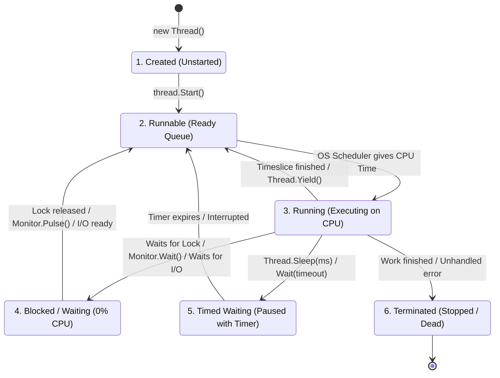
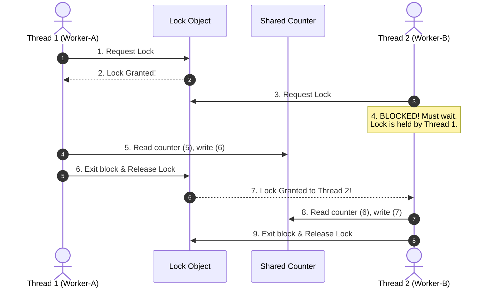

# Deep-Dive Guide: Multithreading & Thread Synchronization in C# (Simple & Clear Bilingual Guide)

---

## 1. English Definition & Concept

### Process vs. Thread vs. Multitasking vs. Multithreading
To understand multithreading, we must separate four key terms:

1. **Process**:
   - An independent running program with its own private memory and system resources.
   - Examples: A Web Browser (Chrome), a Word Processor, or a Media Player.
2. **Thread**:
   - The smallest unit of execution inside a process.
   - Multiple threads in the same process share the same memory space.
   - Example inside a Browser: Thread 1 renders the web page, while Thread 2 downloads an image.
3. **Multitasking**:
   - The operating system running multiple **different processes** at the same time.
   - Example: You write a Word document while listening to Spotify in the background.
4. **Multithreading**:
   - Running multiple **threads inside the same process** at the same time.
   - Example: A web server handling 50 incoming user requests simultaneously.

---

## 2. Bangla Explanation (বাংলায় সহজ ব্যাখ্যা)

### Process, Thread, Multitasking এবং Multithreading-এর পার্থক্য:

1. **Process (প্রসেস)**:
   - কম্পিউটারে চলা একটি সম্পূর্ণ স্বাধীন অ্যাপ্লিকেশন, যার নিজস্ব আলাদা মেমোরি থাকে।
   - উদাহরণ: গুগল ক্রোম ব্রাউজার, মাইক্রোসফট ওয়ার্ড, বা ভিএলসি মিডিয়া প্লেয়ার।
2. **Thread (থ্রেড)**:
   - একটি প্রসেসের ভেতরের কর্মী বা কাজের রাস্তা।
   - একই প্রসেসের সব থ্রেড একই মেমোরি শেয়ার করে কিন্তু আলাদা কাজ করে।
   - উদাহরণ: ক্রোম ব্রাউজারে একটি থ্রেড স্ক্রিনে পেইজ দেখাচ্ছে, অন্য থ্রেড ইন্টারনেট থেকে ডেটা আনছে।
3. **Multitasking (মাল্টিটাস্কিং)**:
   - কম্পিউটারে একসাথে একাধিক **আলাদা প্রসেস বা প্রোগ্রাম** চালানো।
   - উদাহরণ: আপনি গান শুনছেন (ভিএলসি প্লেয়ার) এবং একই সাথে কোড লিখছেন (ভিএস কোড)।
4. **Multithreading (মাল্টিথ্রেডিং)**:
   - **একই প্রোগ্রামের ভেতরে** একসাথে একাধিক থ্রেড চালানো।
   - উদাহরণ: একটি ওয়েব সার্ভারে একই সাথে ১০০ জন ব্যবহারকারীর রিকোয়েস্ট প্রসেস করা।

---

## 3. Why It Exists: Advantages & Disadvantages (কেন তৈরি করা হয়েছে?)

### Advantages (সুবিধাসমূহ):
1. **Parallelism (প্যারালেল কাজ)**: Modern computers have multi-core CPUs. Multithreading runs tasks across different CPU cores at the same time.
2. **Responsiveness (অ্যাপ হ্যাং না হওয়া)**: Heavy tasks run in the background. The main thread keeps the user interface (UI) smooth and clickable.
3. **Better Resource Utilization**: While one thread waits for a database or disk, other threads keep the CPU busy.
4. **Thread Pooling**: Reusing existing threads saves memory and avoids the heavy cost of creating new threads repeatedly.

---

### Disadvantages & Trade-offs (অসুবিধাসমূহ):
1. **Race Conditions**: Two threads modify shared data at the same time, causing wrong values and corrupted data.
2. **Deadlocks**: Two threads get stuck forever, each waiting for the other to release a lock.
3. **Context Switching Overhead**: When the CPU switches between too many threads, it wastes CPU cycles saving and loading thread states.
4. **Thread Pool Exhaustion**: If all threads in the ThreadPool are busy, new requests wait in a queue, causing timeouts and slow response times.

---

## 4. How It Works Under The Hood (অভ্যন্তরীণ মেকানিজম / Internals)

### 1. The 6 Stages of Thread Life Cycle (থ্রেডের জীবনচক্র)

Every thread in an Operating System and .NET goes through **6 distinct states**. 

> **Important Rule**: When a thread wakes up from sleep or gets a lock, it **never jumps straight to Running**! It always moves back to the **Runnable (Ready Queue)** so the OS Scheduler can assign a CPU core.



---

### Step-by-Step State Breakdown:

| State | What is happening? | CPU Usage | Next Possible State |
| :--- | :--- | :--- | :--- |
| **1. Created** | Thread object is initialized in memory (`new Thread()`). `Start()` is not called yet. | **0%** | **Runnable** (via `thread.Start()`) |
| **2. Runnable (Ready)** | Thread is waiting in the OS Ready Queue for its turn on a CPU core. | **0%** | **Running** (when OS picks it) |
| **3. Running** | The CPU core is actively executing the thread's instructions. | **Active CPU** | **Runnable**, **Blocked**, **Timed Waiting**, or **Terminated** |
| **4. Blocked / Waiting** | Thread is paused waiting for a resource (e.g. waiting for a `lock` held by another thread, or waiting for a disk file). | **0%** | **Runnable** (when lock is released) |
| **5. Timed Waiting** | Thread is paused for a specific time using `Thread.Sleep(1000)` or `Wait(5000)`. | **0%** | **Runnable** (when timer expires) |
| **6. Terminated (Dead)** | Thread has finished its method execution or crashed with an unhandled exception. It cannot be restarted. | **0%** | Destroyed from memory |

---

### 2. Memory Layout per Thread
- Each thread gets **1 MB of private Stack memory** for local variables and method call frames.
- All threads read and write to the same **shared Managed Heap**.

```
┌────────────────────────────────────────────────────────┐
│                   PROCESS MEMORY                       │
│                                                        │
│  ┌──────────────────────────────────────────────────┐  │
│  │            Shared Managed Heap Memory            │  │
│  │   (Objects, Shared Variables, Static Data)       │  │
│  └──────────────────────────────────────────────────┘  │
│                                                        │
│   Thread 1 Stack          Thread 2 Stack               │
│   ┌─────────────┐         ┌─────────────┐              │
│   │ Local Vars  │         │ Local Vars  │              │
│   │ Call Frames │         │ Call Frames │              │
│   │ (1 MB Size) │         │ (1 MB Size) │              │
│   └─────────────┘         └─────────────┘              │
└────────────────────────────────────────────────────────┘
```

---

### 3. The Race Condition Problem (`counter++`)

Imagine a shared variable: `int counter = 5;`.  
Two threads run `counter++` at the same time:

#### Without Synchronization (Race Condition Bug):
1. **Thread 1** reads `counter = 5`.
2. **Thread 2** reads `counter = 5` (at the same time).
3. **Thread 1** calculates `5 + 1 = 6` and writes back `counter = 6`.
4. **Thread 2** calculates `5 + 1 = 6` and writes back `counter = 6`.
5. 💥 **Result**: The counter is `6` instead of `7`! One increment was lost!

#### With Synchronization (`lock`):
1. **Thread 1** acquires the lock, reads `5`, increments to `6`, and releases the lock.
2. **Thread 2** must wait until the lock is free.
3. **Thread 2** acquires the lock, reads `6`, increments to `7`.
4. ✅ **Result**: The counter is correctly `7`.

---

## 5. Built-in Types & Simple Example (বিল্ট-ইন টাইপ ও সহজ উদাহরণ)

### 1. Synchronization Primitives in .NET

| Tool | How it works | Scope |
| :--- | :--- | :--- |
| **`lock`** | Locks a code block. Only **1 thread** enters at a time. | Same Process |
| **`Monitor`** | The class behind `lock`. Provides `Enter()`, `Exit()`, and `TryEnter(timeout)`. | Same Process |
| **`Interlocked`** | Performs atomic math operations (`Increment`, `Add`) at the CPU hardware level. | Same Process (Fastest) |
| **`SemaphoreSlim`** | Allows a **limited number of threads** (e.g. max 3) to enter. Supports `async`. | Same Process |
| **`Mutex`** | Cross-process lock. Enforces single-instance applications across the OS. | OS-Wide |
| **`AutoResetEvent`** | A signaling gate. One thread signals another thread to wake up using `Set()`. | Process / OS-Wide |

---

### 2. Thread-Safe Concurrent Collections (`System.Collections.Concurrent`)
Instead of putting manual `lock` blocks around standard collections, .NET provides high-performance thread-safe collections:

1. **`ConcurrentDictionary<TKey, TValue>`**: Multiple threads can read and write keys safely without locking the entire dictionary.
2. **`ConcurrentQueue<T>`**: Thread-safe FIFO queue (`Enqueue` and `TryDequeue`).
3. **`ConcurrentStack<T>`**: Thread-safe LIFO stack (`Push` and `TryPop`).
4. **`ConcurrentBag<T>`**: Thread-safe unordered collection designed for fast worker insertions.

---

### Self-Contained Practical Example: Using `lock` and `ConcurrentQueue`

```csharp
using System;
using System.Collections.Concurrent;
using System.Threading;

public class ThreadDemo
{
    // Thread-safe collection: No manual lock needed!
    private static readonly ConcurrentQueue<string> _orderQueue = new ConcurrentQueue<string>();

    // Shared counter with lock protection
    private static int _processedCount = 0;
    private static readonly object _countLock = new object();

    public static void Main()
    {
        // 1. Add orders to queue
        _orderQueue.Enqueue("Order #101");
        _orderQueue.Enqueue("Order #102");
        _orderQueue.Enqueue("Order #103");

        // 2. Create worker threads
        Thread worker1 = new Thread(ProcessOrders);
        Thread worker2 = new Thread(ProcessOrders);

        worker1.Name = "Worker-A";
        worker2.Name = "Worker-B";

        // 3. Start threads
        worker1.Start();
        worker2.Start();

        // 4. Wait for both to finish
        worker1.Join();
        worker2.Join();

        Console.WriteLine($"All orders processed! Total count: {_processedCount}");
    }

    private static void ProcessOrders()
    {
        while (_orderQueue.TryDequeue(out string order))
        {
            Console.WriteLine($"[{Thread.CurrentThread.Name}] Processing {order}...");
            Thread.Sleep(100); // Simulate work

            // Protect shared counter
            lock (_countLock)
            {
                _processedCount++;
            }
        }
    }
}
```

---

## 6. Real-World Production Example: API Throttling with `SemaphoreSlim`

In production, you often need to limit how many background threads call an external payment gateway at the same time (e.g., maximum 3 concurrent connections):

```csharp
using System;
using System.Threading;
using System.Threading.Tasks;

public class PaymentService
{
    // Allow a maximum of 3 concurrent requests at a time
    private static readonly SemaphoreSlim _gate = new SemaphoreSlim(3, 3);

    public async Task ProcessPaymentAsync(int paymentId)
    {
        Console.WriteLine($"[Payment {paymentId}] Waiting for free slot...");

        // Wait until a slot is free in the semaphore
        await _gate.WaitAsync();

        try
        {
            Console.WriteLine($"✅ [Payment {paymentId}] Calling payment gateway API...");
            await Task.Delay(1000); // Simulate network call to bank
            Console.WriteLine($"🎉 [Payment {paymentId}] Done!");
        }
        finally
        {
            // ALWAYS release the slot in the finally block!
            _gate.Release();
        }
    }
}
```

---

## 7. Visual Diagram (ডায়াগ্রাম)

### How a `lock` Protects Shared Data



---

## 8. Common Mistakes & Gotchas (সাধারণ ভুল ও ফাঁদ)

### ⚠️ Pitfall 1: Deadlock (The Deadly Hug)
- **English**: A deadlock happens when Thread 1 holds Lock A and waits for Lock B, while Thread 2 holds Lock B and waits for Lock A. Both wait forever and freeze the application.
- **বাংলায় ফাঁদ**: থ্রেড ১ লক A ধরে রেখে লক B-এর জন্য অপেক্ষা করে। একই সময়ে থ্রেড ২ লক B ধরে রেখে লক A-এর জন্য অপেক্ষা করে। ফলে দুজনই আজীবন আটকে থাকে (Deadlock)।
- **Solution**: Always acquire locks in the **exact same order** everywhere.

---

### ⚠️ Pitfall 2: Locking on `this` or a `string`
- **English**: Never write `lock(this)` or `lock("myString")`. Strings are shared across the whole app. Locking a string can accidentally lock unrelated code in third-party libraries!
- **বাংলায় ফাঁদ**: কখনো `lock(this)` বা `lock("string")` লিখবেন না। স্ট্রিং পুরো অ্যাপে গ্লোবালি শেয়ার থাকে, ফলে আপনার অজান্তেই অন্য কোড লক হয়ে হ্যাং করবে।
- **Solution**: Always lock on a private, dedicated object:
  ```csharp
  private readonly object _lock = new object();
  ```

---

### ⚠️ Pitfall 3: Thread Pool Exhaustion
- **English**: Blocking ThreadPool threads with `.Result` or `Thread.Sleep()` leaves no worker threads available to process new requests. Incoming HTTP requests time out.
- **বাংলায় ফাঁদ**: থ্রেডপুল থ্রেডকে ব্লক করে রাখলে নতুন রিকোয়েস্ট প্রসেস করার জন্য কোনো থ্রেড পাওয়া যায় না। ফলে সব রিকোয়েস্ট টাইমআউট হয়ে যায়।
- **Solution**: Use `await Task.Delay()` instead of `Thread.Sleep()`.

---

## 9. Interview Perspective: Top Q&As (ইন্টারভিউ প্রস্তুতি)

### Q1: What is the difference between a `Process` and a `Thread`?
- **Answer**: A `Process` is an independent running program with its own memory. A `Thread` is a worker inside that process. Multiple threads share the same process memory.
- **বাংলায়**: `Process` হলো একটি স্বাধীন অ্যাপ্লিকেশন যার নিজস্ব আলাদা মেমোরি থাকে। আর `Thread` হলো সেই অ্যাপ্লিকেশনের ভেতরের একটি কর্মী।

---

### Q2: What is the difference between `lock` and `Monitor`?
- **Answer**: `lock` is simple C# syntactic sugar for `Monitor.Enter` and `Monitor.Exit` wrapped in a `try/finally` block.
- **বাংলায়**: `lock` মূলত `Monitor`-এর সহজ রূপ। কম্পাইলার `lock`-কে ইন্টারনালি `Monitor.Enter` এবং `try/finally`-এর ভেতরে `Monitor.Exit`-এ রূপান্তর করে।

---

### Q3: What is the difference between `Mutex` and `Semaphore`?
- **Answer**: A `Mutex` allows only **one thread** at a time and works across multiple processes. A `Semaphore` allows a **specified count of threads** (e.g. 5 threads) to enter at once.
- **বাংলায়**: `Mutex` একসাথে কেবল **একটি থ্রেডকে** ঢুকতে দেয় (একাধিক অ্যাপ্লিকেশনের মধ্যেও কাজ করে)। আর `Semaphore` একসাথে **নির্দিষ্ট সংখ্যক থ্রেডকে** ঢুকতে অনুমতি দেয়।

---

### Q4: When should you use `Interlocked` instead of `lock`?
- **Answer**: Use `Interlocked` for simple number operations (like incrementing a counter). It uses CPU hardware instructions, does not block threads, and is much faster than `lock`.
- **বাংলায়**: যখন কোনো সাধারণ সংখ্যা যোগ করতে চান, তখন `lock`-এর বদলে `Interlocked.Increment()` ব্যবহার করবেন। এটি কোনো থ্রেড ব্লক না করে সরাসরি হার্ডওয়্যার লেভেলে দ্রুত কাজ করে।

---

### Q5: What is Thread Synchronization, and why do we need it?
- **Answer**: 
  - **What it is**: Thread Synchronization is a technique to control how multiple threads access shared resources (like variables, objects, or files) so that only one thread modifies the data at a time.
  - **Why we need it**: Without synchronization, threads overwrite each other's data (Race Conditions). For example, if two threads increment `counter = 5` at the exact same microsecond, both write back `6`. The final value becomes `6` instead of `7`. Synchronization prevents data corruption.
- **বাংলায় ব্যাখ্যা**: 
  - **সিনক্রোনাইজেশন কী**: একাধিক থ্রেড যখন একই মেমোরি বা ভ্যারিয়েবল শেয়ার করে, তখন তারা যেন এলোমেলোভাবে একই সাথে ডেটা পরিবর্তন করতে না পারে—তার জন্য ট্রাফিক কন্ট্রোল করার নিয়মই হলো থ্রেড সিনক্রোনাইজেশন।
  - **কেন দরকার**: সিনক্রোনাইজেশন না থাকলে ডেটা নষ্ট বা করাপ্ট হয়ে যায় (Race Condition)। যেমন: দুটি থ্রেড একসাথে `counter = 5`-কে ১ বাড়াতে গেলে দুটিই ৫ পড়ে ৬ লিখবে। ফলে মান ৭ না হয়ে ৬ হবে। সিনক্রোনাইজেশন এই ভুল থামিয়ে ডেটা সঠিক রাখে।

---

### Q6: What is the difference between `Task.Delay` and `Thread.Sleep`?
- **Answer**:
  - **`Thread.Sleep` (Synchronous & Blocking)**: It **blocks the current OS thread**. The thread sits idle in the "Timed Waiting" state doing nothing. It still wastes 1 MB of memory and cannot do other work.
  - **`Task.Delay` (Asynchronous & Non-Blocking)**: It sets a timer and **releases the thread immediately** back to the ThreadPool. The thread can serve other users while the timer counts down. When the timer finishes, a thread picks up the next line.
  - **When to use**: Always use **`await Task.Delay()`** in modern web APIs and async code. Never use `Thread.Sleep()` in ASP.NET Core because it causes Thread Pool Exhaustion!
- **বাংলায় ব্যাখ্যা**:
  - **`Thread.Sleep` (থ্রেড ব্লক করে)**: এটি বর্তমান থ্রেডকে সম্পূর্ণ থামিয়ে বা ফ্রিজ করে রাখে। থ্রেডটি অলস বসে থাকে কিন্তু মেমোরি নষ্ট করে এবং অন্য কারো কাজ করতে পারে না।
  - **`Task.Delay` (থ্রেড ছেড়ে দেয়)**: এটি একটি টাইমার সেট করে সাথে সাথে **থ্রেডটিকে মুক্ত করে থ্রেডপুলে ফেরত পাঠায়**। ফলে থ্রেডটি অন্য ব্যবহারকারীর রিকোয়েস্ট হ্যান্ডেল করতে পারে। টাইমার শেষ হলে যেকোনো ফ্রি থ্রেড এসে বাকি কাজ সম্পন্ন করে।
  - **কখন কোনটি ব্যবহার করবেন**: আধুনিক ওয়েব এপিআই বা অ্যাসিনক্রোনাস কোডে সবসময় **`await Task.Delay()`** ব্যবহার করবেন। ASP.NET Core-এ ভুলেও `Thread.Sleep()` ব্যবহার করবেন না, কারণ এতে থ্রেডপুল শেষ হয়ে সার্ভার স্লো হয়ে যায়।

---

## 10. Summary Matrix (এক নজরে তুলনা)

### 1. Synchronization Tools Matrix

| Synchronization Tool | Allowed Threads | Cross-Process? | Supports Async? | Best For |
| :--- | :--- | :--- | :--- | :--- |
| **`lock`** | 1 | ❌ No | ❌ No | Simple in-memory thread safety |
| **`SemaphoreSlim`**| Configurable ($N$) | ❌ No | ✅ Yes (`WaitAsync`) | Rate limiting & async concurrency |
| **`Mutex`** | 1 | ✅ Yes | ❌ No | Single-instance app enforcement |
| **`Interlocked`** | N/A (Atomic) | ❌ No | ❌ No | Fast thread-safe counters |
| **`ConcurrentQueue<T>`** | Unlimited (Thread-safe) | ❌ No | N/A | Lock-free producer-consumer queues |

---

### 2. `Thread.Sleep` vs. `Task.Delay` Matrix

| Feature | `Thread.Sleep(1000)` | `await Task.Delay(1000)` |
| :--- | :--- | :--- |
| **Execution Mode** | Synchronous | Asynchronous |
| **Thread State** | **Blocked** (Thread is stuck in Timed Waiting) | **Released** (Thread returns to ThreadPool) |
| **Thread Usage** | Consumes 1 OS Thread + 1 MB RAM | **0 Threads consumed** while waiting |
| **UI Impact** | Freezes the user interface | Keeps the UI responsive and clickable |
| **ASP.NET Impact** | Causes **Thread Pool Exhaustion** | Scalable (handles thousands of requests) |
| **Cancellation Support** | ❌ Hard to cancel | ✅ Native (`CancellationToken`) |

---

## 📂 Related Documentation Links
- Practical Threading Code: [`Multithreading/Program.cs`](file:///Users/limon/interview/c-sharp-prep/Multithreading/Program.cs)
- Bank Account Lock Example: [`Multithreading/ThreadSafety/BankAccountWithLock.cs`](file:///Users/limon/interview/c-sharp-prep/Multithreading/ThreadSafety/BankAccountWithLock.cs)
- Task-Based Async: [`docs/TaskBasedAsync.md`](file:///Users/limon/interview/c-sharp-prep/docs/TaskBasedAsync.md)
- Memory Management & Heap: [`docs/memory_management.md`](file:///Users/limon/interview/c-sharp-prep/docs/memory_management.md)
- Repository Table of Contents: [`Readme.md`](file:///Users/limon/interview/c-sharp-prep/Readme.md)
