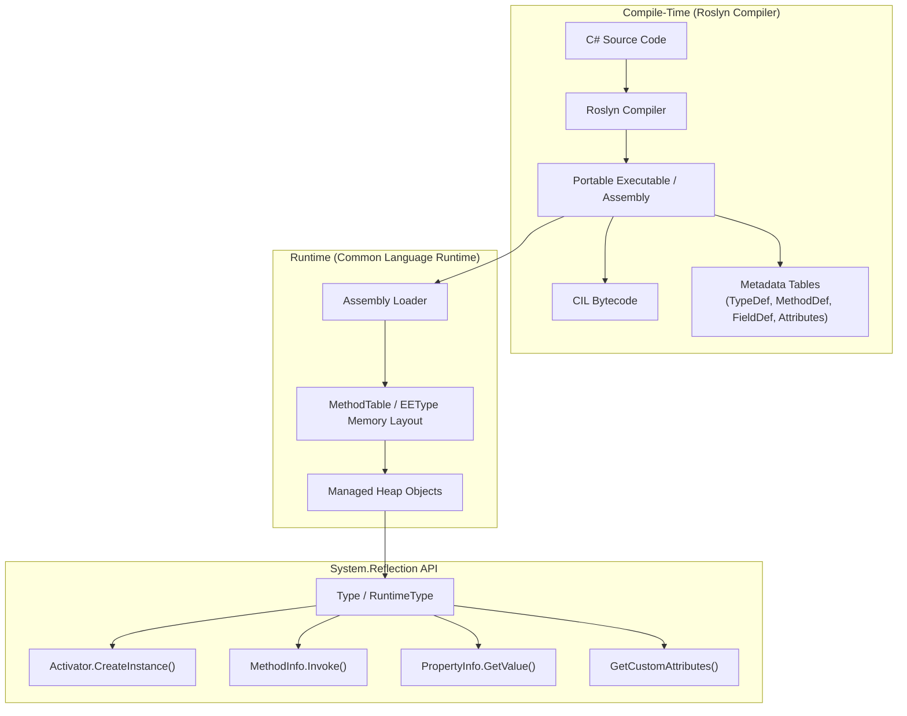

## Reflection
Reflection in C# is a powerful feature that allows you to inspect metadata about types, methods, properties, and events at runtime. It can be useful for a variety of tasks, such as dynamically creating instances of types, invoking methods, accessing properties, and even modifying them.

### Use Cases
Key Use Cases of Reflection
1. Dynamic Type Inspection: It helps in identifying the types within an assembly, including their methods, properties, constructors, and fields. For instance, you can retrieve the names and attributes of all methods in a class at runtime.

2. Late Binding: With reflection, you can create instances and invoke methods on types that are unknown at compile time. This is particularly useful in scenarios like plugin architectures where you load types from external libraries dynamically.

3. Attribute Inspection: Reflection can check custom attributes applied to classes, methods, or properties, allowing behaviors to change based on metadata (e.g., validating model properties marked with specific attributes).

4. Serialization and Deserialization: Reflection helps in serializing objects to formats like JSON or XML by accessing their properties and fields, even if their structure is unknown beforehand.

5. Automated Testing and Mocking: Reflection is commonly used in unit tests to mock objects, inspect private members, or test internal functionalities without exposing them publicly.

---

### Common Terms:
#### `Assembly`
Assemblies are compiled code libraries (.DLL or .EXE files). Reflection allows us to load assemblies at runtime, inspect their contents (types, resources), or dynamically execute code.
   1. Assembly.LoadFrom("Plugin.dll"): Loads an assembly given its name.
   2. Assembly.GetExecutingAssembly(): Gets the assembly that contains the code that is currently executing.
   3. Assembly.GetEntryAssembly(): Gets the assembly that is the entry point of the process (the assembly that contains the Main method).
   4. typeof(MyDbContext).Assembly: This method retrieves the assembly where the MyDbContext class is defined.


```c#
public static IServiceCollection AddApplication(
    this IServiceCollection services)
{
    services.AddScoped(
        typeof(IPipelineBehavior<,>),
        typeof(AuthenticationBehaviour<,>));

    services.AddMediatR(Assembly.GetExecutingAssembly());//or
    services.AddMediatR(cfg =>
        cfg.RegisterServicesFromAssembly(
            typeof(GetCarsHandler).Assembly
            )
        );

    return services;
}

// dbcontext
builder.ApplyConfiguration(new CarConfiguration());//individual

 builder.ApplyConfigurationsFromAssembly(Assembly.GetExecutingAssembly()); //or
 builder.ApplyConfigurationsFromAssembly(typeof(CarConfiguration).Assembly);
```
---

#### `Type`
In reflection, the Type class in .NET represents the metadata of a type `(class, interface, struct, enum, or delegate)`, and using the Type class allows you to inspect its `structure at runtime` (like its `methods, properties, constructors, fields, events, and attributes`).

   1. `typeof()` is used when the type is known at compile time.
   2. `object.GetType()` is called on an instance to get its runtime type.
   3. `Type.GetType()` retrieves a type using a string representation, and it requires the fully qualified name of the type, including the assembly if it's not in the `executing assembly or same assembly`.
   4. 

---

#### Dynamic Invocation and Late Binding:
Dynamic invocation and late binding in C# allow invoking members of a type at runtime without compile-time checks. This can be achieved through `dynamic types` or `reflection (MethodInfo.Invoke)`.
   1. `Activator.CreateInstance` dynamically creates an instance of the Person class.
   2. `GetMethod()` retrieves a method by name. BindingFlags.NonPublic | BindingFlags.Instance allows accessing private methods.
   3. `MethodInfo.Invoke` executes the method at runtime.

----

#### Attribute
In C#, attributes are a way to add metadata to your code elements (such as classes, methods, properties, etc.), providing additional information that can be accessed at runtime using reflection.

**Common Use Cases for Attributes**
   1. Metadata: Store extra information about your code elements (like versioning, authorship).
   2. Validation: Define validation rules for properties (e.g., data annotations in ASP.NET).
   3. Conditional Logic: Control behavior, such as specifying whether a method should be exposed via an API.
   4. Serialization: Customize how data is serialized/deserialized in JSON, XML, or other formats.

**Attribute Targets**<br>
The AttributeTargets enumeration specifies where an attribute can be applied, such as:
   1. AttributeTargets.Class
   2. AttributeTargets.Method
   3. AttributeTargets.Property
   4. AttributeTargets.Field

You specify the valid targets using `[AttributeUsage]` in the custom attribute definition.

---

#### Important Terms:
   1. **`Scan()`**: Scans the assembly for all classes that implement INotificationServiceFactory.
   2. **`AddClasses()`**: Adds classes that match the provided condition.
   3. **`AsImplementedInterfaces()`**: Registers them under the interfaces they implement.
   4. **`WithTransientLifetime()`**: Sets the lifetime of these services as Transient.
   

| **Method/Property** | **Purpose**                                    | **Example Use Case**                    |
|---------------------|-------------------------------------------------|-----------------------------------------|
| **TryGetValue**     | Safely retrieve a value from a dictionary       | `dict.TryGetValue(key, out value)`      |
| **GetType**         | Get the runtime type of an object               | `obj.GetType()`                         |
| **GetTypes**        | Get all types in an assembly                    | `assembly.GetTypes()`                   |
| **GetValues**       | Get all values from an enum                     | `Enum.GetValues(typeof(EnumType))`      |
| **GetValue**        | Get value of a field or property via reflection | `propertyInfo.GetValue(object)`         |
| **GetProperty**     | Get metadata for a property by name             | `person.GetType().GetProperty("Name")`  |


---
## Real Life Examples:
### A abstract factory method for invoking object dynamically:
For example it will dynamically add other features like `Email, Push, or other type of notifications` without alter object creation logics.
```c#
public interface INotificationFactory
{
    INotificationServiceFactory GetFactory(string notificationType);
}

public class NotificationFactory : INotificationFactory
{
    private readonly IEnumerable<INotificationServiceFactory> _factories;

    // Constructor injection using ASP.NET Core DI
    public NotificationFactory(IEnumerable<INotificationServiceFactory> factories)
    {
        _factories = factories;
    }

    // Returns the appropriate factory based on the notification type
    // this is also problematic as we used hard-coded strings
    public INotificationServiceFactory GetFactory(string notificationType)
    {
        return _factories.FirstOrDefault(f =>
            f.GetType().Name.Contains(notificationType, StringComparison.OrdinalIgnoreCase))
            ?? throw new ArgumentException("Invalid notification type.");
    }
}

//DI section
// Register individual notification factories, this is problematic
builder.Services.AddTransient<INotificationServiceFactory, EmailNotificationServiceFactory>();
builder.Services.AddTransient<INotificationServiceFactory, SMSNotificationServiceFactory>();
builder.Services.AddTransient<INotificationServiceFactory, PushNotificationServiceFactory>();

// Register the NotificationFactory itself
builder.Services.AddSingleton<INotificationFactory, NotificationFactory>();


// Create objects
var factory = scope.ServiceProvider.GetRequiredService<INotificationFactory>();
var emailFactory = factory.GetFactory("Email");
var emailService = emailFactory.CreateNotificationService();
emailService.Send("Hello from Email!");

```
However, the above code is not efficient in a case where `INotificationServiceFactory` will be inheritated many class and also .

Solution:
```c#
// Register all INotificationServiceFactory implementations with Scoped lifetime
builder.Services.Scan(scan => scan
    .FromAssemblyOf<INotificationServiceFactory>() // Scan the current assembly
    .AddClasses(classes => classes.AssignableTo<INotificationServiceFactory>())
    .AsImplementedInterfaces()
    .WithScopedLifetime() // Use Scoped lifetime instead of Transient
);
```

Remove the hard-coded string:
```c#
public class NotificationFactory : INotificationFactory
{
    private readonly IEnumerable<INotificationServiceFactory> _factories;

    public NotificationFactory(IEnumerable<INotificationServiceFactory> factories)
    {
        _factories = factories;
    }

//generic type
    public INotificationServiceFactory GetFactory<T>() where T : INotificationServiceFactory
    {
        return _factories.OfType<T>().FirstOrDefault()
            ?? throw new ArgumentException("Invalid notification factory type.");
    }
}

var factory = scope.ServiceProvider.GetRequiredService<INotificationFactory>();

var emailFactory = factory.GetFactory<EmailNotificationServiceFactory>();
var emailService = emailFactory.CreateNotificationService();
emailService.Send("Hello from Email!");
```

### ***`In the DB context Configuration:`***
```c#
builder.ApplyConfigurationsFromAssembly(Assembly.GetExecutingAssembly());
services.AddAutoMapper(Assembly.GetExecutingAssembly());
services.AddValidatorsFromAssembly(Assembly.GetExecutingAssembly());
services.AddMediatR(Assembly.GetExecutingAssembly());
services.AddScoped(typeof(IPipelineBehavior<,>), typeof(LoggingBehavior<,>));
```


# Deep-Dive Guide: C# Reflection & Runtime Metadata (Fully Paired Bilingual Guide)

---

## 1. English Definition & Concept
In C# and the .NET runtime, **Reflection** is the mechanism that allows code to inspect, query, and interact with its own metadata—or the metadata of other assemblies—at **runtime**. 

Through the **`System.Type`** class and the **`System.Reflection`** namespace, an application can dynamically:
1. **Inspect Metadata**: Discover loaded assemblies, modules, classes, interfaces, structs, enums, methods, properties, constructors, fields, events, and custom attributes.
2. **Late Binding & Dynamic Instantiation**: Create instances of types that were completely unknown at compile time (`Activator.CreateInstance`).
3. **Dynamic Invocation**: Invoke methods, access properties, and read/write private fields dynamically (`MethodInfo.Invoke`, `PropertyInfo.GetValue/SetValue`).
4. **Dynamic Code Emission**: Generate IL (Intermediate Language) byte code on the fly at runtime using `System.Reflection.Emit`.

Reflection transforms C# from a strictly static, compile-time language into a flexible runtime-extensible platform, serving as the foundational engine for modern frameworks like ASP.NET Core, Entity Framework Core, Dependency Injection containers, AutoMapper, MediatR, and JSON serializers.

---

## 2. Bangla Explanation (বাংলায় সহজ ব্যাখ্যা)
সহজ কথায়, **Reflection** হলো C# এবং .NET-এর একটি **"এক্স-রে (X-Ray) বা আয়না (Mirror)"**, যার মাধ্যমে প্রোগ্রাম চলাকালীন (Runtime-এ) কোড নিজের অথবা অন্য যেকোনো DLL ফাইলের ভেতরের রূপ ও গঠন দেখতে পারে।

সাধারণত C# একটি স্ট্রংলি-টাইপড (Strongly-Typed) ভাষা—অর্থাৎ কোন ক্লাসের কী নাম, কী মেথড আছে তা আগেই কোডে লিখে কম্পাইল করতে হয়। কিন্তু **Reflection** ব্যবহার করে আপনি:
1. **রানটাইমে টাইপ পর্যবেক্ষণ (Inspection)**: কোনো অবজেক্টের আসল ক্লাস কী, তাতে কী কী মেথড, প্রোপার্টি, বা প্রাইভেট ভ্যারিয়েবল আছে তা স্ক্যান করে বের করতে পারেন।
2. **ডাইনামিক ইনস্ট্যান্স তৈরি (Late Binding)**: কোড লেখার সময় যে ক্লাসের নাম আপনি জানতেনই না (যেমন প্লাগইন বা এক্সটার্নাল DLL), রানটাইমে তার অবজেক্ট তৈরি করতে পারেন (`Activator.CreateInstance`)।
3. **প্রাইভেট মেম্বার অ্যাক্সেস ও মেথড কল**: অ্যাক্সেস মডিফায়ার (`private`) বাইপাস করে মেথড ইনভোক করা বা ভ্যালু রিড/রাইট করা সম্ভব।
4. **অ্যাট্রিবিউট রিডিং**: ক্লাসের বা মেথডের মাথায় লাগানো কাস্টম অ্যাট্রিবিউট (`[Authorize]`, `[CustomValidation]`) রানটাইমে পড়ে সেই অনুযায়ী সিদ্ধান্ত নিতে পারেন।

---

## 3. Why It Exists (কেন তৈরি করা হয়েছে?)

### English:
Without Reflection, C# would be an inflexible, closed-world language where every single type, method call, and relationship must be hard-coded at compile time. 

Reflection was built to solve several critical enterprise architectural challenges:
1. **Elimination of Giant Factory Switch Statements**: Without reflection, resolving implementations in Dependency Injection would require massive, unmaintainable `switch` blocks mapping string names to concrete types.
2. **Plugin & Extensible Architectures**: Applications can load external `.dll` files dropped into a folder at runtime without recompiling the main application.
3. **Framework & ORM Automation**:
   - **ASP.NET Core**: Uses reflection to scan controllers, discover action methods, match HTTP routes, and bind incoming parameters.
   - **Entity Framework Core**: Inspects entity classes to discover primary keys, navigation properties, and map them to SQL tables.
   - **JSON Serializers (`System.Text.Json`, `Newtonsoft.Json`)**: Recursively read object properties to convert them into JSON strings and vice versa.
4. **Unit Testing & Mocking Frameworks**: Tools like Moq, xUnit, and NUnit rely on reflection to discover `[Fact]` test methods and instantiate mock interfaces.

### বাংলায় কারণ:
Reflection না থাকলে C# হতো অত্যন্ত অনমনীয় (Inflexible)। এটি তৈরি করার প্রধান কারণসমূহ:
1. **বিশাল সুইচক্যাস (Switch-Case) পরিহার**: ডিপেনডেন্সি ইনজেকশন বা অবজেক্ট তৈরির জন্য শত শত লাইনের ম্যানুয়াল ফ্যাক্টরি কোড লিখতে হতো।
2. **প্লাগইন আর্কিটেকচার**: মূল অ্যাপ্লিকেশন রি-কম্পাইল না করেই বাইরের নতুন কোনো `.dll` ফাইল ফোল্ডারে পেস্ট করে অ্যাপ রান করা অবস্থায় লোড করা সম্ভব হতো না।
3. **ফ্রেমওয়ার্ক ও ওআরএম (ORM) অটোমেশন**:
   - **ASP.NET Core**: নিজে নিজেই কন্ট্রোলার খুঁজে বের করে, রাউট চেনে এবং ফিল্টার চালায় Reflection-এর মাধ্যমে।
   - **Entity Framework Core**: C# ক্লাসের প্রোপার্টি দেখে ডেটাবেজের টেবিল ও কলাম ম্যাপ করতে পারে।
   - **JSON Serialization**: কোনো অবজেক্টের কী কী ফিল্ড আছে তা রানটাইমে স্ক্যান করে স্বয়ংক্রিয়ভাবে JSON বানাতে পারে।
4. **টেস্টিং ফ্রেমওয়ার্ক**: xUnit বা NUnit মেথডের মাথায় `[Test]` বা `[Fact]` অ্যাট্রিবিউট পড়ে স্বয়ংক্রিয়ভাবে টেস্ট রান করে।

---

## 4. How It Works Under The Hood (অভ্যন্তরীণ মেকানিজম / CLR Internals)

### 1. Metadata Tables in Portable Executable (PE) Files
When you compile C# code into a `.dll` or `.exe`, the Roslyn compiler embeds two things:
1. **CIL (Common Intermediate Language)**: The executable byte-code.
2. **Metadata Tables**: Comprehensive relational databases describing every type, method, parameter, and attribute in that binary.
   - `TypeDef` Table: Lists all classes, structs, enums, interfaces, and their base classes.
   - `MethodDef` Table: Lists method names, signatures, return types, and parameter flags.
   - `FieldDef` & `PropertyMap` Tables: Lists fields and properties.
   - `CustomAttribute` Table: Maps attributes to the target metadata token.

```
┌────────────────────────────────────────────────────────┐
│             Compiled Assembly (.DLL / .EXE)            │
│ ┌────────────────────────────────────────────────────┐ │
│ │                  Metadata Tables                   │ │
│ │  - TypeDef (Token: 0x02000001 -> Product)          │ │
│ │  - MethodDef (Token: 0x06000015 -> CalculateTotal) │ │
│ │  - CustomAttribute (Token: 0x0C000003 -> [Key])    │ │
│ └────────────────────────────────────────────────────┘ │
│ ┌────────────────────────────────────────────────────┐ │
│ │            CIL (Intermediate Language)             │ │
│ │  IL_0000: ldarg.0                                  │ │
│ │  IL_0001: ldfld int32 Product::_price              │ │
│ └────────────────────────────────────────────────────┘ │
└────────────────────────────────────────────────────────┘
```

### 2. Runtime Type Handles & `EEType` / `MethodTable`
When the CLR loads an assembly into memory:
- For every type, the CLR builds an internal data structure called a **`MethodTable`** (or `EEType` in CoreCLR / Native AOT).
- An object on the managed Heap has a 8-byte (64-bit) header pointing to its `MethodTable`.
- Calling `typeof(T)` or `obj.GetType()` returns an instance of **`System.RuntimeType`** (the internal implementation of `System.Type`), which is a managed wrapper around the native `MethodTable*` pointer.

### 3. Why is Reflection Slow? (The 4 Overhead Traps)
Calling `methodInfo.Invoke(instance, args)` is typically **10x to 100x slower** than a direct compile-time C# method call (`instance.Method()`). Here is why:

1. **Security & Access Validation**: On every invoke, the CLR checks visibility rules (e.g., verifying if private members can be accessed).
2. **Argument Array Allocation**: `Invoke()` accepts an `object[]`. If you pass 3 arguments, a new array is allocated on the Heap, generating GC pressure.
3. **Boxing & Unboxing**: If arguments or return values are Value Types (`int`, `DateTime`, `struct`), they must be boxed into `object` and unboxed back.
4. **No JIT Inlining**: The JIT compiler cannot inline a dynamic reflection call; it must resolve the function pointer via indirect call trampolines.

### 4. Modern High-Performance Alternatives
To achieve high performance without compile-time coupling, senior .NET architects avoid raw `MethodInfo.Invoke` in hot execution paths:
- **Compiled Expression Trees (`Expression.Compile()`)**: Generates an in-memory delegate that runs at native speed.
- **DynamicMethod & `ILGenerator`**: Emits raw IL instructions directly into memory.
- **Source Generators (C# 9+)**: Replaces runtime reflection with compile-time Roslyn code generation (Zero runtime overhead, Native AOT friendly!).

---

## 5. Built-in Types & Simple Example (বিল্ট-ইন টাইপ ও সহজ উদাহরণ)

### Core Built-in Types in `System.Reflection`

| Built-in Type | Namespace | English Description | বাংলায় ভূমিকা |
| :--- | :--- | :--- | :--- |
| **`Type`** | `System` | Root class representing type metadata (class, interface, struct, enum). | যেকোনো ক্লাসের মেটাডেটা ধারণকারী প্রধান ক্লাস। |
| **`Assembly`** | `System.Reflection` | Represents a compiled reusable library (.dll/.exe). | কম্পাইল করা লাইব্রেরি (.dll) লোড ও স্ক্যান করার ক্লাস। |
| **`MethodInfo`** | `System.Reflection` | Discovers method signature, return type, and enables execution (`Invoke`). | কোনো মেথডের মেটাডেটা ও তা রান করার মাধ্যম। |
| **`PropertyInfo`** | `System.Reflection` | Inspects getter/setter properties and enables reading/writing values. | ক্লাসের প্রোপার্টির মান পড়া (`GetValue`) ও লেখার (`SetValue`) ক্লাস। |
| **`FieldInfo`** | `System.Reflection` | Accesses backing fields, including `private` and `readonly` fields. | ক্লাসের প্রাইভেট/পাবলিক ফিল্ড সরাসরি অ্যাক্সেস করার ক্লাস। |
| **`ConstructorInfo`**| `System.Reflection` | Discovers constructors and instantiates objects dynamically. | কনস্ট্রাক্টর চিনে নতুন অবজেক্ট বানানোর মাধ্যম। |
| **`BindingFlags`** | `System.Reflection` | Enum bitmask specifying search filters (Public, NonPublic, Instance, Static). | মেম্বার খোঁজার ফিল্টার (পাবলিক, প্রাইভেট, স্ট্যাটিক ইত্যাদি)। |
| **`Activator`** | `System` | Utility class to instantiate types dynamically (`Activator.CreateInstance`). | রানটাইমে অবজেক্ট তৈরি করার ইউটিলিটি। |

---

### Self-Contained Practical Example: Inspection, Private Access & Invocation

```csharp
using System;
using System.Reflection;

public class Employee
{
    public string Name { get; set; }
    private readonly decimal _salary; // Private and readonly!

    public Employee(string name, decimal salary)
    {
        Name = name;
        _salary = salary;
    }

    private string CalculateBonus(decimal percentage)
    {
        return $"Bonus: ${(_salary * percentage):F2}";
    }
}

public class Program
{
    public static void Main()
    {
        // 1. Discover Type via typeof()
        Type empType = typeof(Employee);
        Console.WriteLine($"Type Name: {empType.FullName}");

        // 2. Instantiate dynamically via Activator
        object instance = Activator.CreateInstance(empType, "Rahim", 50000m)!;

        // 3. Inspect and read a PRIVATE field via BindingFlags
        FieldInfo salaryField = empType.GetField("_salary", 
            BindingFlags.NonPublic | BindingFlags.Instance)!;
        
        decimal salaryValue = (decimal)salaryField.GetValue(instance)!;
        Console.WriteLine($"Extracted Private Salary: ${salaryValue}");

        // 4. Invoke a PRIVATE method dynamically
        MethodInfo bonusMethod = empType.GetMethod("CalculateBonus", 
            BindingFlags.NonPublic | BindingFlags.Instance)!;
        
        // Invoke takes target instance and object[] parameters
        object result = bonusMethod.Invoke(instance, new object[] { 0.10m })!;
        Console.WriteLine(result); // Output: Bonus: $5000.00
    }
}
```

---

## 6. Real-World Production Examples (বাস্তব প্রোডাকশন উদাহরণ)

### Production Scenario 1: Automatic Assembly Scanning for Dependency Injection
In modern microservices, developers often avoid manually registering dozens of repository and service interfaces by using assembly scanning:

```csharp
public static class DependencyInjectionExtensions
{
    public static IServiceCollection AddRepositoriesFromAssembly(this IServiceCollection services, Assembly assembly)
    {
        // 1. Scan assembly for all non-abstract classes
        var repositoryTypes = assembly.GetTypes()
            .Where(t => t.IsClass && !t.IsAbstract)
            .Select(t => new
            {
                Implementation = t,
                Interface = t.GetInterfaces().FirstOrDefault(i => i.Name == $"I{t.Name}")
            })
            .Where(t => t.Interface != null);

        // 2. Register each matching pair dynamically
        foreach (var repo in repositoryTypes)
        {
            services.AddScoped(repo.Interface!, repo.Implementation);
        }

        return services;
    }
}
```
* **Why it's used**: Follows the Open/Closed Principle. When a developer creates `ProductRepository : IProductRepository`, it is automatically discovered and registered into the DI container with zero configuration in `Program.cs`.

---

### Production Scenario 2: High-Performance Property Accessor using Compiled Expression Trees
Instead of slow `PropertyInfo.GetValue()` in hot loops (e.g., ORM mapping or serialization), senior engineers compile an in-memory delegate:

```csharp
using System;
using System.Linq.Expressions;
using System.Reflection;

public static class FastPropertyAccessor
{
    // Compiles a strongly-typed delegate: (target) => target.PropertyName
    public static Func<TTarget, TProperty> CreateGetter<TTarget, TProperty>(string propertyName)
    {
        var targetParam = Expression.Parameter(typeof(TTarget), "target");
        var propertyAccess = Expression.Property(targetParam, propertyName);
        var lambda = Expression.Lambda<Func<TTarget, TProperty>>(propertyAccess, targetParam);

        // Compiles IL in memory -> Runs at identical speed to direct C# access!
        return lambda.Compile();
    }
}

// Benchmark comparison:
// PropertyInfo.GetValue(obj) -> ~150 nanoseconds (with boxing)
// compiledGetter(obj)         -> ~2 nanoseconds (equivalent to direct obj.Property!)
```

---

## 7. Visual Diagram (ডায়াগ্রাম)

### Reflection Architecture & Lifecycle Flow



---

## 8. Common Mistakes & Gotchas (সাধারণ ভুল ও ফাঁদ)

### ⚠️ Pitfall 1: Using Raw Reflection in Hot Execution Paths
- **English**: Calling `PropertyInfo.GetValue()` or `MethodInfo.Invoke()` inside loops that process thousands or millions of records per second creates massive CPU bottlenecks and GC pressure due to argument boxing and array allocations.
- **বাংলায় ফাঁদ**: লুপের ভেতরে (যেখানে হাজার হাজার ডেটা প্রসেস হচ্ছে) প্রতিবার রিফ্লেকশন মেথড কল করলে অ্যাপ মারাত্মক স্লো হয়ে যাবে এবং মেমোরিতে প্রচুর গার্বেজ তৈরি হবে।
- **Senior Solution (সিনিয়র সমাধান)**: Cache reflection metadata, or compile an Expression Tree (`Expression.Compile()`) into a reusable delegate. Better yet, in modern .NET 8/9, prefer **C# Source Generators**.

---

### ⚠️ Pitfall 2: `TargetInvocationException` Masking Real Errors
- **English**: When a method invoked via `MethodInfo.Invoke` throws an exception, the CLR wraps it inside a **`TargetInvocationException`**. Developers logging only `ex.Message` fail to see the actual domain exception and stack trace!
- **বাংলায় ফাঁদ**: রিফ্লেকশন দিয়ে মেথড কল করলে ভেতরে কোনো এরর হলে সি-শার্প তাকে `TargetInvocationException` দিয়ে মুড়িয়ে ফেলে। ফলে আসল এরর মেসেজ দেখা যায় না।
- **Senior Solution (সিনিয়র সমাধান)**: Always inspect `ex.InnerException`:
  ```csharp
  try
  {
      method.Invoke(instance, null);
  }
  catch (TargetInvocationException ex)
  {
      // Log the true underlying error:
      logger.LogError(ex.InnerException ?? ex, "Real error occurred");
      throw ex.InnerException ?? ex;
  }
  ```

---

### ⚠️ Pitfall 3: Native AOT (Ahead-Of-Time) and Trimming Incompatibility
- **English**: In modern .NET 7/8/9 with Native AOT compilation, the trimming tool removes unreferenced types and strips metadata to minimize binary size. Dynamic calls like `Type.GetType(stringName)` or unbounded reflection will fail at runtime because the types were pruned!
- **বাংলায় ফাঁদ**: Native AOT বা Trimming ব্যবহার করলে কম্পাইলার অপ্রয়োজনীয় মেটাডেটা মুছে ফেলে। রানটাইমে স্ট্রিং দিয়ে রিফ্লেকশন খুঁজতে গেলে ক্র্যাশ করবে।
- **Senior Solution (সিনিয়র সমাধান)**: Annotate dynamic methods with code attributes like `[DynamicallyAccessedMembers]` or use compile-time **Source Generators** instead of runtime reflection.

---

### ⚠️ Pitfall 4: Modifying `readonly` Fields via Reflection
- **English**: While Reflection allows calling `fieldInfo.SetValue()` on a `readonly` field, doing so after an object is constructed can lead to undefined behavior, broken invariants, and subtle bugs if the JIT compiler has already inlined or optimized the field value.
- **বাংলায় ফাঁদ**: রিফ্লেকশন দিয়ে `readonly` ফিল্ডের মান পরিবর্তন করা সম্ভব হলেও, JIT অপ্টিমাইজেশনের কারণে তা মারাত্মক বাগ তৈরি করতে পারে।
- **Senior Solution (সিনিয়র সমাধান)**: Never mutate `readonly` fields via reflection in production code.

---

## 9. Interview Perspective: Top Tricky Q&As (ইন্টারভিউ প্রস্তুতি)

### Q1: What is the difference between `typeof(T)`, `obj.GetType()`, and `Type.GetType(string)`?
- **English Pitch**: 
  - `typeof(T)` is a compile-time operator resolved at compilation; it is fastest and requires the type to be known statically.
  - `obj.GetType()` is a runtime virtual method on `System.Object`; it inspects the actual runtime type of an allocated instance, honoring polymorphism.
  - `Type.GetType("Namespace.TypeName")` looks up a type dynamically by its string name at runtime; it is slowest and requires the assembly-qualified name if the type is in another assembly.
- **বাংলায় ব্যাখ্যা**:
  - `typeof(T)` কম্পাইল-টাইমে কাজ করে, সবচেয়ে দ্রুত এবং টাইপ আগে থেকেই জানা থাকতে হয়।
  - `obj.GetType()` মেমোরিতে থাকা অবজেক্টের ওপর কল হয় এবং রানটাইমে তার প্রকৃত টাইপ বের করে (পলিমরফিজম সাপোর্ট করে)।
  - `Type.GetType("String")` স্ট্রিং নাম পড়ে রানটাইমে টাইপ খোঁজে; সবচেয়ে ধীরগতির এবং ভিন্ন DLL-এ থাকলে অ্যাসেম্বলি নাম সহ দিতে হয়।

---

### Q2: Why is Reflection slow, and how do modern .NET libraries optimize it?
- **English Pitch**: Reflection is slow because it incurs security verification checks, parameter array (`object[]`) allocations, boxing/unboxing for value types, and cannot be inlined by the JIT compiler. Modern frameworks optimize this by caching `MethodInfo`/`PropertyInfo`, using **Compiled Expression Trees** (`Expression.Compile()`), emitting direct IL via `DynamicMethod`, or utilizing **C# Source Generators** to do all the work at compile time.
- **বাংলায় ব্যাখ্যা**: রিফ্লেকশনে প্রতিবার সিকিউরিটি চেক হয়, প্যারামিটারের জন্য `object[]` মেমোরি লাগে, ভ্যালু টাইপ বক্সিং হয় এবং JIT অপ্টিমাইজেশন করতে পারে না। আধুনিক ফ্রেমওয়ার্কগুলো মেটাডেটা ক্যাশ করে রাখে, অথবা **Expression Tree** কম্পাইল করে নেটিভ স্পিডে মেথড রান করে।

---

### Q3: How do C# Source Generators differ from Reflection?
- **English Pitch**: Reflection inspects metadata dynamically at **runtime** with memory and CPU overhead. Source Generators run at **compile-time** within the Roslyn compiler; they inspect code syntax trees and generate regular C# code before compilation finishes. This yields zero runtime overhead, instant startup times, and 100% compatibility with Native AOT.
- **বাংলায় ব্যাখ্যা**: Reflection কাজ করে **রানটাইমে**, যার ফলে অ্যাপের গতি কমে। অন্যদিকে Source Generator কাজ করে **কম্পাইল-টাইমে**—কোড কম্পাইল হওয়ার সময়ই সে নতুন কোড লিখে ফেলে। ফলে রানটাইমে কোনো বাড়তি প্রসেসর বা মেমোরি খরচ হয় না।

---

### Q4: Can Reflection access `private` and `protected` members?
- **English Pitch**: Yes, by passing `BindingFlags.NonPublic | BindingFlags.Instance` (or `BindingFlags.Static`) to reflection discovery methods (`GetMethod`, `GetField`, `GetProperty`).
- **বাংলায় ব্যাখ্যা**: হ্যাঁ, `BindingFlags.NonPublic` ফ্ল্যাগ ব্যবহার করে যেকোনো ক্লাসের প্রাইভেট ফিল্ড বা মেথড খুঁজে বের করা এবং অ্যাক্সেস করা সম্ভব।

---

## 10. Architectural Comparison Matrix

| Feature | Static Direct Call | Reflection (`MethodInfo.Invoke`) | Compiled Expression Tree | C# Source Generator |
| :--- | :--- | :--- | :--- | :--- |
| **Execution Phase** | Compile-time | Runtime | Runtime (Compiled once) | Compile-time |
| **Execution Speed** | Fastest (~1-2 ns) | Slowest (~100-200 ns) | Near-Native (~2-3 ns) | Fastest (~1-2 ns) |
| **GC Allocations** | Zero | High (`object[]` + Boxing) | Zero (after compilation) | Zero |
| **Native AOT Friendly**| ✅ 100% | ❌ High risk (Pruned) | ⚠️ Partial | ✅ 100% |
| **Dynamism** | None | Full | High | Pre-defined |

---

## 📂 Related Documentation Links
- Reflection Implementation Code: [`ReflectionBasic/Program.cs`](file:///Users/limon/interview/c-sharp-prep/ReflectionBasic/Program.cs)
- CLR Runtime Internals: [`docs/CLR.md`](file:///Users/limon/interview/c-sharp-prep/docs/CLR.md)
- Memory Management & GC: [`docs/memory_management.md`](file:///Users/limon/interview/c-sharp-prep/docs/memory_management.md)
- Web API & Backend Concepts: [`docs/Backend.Prep.md`](file:///Users/limon/interview/c-sharp-prep/docs/Backend.Prep.md)
- Repository Table of Contents: [`Readme.md`](file:///Users/limon/interview/c-sharp-prep/Readme.md)
