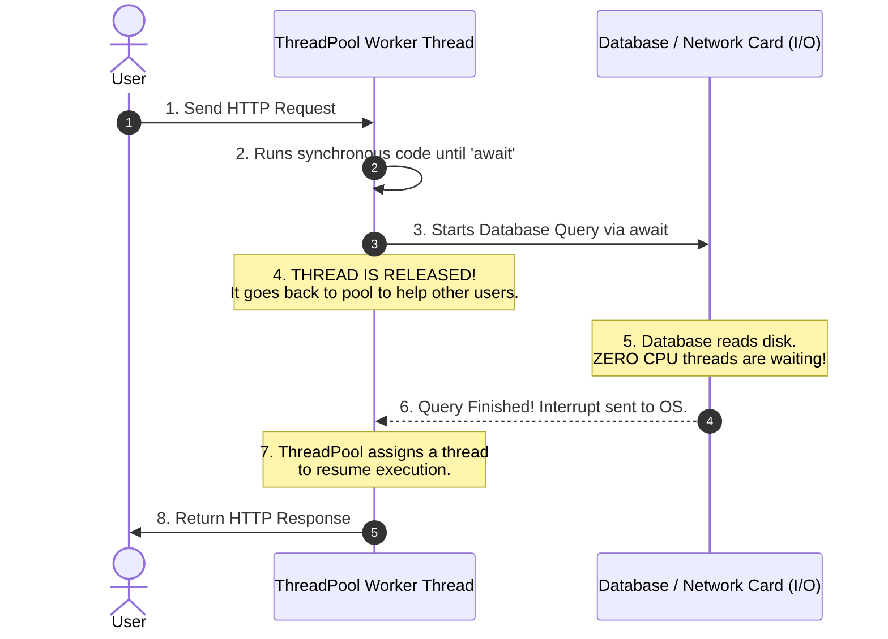

# Deep-Dive Guide: Task-Based Asynchronous Programming in C# (Simple & Clear Bilingual Guide)

---

## 1. English Definition & Concept
In C#, a **`Task`** represents an asynchronous operation. 

Think of a `Task` like a **promise or a receipt** for future work:
- When you start a task, your program does not stop and wait.
- The calling thread stays free to do other work.
- When the background job completes, the `Task` gives you the final result.

There are two main types:
1. **`Task`**: Represents a job that returns **no value** (like an async `void`).
2. **`Task<T>`**: Represents a job that returns a **result of type `T`** (like `Task<string>` or `Task<int>`).

---

## 2. Bangla Explanation (বাংলায় সহজ ব্যাখ্যা)
সহজ কথায়, **`Task`** হলো একটি **"রিসিট বা টোকেন"**-এর মতো।

ধরুন, আপনি রেস্টুরেন্টে গিয়ে কফি অর্ডার করলেন:
- ওয়েটার আপনাকে একটি টোকেন (Task) দিয়ে বলল, "কফি তৈরি হলে ডেকে নেব।"
- আপনি কাউন্টারে ঠায় দাঁড়িয়ে না থেকে নিজের চেয়ারে বসে ফোন ব্যবহার করতে পারেন (আপনার থ্রেড ফ্রি থাকে)।
- কফি তৈরি হয়ে গেলে আপনি টোকেন জমা দিয়ে কফি বুঝে নেন (`await`)।

C#-এ প্রধানত দুই ধরনের টাস্ক থাকে:
1. **`Task`**: যে কাজ কোনো মান ফেরত দেয় না (যেমন: ফাইলে লগ লেখা)।
2. **`Task<T>`**: যে কাজ শেষ হলে নির্দিষ্ট ডেটা ফেরত দেয় (যেমন: `Task<User>` ডাটাবেজ থেকে ইউজার এনে দেয়)।

---

## 3. Why It Exists (কেন তৈরি করা হয়েছে?)

### English:
Before `Task`, developers used raw **`Thread`** or `ThreadPool.QueueUserWorkItem`. That old way had big problems:

1. **Threads are heavy**: Each OS thread takes about **1 MB of memory**. Creating hundreds of threads quickly crashes the server.
2. **Hard to return values**: A raw thread does not have an easy way to return a value back to the caller.
3. **Hard to know when work finishes**: Waiting for 5 threads to finish required complex synchronization code (`ManualResetEvent`).
4. **Error handling was painful**: If a thread threw an exception, it often crashed the entire application.

### Why `Task` is better:
- **Lightweight**: Tasks do not create a new OS thread every time. They reuse existing worker threads from the .NET `ThreadPool`.
- **Easy Results**: You simply use the **`await`** keyword to get the result.
- **Easy Composition**: You can easily run multiple tasks together using **`Task.WhenAll()`** or **`Task.WhenAny()`**.
- **Safe Exceptions**: Errors are safely captured in the `Task` and thrown where you write `await`.

---

### বাংলায় কারণ:
`Task` আসার আগে ডেভেলপাররা সরাসরি **`Thread`** ব্যবহার করতেন। এতে কিছু মারাত্মক সমস্যা হতো:

1. **থ্রেড অনেক ভারী**: প্রতিটি থ্রেড প্রায় **১ মেগাবাইট মেমোরি** নেয়। এক হাজার থ্রেড চালু করলে সার্ভার মেমোরির অভাবে ক্র্যাশ করত।
2. **রেজাল্ট পাওয়া কঠিন ছিল**: থ্রেড কাজ শেষ করে সরাসরি কোনো মান রিটার্ন করতে পারত না।
3. **একাধিক থ্রেড ট্র্যাক করা কঠিন ছিল**: ৫টি থ্রেডের কাজ একসাথে শেষ হলো কিনা তা জানার কোড ছিল খুব জটিল।
4. **ক্র্যাশ করত**: থ্রেডের ভেতর কোনো এরর হলে পুরো অ্যাপ্লিকেশন বন্ধ হয়ে যেত।

### `Task` কীভাবে সমাধান করে:
- **অল্প মেমোরি খরচ**: এটি নতুন থ্রেড না বানিয়ে .NET-এর `ThreadPool`-এর থ্রেড পুনরায় ব্যবহার করে।
- **সহজে রেজাল্ট পাওয়া**: শুধু **`await`** লিখলেই ফলাফল পাওয়া যায়।
- **সহজে সমন্বয়**: `Task.WhenAll()` দিয়ে খুব সহজে ১০টি টাস্ক একসাথে রান করা যায়।
- **নিরাপদ এরর হ্যান্ডলিং**: টাস্কের ভেতরের এরর অ্যাপ্লিকেশন ক্র্যাশ না করে নিরাপদে `try/catch`-এ ধরা পড়ে।

---

## 4. How It Works Under The Hood (অভ্যন্তরীণ মেকানিজম / Internals)

### 1. The Async State Machine
When you mark a method with `async` and use `await`, the C# compiler does something clever:
- It transforms your method into a hidden **State Machine** (`IAsyncStateMachine`).
- It cuts your method into pieces at every `await` line.

Here is the exact lifecycle:
1. Your method runs normally until it hits **`await`**.
2. If the task is already finished, it keeps running without stopping.
3. If the task is still running, it **pauses your method** and saves its local variables.
4. It **frees the current thread** so it can serve other users.
5. When the task finishes, a ThreadPool thread picks up your method and resumes right where it left off!

---

### 2. I/O-Bound vs. CPU-Bound Operations
This is the most important concept in asynchronous programming:

| Type | What is happening? | Are threads used while waiting? | How to write it? |
| :--- | :--- | :--- | :--- |
| **I/O-Bound** | Reading a file, querying a database, calling an external HTTP API. | **NO threads are used!** The network card or disk hardware does the waiting (IOCP). | Use native async APIs: `client.GetAsync()`, `db.SaveChangesAsync()`. |
| **CPU-Bound** | Heavy math calculations, image resizing, decrypting large files. | **YES.** A ThreadPool thread stays busy running CPU instructions. | Use: `Task.Run(() => Calculate())`. |

> **Key Rule**: Never use `Task.Run()` for I/O operations (like database calls). It wastes a thread for no reason!

---

## 5. Built-in Types & Simple Example (বিল্ট-ইন টাইপ ও সহজ উদাহরণ)

### Key Framework Types:

1. **`Task`**: An async job with no return value.
2. **`Task<T>`**: An async job that returns a value of type `T`.
3. **`ValueTask<T>`**: A lightweight struct on the Stack. It saves memory when a result is already available in cache without needing an async wait.
4. **`CancellationToken`**: An object passed to tasks to cancel them gracefully when a user aborts a request.
5. **`Task.WhenAll`**: Waits for all tasks in a list to finish concurrently.
6. **`Task.WhenAny`**: Continues as soon as the first task finishes.

---

### Clear Code Example:

```csharp
using System;
using System.Net.Http;
using System.Threading;
using System.Threading.Tasks;

public class TaskDemo
{
    private static readonly HttpClient _httpClient = new HttpClient();

    // 1. Task that returns no value (Task)
    public static async Task SaveLogAsync(string message)
    {
        await Task.Delay(100); // Simulates fast async I/O
        Console.WriteLine($"Log saved: {message}");
    }

    // 2. Task that returns a value (Task<T>) with Cancellation support
    public static async Task<string> FetchUrlContentAsync(string url, CancellationToken cancellationToken)
    {
        // Zero threads are blocked while the network request is in flight!
        HttpResponseMessage response = await _httpClient.GetAsync(url, cancellationToken);
        return await response.Content.ReadAsStringAsync(cancellationToken);
    }

    // 3. Running multiple tasks together (Task.WhenAll)
    public static async Task RunParallelTasksAsync()
    {
        Task<int> taskA = FetchNumberFromDatabaseAsync(1);
        Task<int> taskB = FetchNumberFromDatabaseAsync(2);

        // Both database queries run at the same time!
        int[] results = await Task.WhenAll(taskA, taskB);

        Console.WriteLine($"Total: {results[0] + results[1]}");
    }

    private static async Task<int> FetchNumberFromDatabaseAsync(int id)
    {
        await Task.Delay(500); // Simulate database delay
        return id * 10;
    }
}
```

---

## 6. Real-World Production Example: E-Commerce Product Page

In an online store, a product page needs:
1. Product Information (from SQL Database).
2. Customer Reviews (from Reviews Service).
3. Stock Inventory (from Warehouse API).

If we run them one by one, it takes: $200\text{ms} + 200\text{ms} + 200\text{ms} = 600\text{ms}$.  
If we run them together with **`Task.WhenAll`**, it takes only **$200\text{ms}$** total!

```csharp
public class ProductService
{
    public async Task<ProductDetailsDto> GetProductPageAsync(int productId, CancellationToken ct)
    {
        // Start all three requests concurrently (at the same time)
        Task<Product> productTask = GetProductDetailsAsync(productId, ct);
        Task<List<Review>> reviewsTask = GetReviewsAsync(productId, ct);
        Task<int> stockTask = GetStockCountAsync(productId, ct);

        // Wait for all 3 tasks to complete together without blocking any thread
        await Task.WhenAll(productTask, reviewsTask, stockTask);

        // Combine the results
        return new ProductDetailsDto
        {
            Product = await productTask,
            Reviews = await reviewsTask,
            StockCount = await stockTask
        };
    }

    private async Task<Product> GetProductDetailsAsync(int id, CancellationToken ct)
    {
        await Task.Delay(200, ct); // Simulates DB query
        return new Product { Id = id, Name = "Laptop" };
    }

    private async Task<List<Review>> GetReviewsAsync(int id, CancellationToken ct)
    {
        await Task.Delay(200, ct); // Simulates API call
        return new List<Review> { new Review { Comment = "Great laptop!" } };
    }

    private async Task<int> GetStockCountAsync(int id, CancellationToken ct)
    {
        await Task.Delay(200, ct); // Simulates Inventory service
        return 15;
    }
}
```

---

## 7. Visual Diagram (ডায়াগ্রাম)

### How `await` Releases the Thread



---

## 8. Common Mistakes & Gotchas (সাধারণ ভুল ও ফাঁদ)

### ⚠️ Pitfall 1: Using `.Result` or `.Wait()` (Sync-Over-Async Deadlock)
- **English**: Calling `.Result` or `.Wait()` blocks the current thread until the task finishes. In ASP.NET or UI applications, this causes **Deadlocks** and drains the ThreadPool (Thread Starvation).
- **বাংলায় ফাঁদ**: `await`-এর বদলে `.Result` বা `.Wait()` ব্যবহার করলে থ্রেড ব্লক হয়ে বসে থাকে। এর ফলে অ্যাপ্লিকেশন ফ্রিজ হয়ে যায় বা ডেডলক ঘটে।
- **Senior Solution**: Always use **`await`** all the way up the call chain:
  ```csharp
  // ❌ BAD: Blocks thread, risks deadlocks!
  var data = GetDataAsync().Result;

  // ✅ GOOD: Releases thread cleanly!
  var data = await GetDataAsync();
  ```

---

### ⚠️ Pitfall 2: Using `async void` (Fire-and-Forget Disaster)
- **English**: Never write `public async void DoWork()`. You can never `await` an `async void` method. If an exception occurs inside it, it cannot be caught by `try/catch` and **crashes the entire process**.
- **বাংলায় ফাঁদ**: ইভেন্ট হ্যান্ডলার ছাড়া কখনোই `async void` লিখবেন না। এতে কোনো এরর হলে তা ধরা যায় না এবং পুরো অ্যাপ্লিকেশন ক্র্যাশ করে।
- **Senior Solution**: Always return **`Task`** instead of `void`:
  ```csharp
  // ❌ BAD: Unhandled exceptions crash the entire server!
  public async void SaveDataAsync() { ... }

  // ✅ GOOD: Can be awaited and safely caught in try/catch!
  public async Task SaveDataAsync() { ... }
  ```

---

### ⚠️ Pitfall 3: Forgetting `CancellationToken`
- **English**: If a client closes their browser tab or cancels a search, an API that ignores `CancellationToken` keeps running heavy database queries anyway, wasting server resources.
- **বাংলায় ফাঁদ**: ইউজার ব্রাউজার কেটে দিলেও সার্ভার ব্যাকগ্রাউন্ডে বড় কোয়েরি চালিয়ে যায় যদি `CancellationToken` পাস না করা হয়।
- **Senior Solution**: Always accept and forward `CancellationToken` to all async database and HTTP calls.

---

### ⚠️ Pitfall 4: Using `Task.Run` for I/O Operations
- **English**: Wrapping a database or HTTP call in `Task.Run(() => client.GetStringAsync(...))` is an anti-pattern. It steals a ThreadPool thread just to wait for another I/O operation.
- **বাংলায় ফাঁদ**: ডাটাবেজ বা নেটওয়ার্ক কলের জন্য `Task.Run` ব্যবহার করবেন না। এতে কোনো লাভ হয় না, উল্টো একটি থ্রেড অপচয় হয়।
- **Senior Solution**: Directly `await` the I/O method without `Task.Run`.

---

## 9. Interview Perspective: Top Tricky Q&As (ইন্টারভিউ প্রস্তুতি)

### Q1: What is the difference between a `Thread` and a `Task`?
- **Short Pitch**: A `Thread` is a low-level operating system resource that takes ~1 MB of memory. A `Task` is a higher-level C# abstraction representing an asynchronous job. Tasks are lightweight and run on shared `ThreadPool` threads.
- **বাংলায়**: `Thread` হলো অপারেটিং সিস্টেমের একটি ভারী রিসোর্স (প্রায় ১ মেগাবাইট মেমোরি নেয়)। আর `Task` হলো সি-শার্পের একটি হালকা অবজেক্ট, যা নতুন থ্রেড না বানিয়ে .NET-এর শেয়ার্ড থ্রেডপুল ব্যবহার করে কাজ করে।

---

### Q2: What is the difference between `Task` and `ValueTask`?
- **Short Pitch**: `Task` is a reference type (class) allocated on the Heap every time. `ValueTask` is a value type (struct) stored on the Stack. Use `ValueTask` when a method often completes synchronously (such as returning a value from an in-memory cache) to eliminate Heap allocations.
- **বাংলায়**: `Task` হলো একটি ক্লাস যা হিপ (Heap) মেমোরিতে জায়গা নেয়। আর `ValueTask` হলো একটি স্ট্রাক্ট (Struct)। যদি কোনো মেথড বেশিরভাগ সময় ক্যাশ থেকে তাৎক্ষণিকভাবে উত্তর দিয়ে দেয়, তখন `ValueTask` ব্যবহার করলে মেমোরি অপচয় একদম শূন্য হয়।

---

### Q3: Does `await` always use a separate thread?
- **Short Pitch**: No! For I/O operations (like reading a file or database), **zero threads are used** while waiting. The hardware does the work. When finished, the OS notifies .NET, and a ThreadPool thread picks up the continuation.
- **বাংলায়**: না! ডাটাবেজ বা ফাইল রিডের মতো I/O কাজের সময় কোনো থ্রেডই বসে অপেক্ষা করে না। কম্পিউটার হার্ডওয়্যার কাজ শেষ করলে তবেই থ্রেডপুল থেকে একটি থ্রেড এসে বাকি কোডটুকু চালায়।

---

### Q4: What is the difference between `Task.WhenAll` and `Parallel.ForEach`?
- **Short Pitch**: Use **`Task.WhenAll`** for **asynchronous, I/O-bound** operations (e.g., calling 5 APIs concurrently without blocking threads). Use **`Parallel.ForEach`** for **synchronous, CPU-bound** work across multiple CPU cores (e.g., processing 100,000 images in memory).
- **বাংলায়**: নেটওয়ার্ক বা ডাটাবেজের মতো অ্যাসিনক্রোনাস (I/O) কাজের জন্য ব্যবহার করবেন **`Task.WhenAll`**। আর ইমেজ প্রসেসিং বা ভারী গণনার মতো প্রসেসর-নির্ভর (CPU) কাজের জন্য ব্যবহার করবেন **`Parallel.ForEach`**।

---

### Q5: What is the difference between `Task.FromResult`, `Task.Yield`, and `Task.Delay`?
- **Short Pitch**:
  - **`Task.FromResult(val)`**: Returns a task that is **already finished**. It runs completely synchronously on the current thread without releasing it. Use it to return cached data when no real async work is needed.
  - **`Task.Yield()`**: Forces the method to **pause and release the thread immediately** back to the ThreadPool. The rest of the method is queued at the back of the queue. Use it to prevent heavy CPU loops from freezing the UI or starving threads.
  - **`Task.Delay(ms)`**: Creates an **asynchronous timer**. It releases the thread immediately and waits for a specific time without blocking. Use it for retries, polling, or timeouts.
- **বাংলায় ব্যাখ্যা**:
  - **`Task.FromResult` (তাৎক্ষণিক সমাপ্ত)**: এটি কোনো অ্যাসিনক্রোনাস কাজ করে না। কোনো মেথডের উত্তর যদি আগেই জানা থাকে (যেমন ক্যাশ মেমোরিতে ডেটা আছে), তখন কোনো থ্রেড সুইচ না করেই সাথে সাথে রেজাল্ট ফেরত দিতে এটি ব্যবহৃত হয়।
  - **`Task.Yield` (থ্রেডকে বিরতি দেওয়া)**: এটি বর্তমান থ্রেডকে সাথে সাথে ছেড়ে দেয় এবং নিজেকে থ্রেডপুলের লাইনের পেছনে পাঠিয়ে দেয়। বিশাল কোনো লুপ চলার সময় যেন স্ক্রিন হ্যাং না হয় বা অন্য জরুরি কাজ আটকে না থাকে, সেজন্য মাঝে মাঝে `await Task.Yield()` দিয়ে বিরতি দেওয়া হয়।
  - **`Task.Delay` (অ্যাসিনক্রোনাস টাইমার)**: এটি নির্দিষ্ট সময়ের জন্য একটি টাইমার চালু করে এবং সাথে সাথে থ্রেডটিকে মুক্ত করে দেয়। নির্দিষ্ট সময় পর থ্রেডপুল থেকে একটি থ্রেড এসে বাকি কাজ চালায়। এটি রিট্রাই পলিসি বা টাইমাউটের জন্য সেরা।

#### Code Snippet Comparing All Three:
```csharp
public class AsyncHelperDemo
{
    // 1. Task.FromResult: Returns immediately from cache (Zero thread switch!)
    public Task<string> GetUserRoleAsync(string userId)
    {
        if (userId == "Admin")
        {
            return Task.FromResult("SuperAdmin"); // Already completed!
        }
        return FetchRoleFromDatabaseAsync(userId);
    }

    // 2. Task.Yield: Prevents CPU-heavy loop from freezing the UI/Thread
    public async Task ProcessBatchAsync()
    {
        for (int i = 0; i < 100_000; i++)
        {
            DoWork(i);

            // Every 1,000 items, give other tasks a turn to run!
            if (i % 1000 == 0)
            {
                await Task.Yield(); // Releases thread briefly to ThreadPool
            }
        }
    }

    // 3. Task.Delay: Non-blocking timer for retry
    public async Task RetryOperationAsync()
    {
        Console.WriteLine("Waiting 2 seconds before retrying...");
        await Task.Delay(2000); // 0 threads blocked while waiting!
        Console.WriteLine("Retrying now!");
    }

    private async Task<string> FetchRoleFromDatabaseAsync(string id)
    {
        await Task.Delay(200);
        return "Member";
    }

    private void DoWork(int i) { }
}
```

---

### Q6: How do you get an async result synchronously (Sync-over-Async), and what are the dangers?
- **Short Pitch**: Calling async code synchronously is an anti-pattern known as **Sync-over-Async**. It blocks worker threads, causes thread starvation, and can cause catastrophic **Deadlocks** in UI apps (WPF/WinForms) and legacy ASP.NET. If you are forced to do it (e.g. inside a legacy interface or constructor):
  1. **`task.Result`**: Blocks the thread, but wraps any exception inside an `AggregateException`.
  2. **`task.GetAwaiter().GetResult()`**: Blocks the thread, but throws the original, clean exception directly.
  3. **`Task.Run(() => ...).GetAwaiter().GetResult()`**: Safest sync fallback because it moves execution off the UI context to a ThreadPool thread to avoid deadlocks.
- **বাংলায় ব্যাখ্যা**:
  - অ্যাসিনক্রোনাস মেথডকে সিনক্রোনাস বানিয়ে রেজাল্ট বের করাকে বলে **Sync-over-Async**। সি-শার্পে এটি একটি বিপজ্জনক ভুল পদ্ধতি (Anti-pattern)।
  - এর ফলে থ্রেড আটকে থাকে, সার্ভারের পারফরম্যান্স নষ্ট হয় এবং UI অ্যাপে মারাত্মক **Deadlock** ঘটে অ্যাপ ফ্রিজ হয়ে যায়।
  - যদি বাধ্য হয়ে কোনো লিগ্যাসি কোডে সিনক্রোনাস করতেই হয়:
    - `.Result`-এর বদলে **`task.GetAwaiter().GetResult()`** ব্যবহার করা ভালো, কারণ এটি এররকে `AggregateException` দিয়ে না মুড়িয়ে সরাসরি আসল এক্সেপশন ছুড়ে দেয়।
    - আর ডেডলক থেকে পুরোপুরি বাঁচতে **`Task.Run(() => MethodAsync()).GetAwaiter().GetResult()`** ব্যবহার করা সবচেয়ে নিরাপদ।

#### Why Does it Deadlock? (কীভাবে ডেডলক ঘটে?):
```csharp
// ❌ DEADLOCK TRAP in UI / Legacy ASP.NET!
public string GetData()
{
    // Thread 1 blocks here waiting for the task to finish!
    return FetchFromApiAsync().Result; 
}

public async Task<string> FetchFromApiAsync()
{
    var response = await _httpClient.GetStringAsync("https://api.com");
    // To execute this line, it tries to get back onto Thread 1 (via SynchronizationContext)!
    // But Thread 1 is frozen waiting for this method! Both wait forever -> DEADLOCK!
    return response; 
}
```

#### Safe Mitigation in Legacy Code:
```csharp
// ✅ SAFEST FALLBACK: Runs on ThreadPool, avoiding UI SynchronizationContext deadlocks
public string GetCleanDataSafe()
{
    return Task.Run(() => FetchFromApiAsync()).GetAwaiter().GetResult();
}
```

---

## 10. Summary Matrix (এক নজরে তুলনা)

### 1. `Thread` vs. `Task` vs. `ValueTask`

| Feature | `Thread` | `Task` | `ValueTask` |
| :--- | :--- | :--- | :--- |
| **Type** | OS Native Thread | Managed Class (Heap) | Managed Struct (Stack) |
| **Memory Cost**| ~1 MB per thread | ~100 bytes object | Zero Heap allocation |
| **Returns Value?**| Hard (requires shared state) | Easy (`Task<T>`) | Easy (`ValueTask<T>`) |
| **Best Used For** | Long-running background workers | General async I/O and tasks | High-throughput cached methods |

---

### 2. `Task.FromResult` vs. `Task.Yield` vs. `Task.Delay`

| Feature | `Task.FromResult(val)` | `await Task.Yield()` | `await Task.Delay(ms)` |
| :--- | :--- | :--- | :--- |
| **Status when returned** | **Already Finished** (`RanToCompletion`) | **Not Finished** (Yields control) | **Not Finished** (Waiting for timer) |
| **Releases current thread?**| ❌ No (runs synchronously) | ✅ Yes (yields to ThreadPool queue) | ✅ Yes (releases thread to ThreadPool) |
| **Waiting Time** | 0 ms (Instant) | ~0 ms (Next turn in queue) | Specific time (e.g. 2000 ms) |
| **Returns Value?** | ✅ Yes (`Task<T>`) | ❌ No | ❌ No |
| **Primary Use Case** | Return cached values in async methods | Prevent heavy CPU loops from freezing UI | Non-blocking waits, retries, polling |

---

### 3. Sync-over-Async Approaches Matrix

| Approach | Blocks Thread? | Throws Clean Exception? | Prevents UI Deadlocks? | Production Recommendation |
| :--- | :--- | :--- | :--- | :--- |
| **`await task`** | ❌ **No (Free)** | ✅ Yes (Direct) | ✅ Yes | ⭐ **Always Recommended** |
| **`task.Result`** | ⚠️ Yes | ❌ No (`AggregateException`) | ❌ No (High risk) | ❌ Avoid |
| **`task.GetAwaiter().GetResult()`**| ⚠️ Yes | ✅ Yes (Direct) | ❌ No (High risk) | ⚠️ Only if forced by legacy interface |
| **`Task.Run(...).GetResult()`** | ⚠️ Yes | ✅ Yes (Direct) | ✅ Yes (Bypasses UI context)| ⚠️ Safest sync fallback |

---

## 11. Code Output Puzzle: What will be the output?

### The Code Snippet:
```csharp
public class TestTask
{
    public async Task TestAsync()
    {
        Console.Write("1 ");
        var work = DoWorkAsync();
        Console.Write("2 ");
        await work;
        Console.Write("3 ");
    }
    
    async Task DoWorkAsync()
    {
        Console.Write("4 ");
        Thread.Sleep(1000); // Synchronous block!
        Console.Write("5 ");
        await Task.Delay(100); // First asynchronous await!
        Console.Write("6 ");
    }
}
```

### Output:
```text
1 4 5 2 6 3 
```

---

### Step-by-Step Execution Trace (কেন আউটপুট 1 4 5 2 6 3 হলো?):

1. **Step 1**: `TestAsync()` starts executing synchronously on the calling thread. It prints **`1 `**.
2. **Step 2**: It calls `DoWorkAsync()`.
   - **The Golden Rule**: In C#, an `async` method runs **100% synchronously** on the current thread until it hits its very first **`await`**!
   - Inside `DoWorkAsync()`, `Console.Write("4 ")` runs immediately $\rightarrow$ Prints **`4 `**.
   - Next, `Thread.Sleep(1000)` freezes the current thread synchronously for 1 second.
   - After 1 second, `Console.Write("5 ")` runs on the same thread $\rightarrow$ Prints **`5 `**.
   - Next, it hits **`await Task.Delay(100)`** $\rightarrow$ **THIS IS THE VERY FIRST AWAIT!**
   - Because `Task.Delay(100)` is not finished, `DoWorkAsync()` pauses here and returns an incomplete `Task` back to `TestAsync()`.
3. **Step 3**: Execution returns to `TestAsync()`. It assigns the incomplete task to `var work`.
   - It continues synchronously $\rightarrow$ Prints **`2 `**.
   - Then it hits **`await work`**.
   - Because `work` is still waiting for the 100 ms timer inside `DoWorkAsync()`, `TestAsync()` pauses here and releases the thread.
4. **Step 4**: The 100 ms timer expires.
   - A ThreadPool thread resumes `DoWorkAsync()` right after `await Task.Delay(100)`.
   - It prints **`6 `**.
   - `DoWorkAsync()` finishes, which marks `work` as completed (`RanToCompletion`).
5. **Step 5**: In `TestAsync()`, `await work` completes.
   - It resumes execution and prints **`3 `**.

**Final Result**: `1 4 5 2 6 3 `

---

### Key Interview Takeaway:
> **Why did `5` print BEFORE `2`?**  
> Because `Thread.Sleep(1000)` and `Console.Write("5 ")` happen **before the first `await`** in `DoWorkAsync()`. An `async` method does NOT run on a background thread automatically when called; it only becomes asynchronous at the first `await` expression!


---

## 📂 Related Documentation Links
- Practical Async Code: [`TaskBasedAsync/Program.cs`](file:///Users/limon/interview/c-sharp-prep/TaskBasedAsync/Program.cs)
- Low-Level Multithreading: [`docs/Multithreading.md`](file:///Users/limon/interview/c-sharp-prep/docs/Multithreading.md)
- Memory Management & Heap: [`docs/memory_management.md`](file:///Users/limon/interview/c-sharp-prep/docs/memory_management.md)
- Repository Table of Contents: [`Readme.md`](file:///Users/limon/interview/c-sharp-prep/Readme.md)
