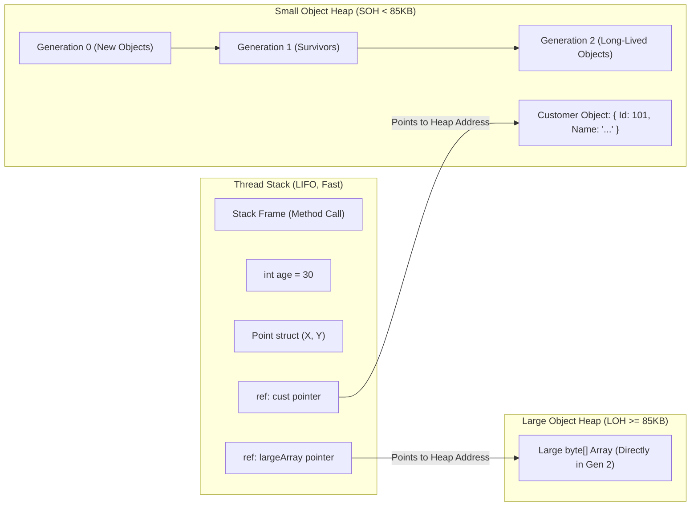
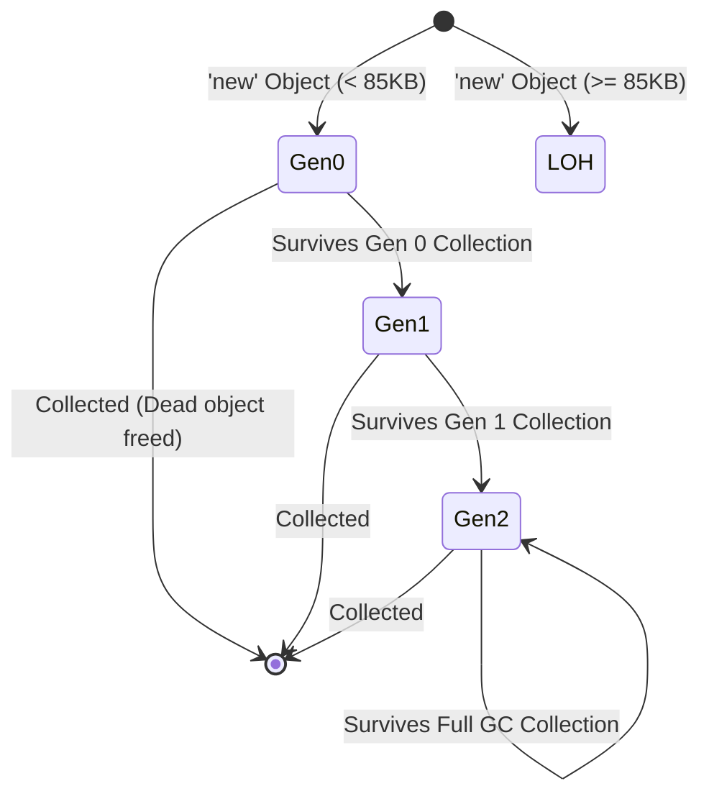

# Deep-Dive Guide: Stack, Heap, Garbage Collection (GC) & CLR Internals (Fully Paired Bilingual Guide)

---

## 1. Concept in English
The **Common Language Runtime (CLR)** manages memory automatically in .NET. You do not need to free memory by hand.

.NET divides memory into two main areas:
- **The Stack**: Very fast memory for each thread. It stores method calls, local variables, and primitive types. It works on a Last-In, First-Out (LIFO) model. When a method finishes, its memory is freed instantly. The Garbage Collector (GC) does not need to clean the Stack.
- **The Managed Heap**: A large memory pool managed by the **Garbage Collector (GC)**. All reference type objects (`class`, `string`, arrays) live here. The GC periodically finds unused objects and frees their memory.

---

## 2. Concept in Bangla (বাংলায় সহজ ব্যাখ্যা)
.NET এ মেমোরি ম্যানেজমেন্ট সম্পূর্ণ স্বয়ংক্রিয়। ডেভেলপারকে নিজে কোড লিখে মেমোরি খালি করতে হয় না। **CLR** এবং **Garbage Collector (GC)** এই দায়িত্ব পালন করে।

.NET এ মেমোরি মূলত দুটি প্রধান ভাগে বিভক্ত:
- **Stack (স্ট্যাক মেমোরি)**: প্রতিটি থ্রেডের নিজস্ব অতি দ্রুতগতির মেমোরি। যখন কোনো মেথড কল হয়, তার লোকাল ভ্যারিয়েবল এবং ভ্যালু টাইপ (`int`, `bool`, `struct`) এখানে জমা থাকে। মেথডের কাজ শেষ হলে সাথে সাথে স্ট্যাক থেকে মেমোরি মুছে যায় (LIFO নিয়মে)। এখানে কোনো Garbage Collector কাজ করে না।
- **Managed Heap (হিপ মেমোরি)**: এটি একটি বড় মেমোরি পুল যেখানে সমস্ত রেফারেন্স টাইপ অবজেক্ট (`class`, `string`, `array`) তৈরি হয়। এই মেমোরি পরিষ্কার এবং নিয়ন্ত্রণ করার সম্পূর্ণ দায়িত্ব হলো **Garbage Collector (GC)** এর।

---

## 3. Why It Exists (কেন তৈরি করা হয়েছে?)

### English:
In older languages like C and C++, developers must allocate (`malloc`/`new`) and free (`free`/`delete`) memory manually. This causes serious bugs:
1. **Memory Leaks**: You forget to free memory. The app consumes more and more RAM until it crashes.
2. **Dangling Pointers**: You access memory that was already freed. This leads to app crashes or security flaws.
3. **Double Free**: You free the same memory block twice. This corrupts the heap.

.NET provides **automatic memory safety**. You write business logic, and the CLR safely allocates and cleans memory for you.

### বাংলায় কারণ:
C বা C++ এর মতো ভাষায় প্রোগ্রামারকে নিজে মেমোরি নিতে হতো এবং কাজ শেষে মেমোরি মুছে দিতে হতো। এর ফলে বড় ধরনের সমস্যা হতো:
1. **মেমোরি লিক (Memory Leaks)**: কোডার মেমোরি ফ্রি করতে ভুলে গেলে অ্যাপ ক্রমাগত RAM নিতে নিতে সার্ভার ক্র্যাশ করত।
2. **ড্যাংলিং পয়েন্টার (Dangling Pointers)**: যে মেমোরি আগেই ডিলিট হয়ে গেছে, কোড সেখানে ডেটা খুঁজতে গিয়ে ক্র্যাশ করত।
3. **ডাবল ফ্রি (Double Free)**: একই মেমোরি দুইবার ডিলিট করতে গিয়ে পুরো মেমোরি সিস্টেম নষ্ট হতো।

এই সমস্যাগুলো সমাধান করতেই .NET এ **Garbage Collector (GC)** তৈরি করা হয়েছে। এটি রানটাইমে নিরাপদ মেমোরি ব্যবস্থাপনা নিশ্চিত করে।

---

## 4. How It Works Under The Hood (অভ্যন্তরীণ মেকানিজম / CLR Internals)

### English:
The .NET Managed Heap is split into different sections based on object size and pinning:

1. **Small Object Heap (SOH)**: Stores objects smaller than **85,000 bytes** (85 KB). It has three generations:
   - **Generation 0 (Gen 0)**: Where new objects are created. Collections are ultra-fast (under 1 millisecond).
   - **Generation 1 (Gen 1)**: A buffer between short-lived and long-lived objects. Objects surviving Gen 0 move here.
   - **Generation 2 (Gen 2)**: Long-lived objects (like static data, singletons, caches). Collecting Gen 2 is called a **Full GC**. It takes more CPU time.
2. **Large Object Heap (LOH)**: Stores objects that are **85,000 bytes or larger** (like large byte arrays or large strings). LOH objects start directly in Gen 2. By default, LOH is not compacted to save CPU, which can cause **memory fragmentation**.
3. **Pinned Object Heap (POH)** (Introduced in .NET 5): Stores pinned objects that cannot move in memory (used when talking to native C/C++ code). This prevents normal SOH from becoming fragmented.

#### The 3 Phases of Garbage Collection:
1. **Mark Phase**: The GC finds all root references (active stack variables, CPU registers, static fields). It follows all reachable objects and marks them as **Alive**. Unreachable objects are marked as **Dead**.
2. **Sweep Phase**: The GC finds the memory blocks taken by dead objects and marks them as free.
3. **Compact Phase**: The GC moves live objects together to remove empty gaps, creating one contiguous free memory block. Then it updates the memory addresses stored on the Stack.

### বাংলায় অভ্যন্তরীণ মেকানিজম:
.NET Managed Heap অবজেক্টের সাইজের ওপর ভিত্তি করে কয়েকটি ভাগে বিভক্ত:

1. **Small Object Heap (SOH)**: যেসব অবজেক্টের সাইজ **৮৫,০০০ বাইটস (85 KB)** এর কম, সেগুলো এখানে জমা হয়। এটি ৩টি জেনারেশনে বিভক্ত:
   - **Gen 0**: নতুন অবজেক্ট প্রথমে Gen 0 তে তৈরি হয়। এটি খুব দ্রুত পরিষ্কার হয় (১ মিলিসেকেন্ডেরও কম সময়ে)।
   - **Gen 1**: এটি শর্ট-লিভড এবং লং-লিভড অবজেক্টের মাঝে বাফার হিসেবে থাকে। Gen 0 এর ক্লিনিংয়ে যারা বেঁচে যায়, তারা Gen 1 এ আসে।
   - **Gen 2**: যেসব অবজেক্ট দীর্ঘদিন বাঁচে (যেমন Singletons, Caching, Static Data)। Gen 2 পরিষ্কার করাকে **Full GC** বলে এবং এতে সবচেয়ে বেশি CPU খরচ হয়।
2. **Large Object Heap (LOH)**: যেসব অবজেক্টের সাইজ **৮৫,০০০ বাইটস বা তার বেশি** (যেমন বড় ইমেজ বা ফাইল বাফার), সেগুলো সরাসরি LOH এ যায়। বড় অবজেক্ট সরানো কঠিন, তাই ডিফল্টভাবে এটি কম্প্যাক্ট হয় না। এর ফলে মেমোরি ফ্র্যাগমেন্টেশন হতে পারে।
3. **Pinned Object Heap (POH)** (.NET 5+ এ যুক্ত): যেসব বাফার আনম্যানেজড কোডে পাঠানো হয় এবং মেমোরিতে নড়াচড়া করা নিষেধ, সেগুলো এখানে রাখা হয় যাতে সাধারণ হিপ ফ্র্যাগমেন্ট না হয়।

#### গারবেজ কালেকশনের ৩টি ধাপ:
1. **Mark Phase (মার্ক পর্যায়)**: GC স্ট্যাক ভ্যারিয়েবল ও স্ট্যাটিক রেফারেন্স চেক করে সব জীবিত অবজেক্টকে "Alive" মার্ক করে। বাকিগুলো "Dead"।
2. **Sweep Phase (সুইপ পর্যায়)**: Dead অবজেক্টগুলোর মেমোরি ফাঁকা জায়গা হিসেবে চিহ্নিত করে।
3. **Compact Phase (কম্প্যাক্ট পর্যায়)**: জীবিত অবজেক্টগুলোকে একসাথে চেপে একপাশে নিয়ে আসে যাতে মাঝে কোনো ফাঁকা জায়গা না থাকে। এরপর স্ট্যাকের পয়েন্টারগুলোকে নতুন মেমোরি ঠিকানায় আপডেট করে।

---

## 5. Built-in Types & Simple Example (বিল্ট-ইন টাইপ ও সহজ উদাহরণ)

### Framework Built-in Memory Management Types:

| Built-in Type / API | Namespace | Purpose / Description |
| :--- | :--- | :--- |
| **`GC`** | `System` | Controls and inspects the garbage collector (`GC.Collect()`, `GC.GetGeneration()`, `GC.SuppressFinalize()`, `GC.GetTotalMemory()`). |
| **`IDisposable`** | `System` | Provides the `Dispose()` method to clean up unmanaged resources (file streams, database connections). |
| **`IAsyncDisposable`** | `System` | Provides `DisposeAsync()` for asynchronous resource cleanup. |
| **`WeakReference<T>`** | `System` | Holds a reference to an object but still lets the GC collect it if memory is low. Great for caches. |
| **`Span<T>` / `ReadOnlySpan<T>`** | `System` | Stack-only `ref struct` that slices memory with zero heap allocations. |
| **`ArrayPool<T>`** | `System.Buffers` | Rents and returns reusable arrays. Prevents LOH allocations and reduces GC pressure. |

### Code Example: Stack vs Heap Allocation & GC APIs

```csharp
using System;

namespace MemoryManagementDemo
{
    // Reference Type -> Instance lives on the Managed Heap
    public class Customer
    {
        public int Id { get; set; }        // 4 bytes inside the Heap object
        public string Name { get; set; } = string.Empty; // Pointer to string on Heap
    }

    // Value Type -> Stored inline where declared (Stack or inside parent object)
    public struct Point
    {
        public int X;
        public int Y;
    }

    public class Program
    {
        public static void Main()
        {
            // 1. Value Types -> Allocated directly on the Thread Stack
            int age = 30;
            Point p = new Point { X = 10, Y = 20 };

            // 2. Reference Type:
            // - 'cust' pointer variable lives on the Stack (8 bytes on 64-bit)
            // - The actual Customer object lives on the Managed Heap
            Customer cust = new Customer { Id = 101, Name = "Antigravity" };

            // 3. Inspecting GC Generation
            Console.WriteLine($"Customer is currently in Generation: {GC.GetGeneration(cust)}");

            // 4. Checking Total Memory Used
            long memoryUsed = GC.GetTotalMemory(forceFullCollection: false);
            Console.WriteLine($"Total Managed Memory: {memoryUsed / 1024} KB");

            // 5. WeakReference Demonstration
            WeakReference<Customer> weakRef = new WeakReference<Customer>(cust);

            // Removing strong reference from stack
            cust = null!;

            // Checking if object is still alive before GC
            if (weakRef.TryGetTarget(out Customer? target))
            {
                Console.WriteLine($"Customer #{target.Id} is still alive in memory.");
            }
        }
    }
}
```

---

## 6. Real-World Production Example (বাস্তব প্রোডাকশন উদাহরণ)

### Production Memory Optimization: `ArrayPool<T>` + `IDisposable` with `GC.SuppressFinalize`

#### English:
In high-traffic services, creating `new byte[120000]` on every HTTP request quickly fills the Large Object Heap (LOH). This triggers expensive Gen 2 Full GC collections and freezes the server. 

The industry solution uses **`ArrayPool<byte>`** to rent and return buffers, combined with the **Standard Dispose Pattern**.

#### বাংলায় প্রেক্ষাপট:
হাই-ট্রাফিক সার্ভারে প্রতি রিকোয়েস্টে `new byte[120000]` তৈরি করলে তা সরাসরি LOH এ যায়। এতে বারবার Gen 2 Full GC চলে এবং সার্ভার ফ্রিজ (Stop-The-World) হয়ে যায়। 

এর সমাধান হলো **`ArrayPool<byte>`** থেকে অ্যারে ভাড়া নিয়ে কাজ করা এবং কাজ শেষে **Dispose Pattern** এর মাধ্যমে পুলে ফেরত দেওয়া।

```csharp
using System;
using System.Buffers;
using System.IO;

public class HighThroughputBufferProcessor : IDisposable
{
    private byte[]? _rentedBuffer;
    private bool _disposed = false;
    private const int BufferSize = 120_000; // > 85KB -> Would normally hit LOH!

    public HighThroughputBufferProcessor()
    {
        // Rent from shared pool instead of allocating 'new byte[BufferSize]' on LOH!
        _rentedBuffer = ArrayPool<byte>.Shared.Rent(BufferSize);
    }

    public void ProcessStream(Stream inputStream)
    {
        if (_disposed || _rentedBuffer == null)
            throw new ObjectDisposedException(nameof(HighThroughputBufferProcessor));

        int bytesRead = inputStream.Read(_rentedBuffer, 0, BufferSize);
        Console.WriteLine($"[Zero-Allocation]: Processed {bytesRead} bytes safely using ArrayPool.");
    }

    // Standard Dispose Pattern
    public void Dispose()
    {
        Dispose(true);
        // Tell GC not to call finalizer because cleanup is already done!
        GC.SuppressFinalize(this);
    }

    protected virtual void Dispose(bool disposing)
    {
        if (!_disposed)
        {
            if (disposing && _rentedBuffer != null)
            {
                // Return buffer back to the pool for reuse by other requests!
                ArrayPool<byte>.Shared.Return(_rentedBuffer);
                _rentedBuffer = null;
            }
            _disposed = true;
        }
    }

    // Defensive Finalizer (only runs if caller forgot to call Dispose)
    ~HighThroughputBufferProcessor()
    {
        Dispose(false);
    }
}
```

---

## 7. Visual Diagrams (ডায়াগ্রাম)

### Memory Architecture: Stack vs Small Object Heap (SOH) vs Large Object Heap (LOH)



### Garbage Collection Generational Promotion



---

## 8. Common Mistakes & Gotchas (সাধারণ ভুল ও ফাঁদ)

### ⚠️ Pitfall 1: Manual `GC.Collect()` Calls
- **English**: Do not call `GC.Collect()` in production code. The CLR self-tunes automatically. Calling it manually freezes all threads (Stop-The-World pause) and destroys performance.
- **বাংলায় ফাঁদ**: প্রোডাকশন কোডে নিজে থেকে `GC.Collect()` কল করবেন না। এটি CLR এর স্বাভাবিক গতি নষ্ট করে এবং অপ্রয়োজনীয় Full GC রান করে সমস্ত থ্রেড সাময়িক ফ্রিজ করে দেয়।

### ⚠️ Pitfall 2: Large Object Heap (LOH) Memory Fragmentation
- **English**: Creating many objects `>= 85,000` bytes (e.g., `new byte[100000]`) fragments the LOH because the GC does not compact it by default. The app throws `OutOfMemoryException` even when total free RAM seems enough. **Fix**: Use `ArrayPool<T>`.
- **বাংলায় ফাঁদ**: বারবার ৮৫ KB বা তার বড় অবজেক্ট তৈরি করলে LOH মেমোরি ফ্র্যাগমেন্টেড হয়ে যায়। মেমোরিতে জায়গা থাকা সত্ত্বেও একটানা খালি জায়গা না থাকায় `OutOfMemoryException` হতে পারে। **সমাধান**: `ArrayPool<T>` ব্যবহার করা।

### ⚠️ Pitfall 3: Event Handler Memory Leaks
- **English**: Subscribing to an event (`publisher.OnData += HandleData;`) keeps a strong reference to the subscriber. If you do not unsubscribe with `-=`, the subscriber will stay alive in memory forever.
- **বাংলায় ফাঁদ**: কোনো ইভেন্টে সাবস্ক্রাইব করে কাজ শেষে `-=` দিয়ে আনসাবস্ক্রাইব না করলে অবজেক্ট মেমোরিতে আটকে থাকে এবং মেমোরি লিক হয়।

### ⚠️ Pitfall 4: Unnecessary Finalizers (Destructors)
- **English**: Writing a finalizer (`~MyClass()`) forces the object into the **Finalization Queue**. The object cannot be freed in Gen 0 and survives an extra GC cycle into Gen 1 or Gen 2.
- **বাংলায় ফাঁদ**: ক্লাসে অকারণে ডেস্ট্রাক্টর বা ফাইনলাইজার লিখলে অবজেক্ট সাথে সাথে ডিলিট হতে পারে না। এটি অতিরিক্ত এক সাইকেল বেশি বাঁচে এবং Gen 2 তে প্রমোট হয়ে যায়।

---

## 9. Interview Perspective & Summary Matrix (ইন্টারভিউ প্রস্তুতি)

### Summary Comparison Matrix:

| Feature / Concept | Stack | Small Object Heap (SOH) | Large Object Heap (LOH) |
| :--- | :--- | :--- | :--- |
| **Object Size** | Small (call frames, primitives) | `< 85,000` bytes | `>= 85,000` bytes |
| **Allocation Speed** | Ultra-fast (CPU pointer bump) | Fast (Gen 0 allocation) | Slower |
| **Deallocation** | Instant (when method returns) | Periodic (Garbage Collector) | Full GC (Gen 2 collection) |
| **Compaction** | Not needed | Compacted automatically | Not compacted by default |
| **GC Overhead** | **0% GC Overhead** | Handled in Gen 0, 1, 2 | Causes Gen 2 GC pauses |

### Top 3 Quick Interview Questions:

#### Q1: Are Value Types always stored on the Stack?
- **English Answer**: **No, this is a myth.** Value types are stored inline wherever they are declared. If an `int` or `struct` is a field inside a `class`, it lives on the **Heap** inside that class. Value types inside async state machines or closures are also placed on the Heap.
- **বাংলায় উত্তর**: **না, এটি ভুল ধারণা।** ভ্যালু টাইপ যেখানে ডিক্লেয়ার করা হয় ঠিক সেখানেই স্টোর হয়। কোনো ক্লাসের ভেতরে `int` ফিল্ড থাকলে সেটি ক্লাসের সাথে **Heap** এ থাকে। ল্যাম্বডা বা `async` মেথডের স্টেট মেশিনে ব্যবহৃত ভ্যালু টাইপও Heap এ চলে যায়।

#### Q2: What triggers a Garbage Collection?
- **English Answer**: GC runs automatically under 3 conditions:
  1. Operating System sends a low memory notification.
  2. Memory allocations exceed the threshold for Generation 0.
  3. Code calls `GC.Collect()` manually (discouraged).
- **বাংলায় উত্তর**: মূলত ৩টি কারণে GC চলে:
  1. অপারেটিং সিস্টেম থেকে কম মেমোরির সংকেত আসলে।
  2. Gen 0 এর নির্ধারিত মেমোরি সীমা পূর্ণ হয়ে গেলে।
  3. ম্যানুয়ালি কোডে `GC.Collect()` কল করা হলে।

#### Q3: What is the difference between Workstation GC and Server GC?
- **English Answer**:
  - **Workstation GC**: Default for desktop apps. Uses a single GC thread to keep UI smooth with low latency.
  - **Server GC**: Default in ASP.NET Core. Creates a separate heap and GC thread for each CPU core. It runs collections in parallel for maximum throughput.
- **বাংলায় উত্তর**:
  - **Workstation GC**: ডেস্কটপ অ্যাপের জন্য। একটি মাত্র থ্রেডে কাজ করে যাতে UI মসৃণ থাকে।
  - **Server GC**: ASP.NET Core এর জন্য ডিফল্ট। প্রতিটি CPU কোরের জন্য আলাদা Heap এবং ডেডিকেটেড থ্রেড নিয়ে প্যারালালে কাজ করে যাতে সর্বোচ্চ থ্রুপুট পাওয়া যায়।

---

## 📂 Workspace References
- Asynchronous State Machine allocations: [`docs/TaskBasedAsync.md`](file:///Users/limon/interview/c-sharp-prep/docs/TaskBasedAsync.md)
- Reflection type inspection memory cost: [`docs/Reflection.md`](file:///Users/limon/interview/c-sharp-prep/docs/Reflection.md)
- Object-Oriented Principles: [`docs/OOP.md`](file:///Users/limon/interview/c-sharp-prep/docs/OOP.md)
